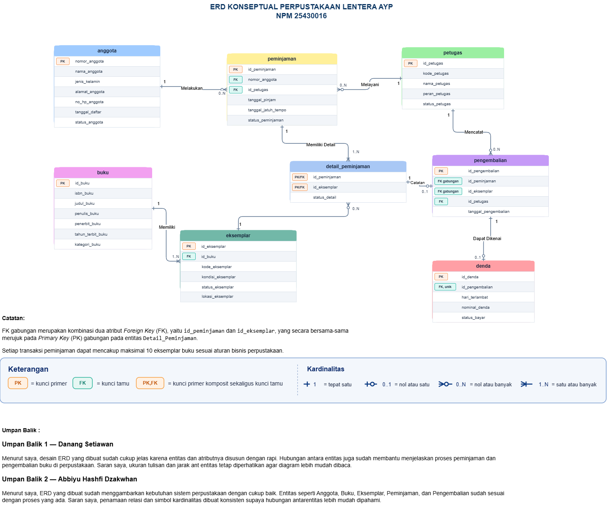

# Laporan Praktikum Basis Data - Pertemuan 03

**Nama:** Arya Yoga Pratama  
**NPM:** 25430016  
**Kelas:** A  
**Tanggal:** 12 Oktober 2026
**Nama Asisten/Dosen:** Dedi Irawan, S.Kom., M.T.I.

## 1. Tujuan Praktikum

1. Mengidentifikasi entitas, atribut, dan kunci berdasarkan dokumen kebutuhan data.
2. Menentukan relasi, kardinalitas, dan partisipasi berdasarkan aturan bisnis.
3. Membentuk entitas asosiatif untuk memecah relasi banyak-ke-banyak.
4. Menggambar ERD menggunakan notasi Crow’s Foot dan memvalidasinya terhadap kebutuhan informasi.

## 2. Ringkasan Dasar Teori

Entity-Relationship Diagram (ERD) merupakan diagram yang digunakan untuk menggambarkan struktur data dalam suatu sistem serta hubungan antar-data tersebut. ERD terdiri dari entitas, atribut, dan relasi. Entitas mewakili objek yang datanya disimpan, atribut menjelaskan karakteristik entitas, sedangkan relasi menunjukkan hubungan antara entitas satu dengan lainnya.

Dalam perancangan ERD, setiap entitas memiliki kunci untuk membedakan dan menghubungkan data. *Primary Key* (PK) digunakan sebagai identitas unik setiap data, sedangkan *Foreign Key* (FK) digunakan untuk menghubungkan data antarentitas. Kardinalitas menunjukkan jumlah keterhubungan antarentitas, sementara partisipasi menjelaskan apakah hubungan tersebut wajib atau opsional.

ERD dapat menggunakan notasi Crow’s Foot untuk menggambarkan kardinalitas dan partisipasi melalui simbol pada ujung garis relasi. Apabila terdapat hubungan banyak-ke-banyak (*many-to-many*), hubungan tersebut dapat dipecah menggunakan entitas asosiatif. Dalam proyek Perpustakaan Lentera AYP, `Detail_Peminjaman` digunakan untuk menghubungkan transaksi `Peminjaman` dengan `Eksemplar` yang dipinjam.

## 3. Hasil Langkah Percobaan

#### 3.1 Dari Entitas Kandidat ke Entitas

Pada langkah ini, entitas kandidat dari studi kasus Koperasi Mahasiswa Sejahtera (Kopma) diperiksa untuk menentukan atribut kunci, kunci alternatif, dan atribut turunan. Pemeriksaan dilakukan berdasarkan kebutuhan data pada Pertemuan 2, termasuk data anggota, barang, transaksi penjualan, petugas, pemasok, dan pembelian.

Entitas `Pembelian` dan `Detail Pembelian` dipisahkan agar data utama pembelian dapat disimpan secara terpisah dari rincian barang yang dibeli. Entitas `Pembelian` menyimpan informasi transaksi pembelian, seperti nomor faktur, tanggal, dan pemasok. Sementara itu, `Detail Pembelian` mencatat barang, jumlah, dan harga beli pada setiap transaksi.

Pemisahan tersebut membuat satu transaksi pembelian dapat mencatat beberapa jenis barang tanpa mengulang informasi utama transaksi. Hasil identifikasi entitas dan atribut kunci selanjutnya digunakan sebagai dasar untuk menentukan relasi dan kardinalitas pada langkah berikutnya.

### 3.2 D.2 Menentukan Relasi dan Kardinalitas

Pada langkah ini, hubungan antarentitas Kopma ditentukan berdasarkan proses bisnis dan aturan bisnis yang telah disusun pada Pertemuan 2. Setiap relasi dijelaskan menggunakan kata kerja agar hubungan antarentitas lebih mudah dipahami. Selanjutnya, ditentukan kardinalitas minimum dan maksimum dari kedua sisi relasi.

**Tabel 3.1 Relasi dan Kardinalitas Kopma**

| Relasi | Sisi kiri | Sisi kanan | Dasar |
|---|---|---|---|
| Petugas melayani penjualan | Tepat satu petugas | Nol atau banyak penjualan | Proses bisnis PB-02 |
| Anggota melakukan penjualan | Nol atau satu anggota | Nol atau banyak penjualan | Aturan bisnis AB-02 |
| Penjualan memiliki detail penjualan | Satu atau banyak detail penjualan | Tepat satu penjualan | Aturan bisnis AB-01 |
| Barang tercatat dalam detail penjualan | Nol atau banyak detail penjualan | Tepat satu barang | Data transaksi penjualan |
| Petugas mengelola pembelian | Tepat satu petugas | Nol atau banyak pembelian | Proses bisnis PB-03 dan PB-04 |
| Pemasok menerima pesanan pembelian | Nol atau satu pemasok | Nol atau banyak pembelian | Proses bisnis PB-03 |
| Pembelian memiliki detail pembelian | Satu atau banyak detail pembelian | Tepat satu pembelian | Struktur data pembelian |
| Barang tercatat dalam detail pembelian | Nol atau banyak detail pembelian | Tepat satu barang | Struktur data pembelian |

## 4. Jawaban Titik Analisis

### 4.1 Titik Analisis 1

`id_anggota` tetap digunakan sebagai kunci primer meskipun `no_anggota` dan `nim_anggota` sama-sama memiliki nilai unik. Hal ini karena `id_anggota` berfungsi sebagai identitas internal yang lebih stabil dan tidak bergantung pada nomor anggota atau NIM. Jika NIM mengalami perubahan, penggunaan NIM sebagai kunci primer dapat menyebabkan perubahan pada tabel lain yang menggunakan NIM sebagai referensi. Oleh karena itu, penggunaan `id_anggota` sebagai kunci primer dapat mempermudah pengelolaan data dan menjaga hubungan antartabel. Sementara itu, `no_anggota` dan `nim_anggota` tetap dapat diberi batasan unik agar tidak terjadi data yang sama.

### 4.2 Titik Analisis 2

Relasi antara `Penjualan` dan `Detail_Penjualan` pada sisi penjualan bernilai satu atau banyak karena setiap transaksi penjualan harus memiliki minimal satu barang. Aturan bisnis yang mendasarinya adalah setiap nota penjualan wajib mencatat sekurang-kurangnya satu barang yang dibeli. Dengan demikian, satu transaksi penjualan dapat memiliki satu atau beberapa detail penjualan.

Aturan minimal satu detail tidak dapat dijamin hanya dengan struktur tabel dan relasi biasa. Kunci asing dapat memastikan bahwa detail penjualan mengacu pada transaksi yang tersedia, tetapi tidak menjamin bahwa setiap transaksi penjualan memiliki detail. Oleh karena itu, diperlukan mekanisme tambahan untuk memastikan bahwa setiap transaksi yang disimpan benar-benar memiliki minimal satu detail penjualan. Hal ini sesuai dengan aturan bisnis pada studi kasus Kopma.

### 4.3 Titik Analisis 3

ERD saat ini belum dapat menjawab pertanyaan mengenai petugas gudang yang menerima barang dari pemasok apabila belum terdapat relasi yang menghubungkan petugas dengan transaksi penerimaan barang. Oleh karena itu, perlu ditambahkan relasi antara entitas `Petugas` dan `Pembelian` agar sistem dapat mencatat petugas yang bertanggung jawab menerima barang dari pemasok. Keputusan ini perlu dicatat sebagai aturan bisnis baru karena informasi mengenai petugas penerima barang harus menjadi bagian dari data yang dikelola oleh sistem.

## 5. Hasil Latihan dan Modifikasi

### 5.1 Penambahan Poin Loyalitas

Poin loyalitas dapat ditambahkan ke ERD Kopma untuk mencatat poin yang diperoleh anggota dari transaksi pembelian. Jika poin hanya disimpan sebagai atribut pada entitas `Anggota`, sistem hanya dapat menyimpan jumlah poin saat ini tanpa mencatat riwayat penambahan atau pengurangannya.

Oleh karena itu, lebih baik dibuat entitas baru, yaitu `Riwayat_Poin`, untuk mencatat setiap perubahan poin anggota. Entitas ini dapat memiliki atribut `id_riwayat` sebagai kunci primer, `id_anggota` sebagai kunci asing, tanggal transaksi, jumlah poin, dan keterangan perubahan poin. Relasi antara `Anggota` dan `Riwayat_Poin` adalah satu-ke-banyak karena satu anggota dapat memiliki banyak catatan riwayat poin.

Dengan adanya entitas `Riwayat_Poin`, sistem dapat mengetahui riwayat perolehan dan penggunaan poin anggota. Selain itu, jumlah poin yang dimiliki anggota dapat dihitung berdasarkan seluruh riwayat perubahan poin yang tercatat.

### 5.2 Relasi Penjualan–Barang Tanpa Entitas Asosiatif

Jika relasi antara `Penjualan` dan `Barang` digambar ulang sebagai relasi banyak-ke-banyak secara langsung tanpa entitas asosiatif `Detail_Penjualan`, hubungan kedua entitas memang dapat menunjukkan bahwa satu transaksi penjualan melibatkan banyak barang dan satu barang dapat muncul dalam banyak transaksi penjualan.

Namun, beberapa informasi penting akan hilang karena tidak ada tempat khusus untuk menyimpan data pada setiap hubungan penjualan dan barang. Data yang hilang meliputi jumlah barang yang dibeli, harga jual barang pada saat transaksi, serta informasi lain yang berkaitan dengan rincian transaksi.

Oleh karena itu, entitas `Detail_Penjualan` tetap diperlukan sebagai penghubung antara `Penjualan` dan `Barang`. Entitas ini memungkinkan sistem menyimpan rincian setiap barang yang terjual dalam suatu transaksi dengan lebih terstruktur.

## 6. Tugas Mandiri: Milestone Proyek 3

Pada Milestone Proyek 3, dilakukan perancangan ERD konseptual untuk proyek Perpustakaan Lentera AYP berdasarkan dokumen kebutuhan data yang telah disusun pada pertemuan sebelumnya. Perancangan ini bertujuan untuk menggambarkan entitas, atribut, hubungan antarentitas, serta kardinalitas yang sesuai dengan proses bisnis dan kebutuhan informasi perpustakaan.

### 6.1 ERD Konseptual Perpustakaan Lentera AYP

ERD konseptual yang dibuat terdiri dari delapan entitas, yaitu `Anggota`, `Buku`, `Eksemplar`, `Petugas`, `Peminjaman`, `Detail_Peminjaman`, `Pengembalian`, dan `Denda`. Setiap entitas memiliki atribut yang mendukung pengelolaan data perpustakaan. Relasi antarentitas ditentukan berdasarkan aturan bisnis yang telah dirumuskan pada Milestone Proyek 2.

**Gambar 6.1. ERD Konseptual Perpustakaan Lentera AYP**

File sumber diagram dapat dibuka dan diedit menggunakan draw.io melalui berkas `p03_erd_25430016.drawio`.

### 6.2 Pemetaan Entitas terhadap Proses Bisnis

Setiap entitas pada ERD dipetakan ke proses bisnis yang berkaitan berdasarkan matriks CRUD pada dokumen kebutuhan data. Pemetaan ini digunakan untuk mengetahui proses bisnis yang membaca atau mengelola data dari setiap entitas.

| No. | Entitas | Proses Bisnis Terkait |
|---:|---|---|
| 1 | Anggota | PB-01, PB-03, PB-06 |
| 2 | Buku | PB-02, PB-03, PB-06 |
| 3 | Eksemplar | PB-02, PB-03, PB-04, PB-06 |
| 4 | Petugas | PB-03, PB-04, PB-05, PB-06, PB-07 |
| 5 | Peminjaman | PB-03, PB-04, PB-05, PB-06 |
| 6 | Detail_Peminjaman | PB-03, PB-04, PB-05, PB-06 |
| 7 | Pengembalian | PB-04, PB-05, PB-06 |
| 8 | Denda | PB-05, PB-06 |

Berdasarkan tabel tersebut, setiap entitas digunakan dalam satu atau beberapa proses bisnis perpustakaan. Entitas master menyimpan data utama, seperti anggota, buku, eksemplar, dan petugas. Sementara itu, entitas transaksi digunakan untuk mencatat peminjaman, rincian eksemplar yang dipinjam, pengembalian, dan denda.

Pemetaan ini juga membantu memeriksa apakah data yang dibutuhkan dalam setiap proses bisnis sudah tersedia pada ERD.

### 6.3 Tabel Relasi dan Kardinalitas

Relasi dan kardinalitas ditentukan berdasarkan aturan bisnis pada dokumen kebutuhan data. Tabel berikut menunjukkan hubungan antarentitas, kardinalitasnya, dan aturan bisnis yang menjadi dasar penentuan hubungan tersebut.

| No. | Relasi | Kardinalitas | Kode Aturan Bisnis |
|---:|---|---|---|
| 1 | Anggota — Peminjaman | 1 : 0..N | AB-01, AB-02, AB-05 |
| 2 | Petugas — Peminjaman | 1 : 0..N | AB-05 |
| 3 | Peminjaman — Detail_Peminjaman | 1 : 1..N | AB-04, AB-05 |
| 4 | Buku — Eksemplar | 1 : 1..N | AB-09 |
| 5 | Eksemplar — Detail_Peminjaman | 1 : 0..N | AB-03, AB-06 |
| 6 | Petugas — Pengembalian | 1 : 0..N | AB-06, AB-10 |
| 7 | Detail_Peminjaman — Pengembalian | 1 : 0..1 | AB-06 |
| 8 | Pengembalian — Denda | 1 : 0..1 | AB-07, AB-08 |

Relasi `Anggota` dengan `Peminjaman` dibuat satu ke banyak karena seorang anggota dapat melakukan beberapa transaksi peminjaman, sedangkan setiap transaksi harus mengacu pada satu anggota. Relasi `Buku` dengan `Eksemplar` juga dibuat satu ke banyak karena satu judul buku dapat memiliki beberapa salinan fisik.

Entitas `Detail_Peminjaman` digunakan untuk mencatat eksemplar yang termasuk dalam suatu transaksi. Satu transaksi dapat memiliki beberapa detail, dengan batas maksimal sepuluh eksemplar sesuai AB-04. Setiap detail mengacu pada satu eksemplar, sedangkan satu eksemplar dapat muncul pada beberapa detail dalam riwayat transaksi yang berbeda.

Relasi `Detail_Peminjaman` dengan `Pengembalian` bersifat opsional pada sisi pengembalian karena suatu eksemplar dapat masih dipinjam atau sudah dikembalikan. Sementara itu, relasi `Pengembalian` dengan `Denda` dibuat opsional karena tidak semua pengembalian menimbulkan denda.

Kardinalitas tersebut perlu diperiksa kembali terhadap diagram dan aturan bisnis. Beberapa aturan, seperti anggota harus aktif sebelum meminjam dan eksemplar harus tersedia, memerlukan validasi tambahan dan tidak cukup hanya dengan relasi antarentitas.

### 6.4 Penelusuran Kebutuhan Informasi melalui ERD

Penelusuran kebutuhan informasi dilakukan untuk memeriksa apakah informasi yang ditetapkan pada Milestone Proyek 2 dapat diperoleh melalui entitas dan relasi dalam ERD. Setiap kebutuhan informasi ditelusuri melalui jalur relasi yang sesuai dengan data yang diperlukan.

| Kode | Kebutuhan Informasi | Jalur ERD |
|---|---|---|
| KI-01 | Daftar anggota aktif | Anggota |
| KI-02 | Katalog dan ketersediaan buku | Buku → Eksemplar |
| KI-03 | Riwayat peminjaman anggota | Anggota → Peminjaman → Detail_Peminjaman → Eksemplar |
| KI-04 | Peminjaman yang masih berlangsung | Anggota → Peminjaman → Detail_Peminjaman → Eksemplar |
| KI-05 | Pengembalian dalam periode tertentu | Pengembalian → Detail_Peminjaman → Peminjaman |
| KI-06 | Peminjaman yang terlambat, baik sudah dikembalikan maupun belum | Anggota → Peminjaman → Detail_Peminjaman, dengan Pengembalian sebagai relasi opsional |
| KI-07 | Ringkasan denda keterlambatan | Denda → Pengembalian → Detail_Peminjaman → Peminjaman |
| KI-08 | Buku yang paling sering dipinjam | Buku → Eksemplar → Detail_Peminjaman → Peminjaman |

Hasil penelusuran menunjukkan bahwa kebutuhan informasi dapat dihubungkan dengan entitas yang relevan dalam ERD. Informasi katalog dan ketersediaan buku melibatkan entitas `Buku` dan `Eksemplar`, sedangkan riwayat peminjaman memerlukan hubungan antara anggota, transaksi peminjaman, detail transaksi, dan eksemplar.

Khusus untuk KI-06, penelusuran dimulai dari `Anggota`, `Peminjaman`, dan `Detail_Peminjaman`. Hubungan dengan `Pengembalian` bersifat opsional karena tidak semua eksemplar yang dipinjam sudah dikembalikan. Dengan demikian, data peminjaman yang belum memiliki catatan pengembalian tetap dapat diperiksa.

Untuk menentukan keterlambatan, tanggal jatuh tempo pada `Peminjaman` perlu dibandingkan dengan tanggal pengembalian apabila sudah tersedia. Jika eksemplar belum dikembalikan, tanggal saat laporan dibuat digunakan sebagai pembanding. Perhitungan tersebut perlu diterapkan melalui aturan atau query pada tahap implementasi sistem.

### 6.5 Entitas Asosiatif Detail_Peminjaman

Entitas `Detail_Peminjaman` berfungsi sebagai entitas asosiatif yang menghubungkan `Peminjaman` dan `Eksemplar`. Entitas ini diperlukan karena satu transaksi peminjaman dapat melibatkan beberapa eksemplar, sedangkan satu eksemplar dapat tercatat pada transaksi yang berbeda sepanjang riwayatnya.

Atribut `id_peminjaman` dan `id_eksemplar` digunakan sebagai kunci primer komposit sekaligus kunci tamu yang mengacu pada entitas terkait. Atribut `status_detail` digunakan untuk mencatat status setiap eksemplar dalam transaksi. Dengan rancangan tersebut, detail peminjaman dapat diidentifikasi berdasarkan kombinasi transaksi dan eksemplar yang dipinjam.

Penggunaan entitas asosiatif ini membantu menjaga struktur data tetap terorganisasi dan mendukung penelusuran riwayat peminjaman maupun pengembalian pada tingkat eksemplar.

### 6.6 Tinjauan dan Masukan dari Teman

Tinjauan ERD dilakukan untuk memperoleh masukan mengenai keterbacaan diagram dan kejelasan hubungan antarentitas. Masukan yang diperoleh digunakan sebagai bahan evaluasi sebelum rancangan ERD dinyatakan selesai.

| No. | Peninjau | Masukan | Keputusan | Alasan |
|---:|---|---|---|---|
| 1 | Danang Setiawan | Desain ERD sudah cukup jelas karena entitas dan atribut disusun dengan rapi. Jarak ant entitas dan ukuran tulisan perlu diperhatikan agar diagram lebih mudah dibaca. | Diterima | Masukan ini dapat membantu meningkatkan keterbacaan diagram tanpa mengubah struktur utama ERD. |
| 2 | Abbiyu Hashfi Dzakwhan | Entitas yang digunakan sudah sesuai dengan proses perpustakaan. Penamaan relasi dan simbol kardinalitas perlu dibuat konsisten agar hubungan antarentitas lebih mudah dipahami. | Diterima | Konsistensi penamaan relasi dan simbol kardinalitas membantu pembaca memahami hubungan antarentitas dengan lebih mudah. |

Berdasarkan masukan tersebut, pemeriksaan difokuskan pada kerapian tata letak, keterbacaan atribut, konsistensi penamaan relasi, dan penggunaan simbol kardinalitas. Perbaikan pada bagian tersebut dilakukan tanpa mengubah struktur utama ERD selama masih sesuai dengan aturan bisnis dan kebutuhan informasi perpustakaan.

### 6.7 Kesimpulan Milestone Proyek 3

Berdasarkan hasil perancangan, ERD Perpustakaan Lentera AYP terdiri dari delapan entitas, yaitu `Anggota`, `Buku`, `Eksemplar`, `Petugas`, `Peminjaman`, `Detail_Peminjaman`, `Pengembalian`, dan `Denda`. Setiap entitas memiliki atribut dan kunci yang disesuaikan dengan kebutuhan pengelolaan data perpustakaan.

Hubungan antarentitas ditentukan berdasarkan proses bisnis dan aturan bisnis yang telah disusun pada Milestone Proyek 2. Entitas `Detail_Peminjaman` berperan sebagai entitas asosiatif yang menghubungkan transaksi peminjaman dengan eksemplar yang dipinjam. Selain itu, penelusuran kebutuhan informasi digunakan untuk memeriksa apakah data yang diperlukan dapat diperoleh melalui jalur relasi pada ERD.

Hasil tinjauan juga memberikan masukan mengenai keterbacaan diagram, kerapian tata letak, konsistensi penamaan relasi, dan penggunaan simbol kardinalitas. Masukan tersebut dapat digunakan sebagai bahan evaluasi untuk menyempurnakan rancangan.

Meskipun demikian, beberapa aturan bisnis masih perlu diperhatikan pada tahap implementasi, seperti validasi status anggota, ketersediaan eksemplar, batas maksimal sepuluh eksemplar per transaksi, serta perhitungan keterlambatan dan denda. Dengan demikian, ERD ini dapat digunakan sebagai dasar perancangan basis data selanjutnya setelah pemeriksaan konsistensi relasi dan aturan bisnis diselesaikan.

## 7. Pembahasan dan Kendala

### 7.1 Pembahasan

Perancangan ERD konseptual Perpustakaan Lentera AYP dilakukan berdasarkan kebutuhan data, proses bisnis, dan aturan bisnis yang telah disusun pada pertemuan sebelumnya. ERD terdiri dari delapan entitas, yaitu `Anggota`, `Buku`, `Eksemplar`, `Petugas`, `Peminjaman`, `Detail_Peminjaman`, `Pengembalian`, dan `Denda`.

Setiap entitas memiliki fungsi masing-masing dalam mendukung pengelolaan data perpustakaan. Entitas `Detail_Peminjaman` digunakan sebagai entitas asosiatif untuk menghubungkan transaksi peminjaman dengan eksemplar yang dipinjam. Selain itu, penentuan relasi dan kardinalitas membantu menggambarkan hubungan antarentitas sesuai aturan bisnis yang berlaku.

Penelusuran kebutuhan informasi juga dilakukan untuk memastikan bahwa data yang dibutuhkan, seperti katalog buku, riwayat peminjaman, pengembalian, dan denda, dapat diperoleh melalui jalur relasi pada ERD. Masukan dari teman sekelas digunakan sebagai bahan evaluasi untuk memperbaiki keterbacaan diagram, tata letak, serta konsistensi penamaan relasi dan simbol kardinalitas.

### 7.2 Kendala

Kendala dalam perancangan ERD adalah menentukan relasi dan kardinalitas yang sesuai dengan aturan bisnis serta memastikan setiap kebutuhan informasi memiliki jalur penelusuran yang jelas. Selain itu, beberapa aturan bisnis, seperti status keaktifan anggota, ketersediaan eksemplar, batas maksimal sepuluh eksemplar dalam satu transaksi, dan perhitungan keterlambatan serta denda, memerlukan validasi lebih lanjut pada tahap implementasi.

Oleh karena itu, ERD perlu diperiksa kembali untuk memastikan kesesuaian antara entitas, atribut, relasi, kardinalitas, dan aturan bisnis. Pemeriksaan tersebut juga menjadi persiapan sebelum rancangan basis data memasuki tahap normalisasi pada pertemuan berikutnya.

## 8. Kesimpulan

Berdasarkan praktikum Modul 3, perancangan ERD konseptual Perpustakaan Lentera AYP dilakukan dengan mengidentifikasi entitas, atribut, kunci, relasi, dan kardinalitas berdasarkan kebutuhan data serta aturan bisnis yang telah disusun sebelumnya.

ERD yang dirancang terdiri dari delapan entitas, yaitu `Anggota`, `Buku`, `Eksemplar`, `Petugas`, `Peminjaman`, `Detail_Peminjaman`, `Pengembalian`, dan `Denda`. Entitas `Detail_Peminjaman` berfungsi sebagai entitas asosiatif yang menghubungkan transaksi peminjaman dengan eksemplar yang dipinjam.

Selain itu, tabel relasi dan kardinalitas serta penelusuran kebutuhan informasi digunakan untuk memeriksa kesesuaian rancangan dengan proses bisnis perpustakaan. Masukan dari teman sekelas juga menjadi bahan evaluasi untuk meningkatkan keterbacaan dan konsistensi diagram.

Dengan demikian, ERD konseptual ini dapat menjadi dasar dalam perancangan basis data selanjutnya. Namun, konsistensi relasi dan penerapan aturan bisnis tetap perlu diperiksa kembali sebelum memasuki tahap normalisasi pada Pertemuan 4.

## 9. Pernyataan Penggunaan AI

Dalam penyusunan laporan praktikum Modul 3, kecerdasan buatan (AI) digunakan sebagai alat bantu untuk memahami materi ERD, merapikan penulisan laporan, serta membantu menyusun penjelasan mengenai entitas, relasi, kardinalitas, dan aturan bisnis.

Penggunaan AI dilakukan sebagai pendukung proses pengerjaan. Hasil yang diperoleh tetap perlu diperiksa dan disesuaikan dengan panduan praktikum, dokumen kebutuhan data, serta hasil pengerjaan proyek Perpustakaan Lentera AYP.

## 10. Bukti Git

Repository GitHub proyek praktikum Basis Data:

**Repository:** `basisdata-25430016`

**Tautan:** https://github.com/arya-yoga-pratama/basisdata-25430016

**Branch:** `master`

**Commit terbaru:** `06089f1`

**File Milestone Proyek 3 yang disimpan dalam repository:**
- `p03_erd_25430016.drawio`
- `p03_erd_kopma_25430016.drawio`
- `laporan/img/p03_erd_25430016.png`
- `laporan/img/p03_erd_kopma_25430016.png`
- `laporan/p03_laporan_25430016.md`

Selain file Milestone Proyek 3, perubahan pada laporan dan dokumentasi Modul 2 juga disertakan dalam commit yang sama.

**Bukti pengerjaan:** Screenshot riwayat commit pada GitHub yang menunjukkan commit terbaru dengan hash `06089f1` dan jumlah 8 commits.