# Laporan Praktikum Basis Data - Pertemuan 04

**Nama:** Arya Yoga Pratama  
**NPM:** 25430016  
**Kelas:** A  
**Tanggal:** 16 Oktober 2026  
**Nama Asisten/Dosen:** Dedi Irawan, S.Kom., M.T.I.

## 1. Tujuan Praktikum

Praktikum ini bertujuan untuk memahami proses normalisasi basis data dari bentuk UNF hingga 3NF serta pemeriksaan BCNF. Melalui praktikum ini, saya mempelajari cara menentukan dependensi fungsional berdasarkan aturan bisnis, memisahkan atribut ke dalam relasi yang sesuai, dan mempertimbangkan penyimpanan nilai turunan. Hasilnya digunakan sebagai dasar penyusunan skema relasional untuk proyek basis data.

## 2. Ringkasan Dasar Teori

Normalisasi merupakan proses mengatur data ke dalam beberapa tabel agar pengulangan data dapat dikurangi dan masalah saat menambah, mengubah, atau menghapus data dapat dihindari. Masalah tersebut dikenal sebagai anomali sisip, anomali ubah, dan anomali hapus.

Dalam normalisasi, dependensi fungsional digunakan untuk menjelaskan hubungan antara atribut yang nilainya ditentukan oleh atribut lain berdasarkan aturan bisnis. Proses normalisasi dilakukan secara bertahap, dimulai dari UNF, kemudian 1NF yang menghilangkan kelompok data berulang, 2NF yang menghilangkan ketergantungan parsial pada kunci komposit, dan 3NF yang memeriksa ketergantungan transitif pada atribut nonkunci. Setelah itu, BCNF diperiksa untuk mengetahui apakah setiap determinan pada dependensi fungsional nontrivial merupakan superkey.

Selain menentukan bentuk normal, perancangan basis data juga perlu mempertimbangkan penyimpanan nilai turunan. Nilai tersebut dapat dihitung dari atribut lain, tetapi keputusan untuk menyimpan atau menghitungnya perlu disesuaikan dengan aturan bisnis dan kebutuhan pencatatan agar data tetap konsisten.

## 3. Hasil Langkah Percobaan

### 3.1 Penyusunan Bentuk Tidak Normal (UNF)

Pada tahap awal, data penjualan Kopma disusun dalam bentuk tidak normal (*Unnormalized Form* atau UNF). Pada bentuk ini, data barang yang dijual dalam satu transaksi masih dapat memuat kelompok data berulang. Kondisi tersebut menjadi dasar untuk melakukan proses normalisasi agar struktur data lebih teratur dan mengurangi pengulangan data.

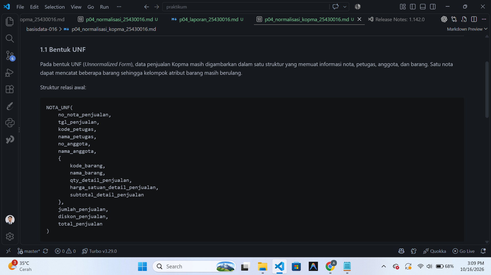

### 3.2 Pembentukan Bentuk Normal Pertama (1NF)

Pada tahap 1NF, kelompok data berulang pada transaksi penjualan dipisahkan sehingga setiap baris merepresentasikan satu data barang dalam suatu transaksi. Dengan demikian, setiap atribut menyimpan satu nilai pada setiap baris dan data dapat diolah dengan lebih terstruktur.

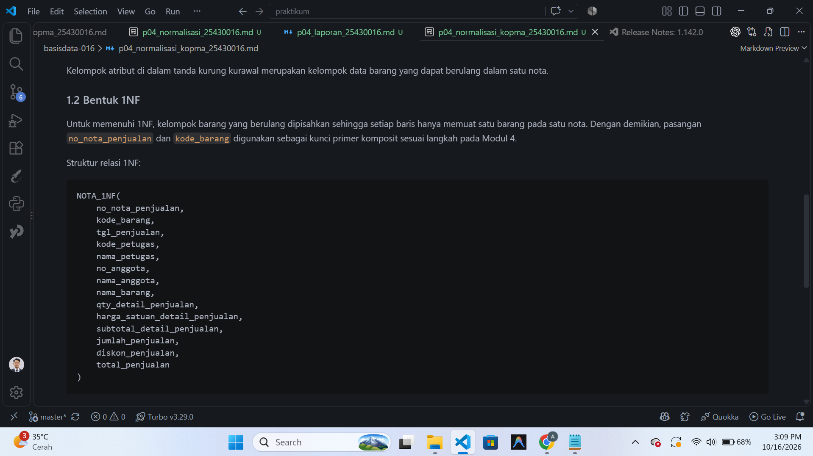

### 3.3 Identifikasi *Functional Dependency* (FD)

Setelah bentuk 1NF disusun, dilakukan identifikasi *functional dependency* (FD) untuk mengetahui hubungan ketergantungan antaratribut. Identifikasi ini digunakan sebagai dasar untuk menentukan pemisahan relasi pada tahap normalisasi berikutnya.

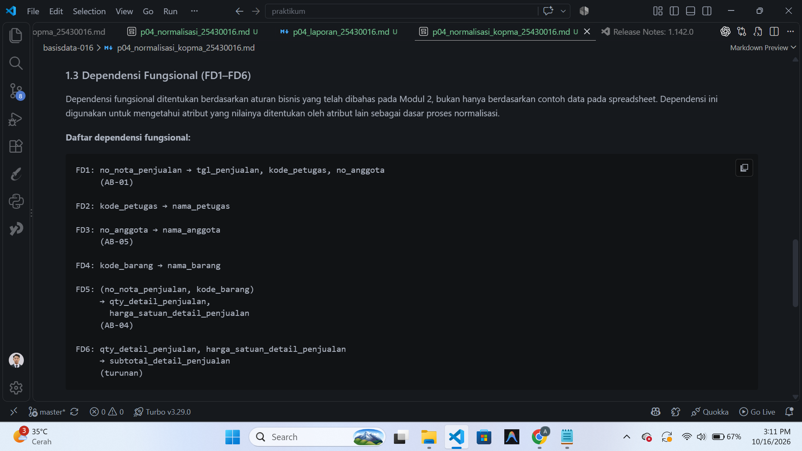

### 3.4 Pembentukan Bentuk Normal Kedua (2NF)

Pada tahap 2NF, relasi diperiksa untuk mengetahui apakah terdapat atribut nonkunci yang hanya bergantung pada sebagian dari kunci primer komposit. Berdasarkan hasil pemeriksaan, data transaksi penjualan dipisahkan dari data barang. Hasil pemisahan ini menghasilkan relasi `PENJUALAN_2NF`, `DETAIL_PENJUALAN_2NF`, dan `BARANG_2NF`.

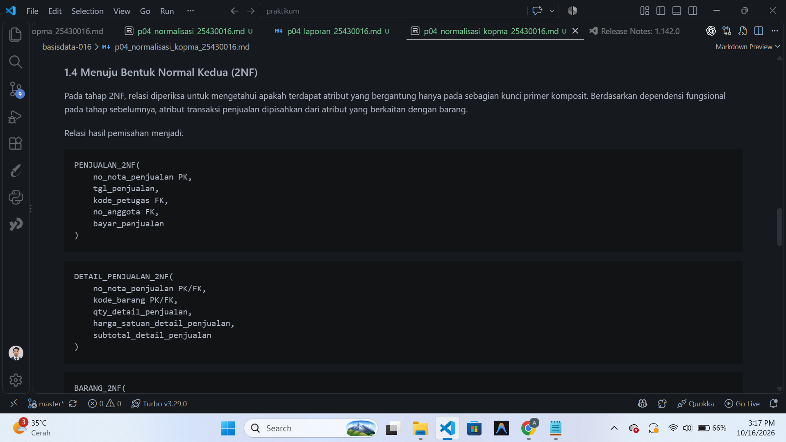

Penjelasan mengenai hasil pemisahan relasi 2NF ditampilkan pada gambar berikut. Harga satuan tetap disimpan pada detail penjualan karena harga barang dalam transaksi dapat berbeda dari harga barang saat ini.

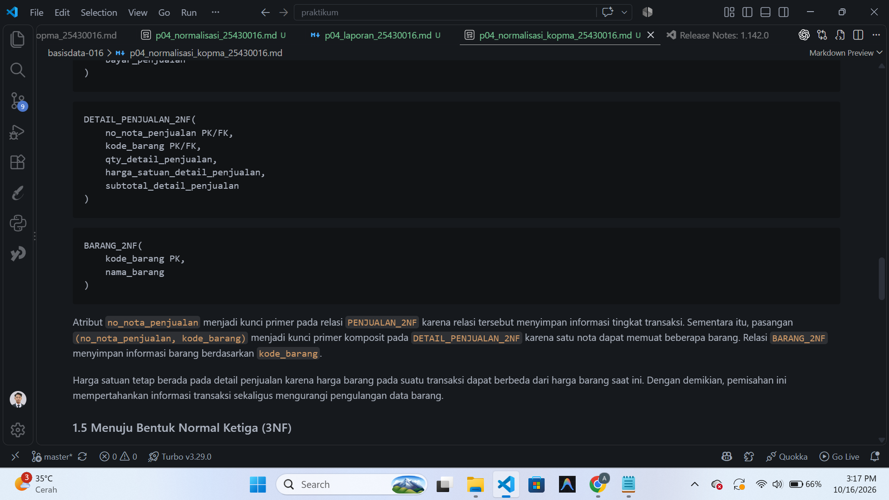

### 3.5 Pembentukan Bentuk Normal Ketiga (3NF)

Pada tahap 3NF, relasi diperiksa untuk mengetahui adanya ketergantungan transitif. Informasi barang, petugas, dan anggota dipisahkan ke dalam relasi masing-masing agar atribut yang menjelaskan data tersebut tidak perlu disimpan berulang pada tabel transaksi.

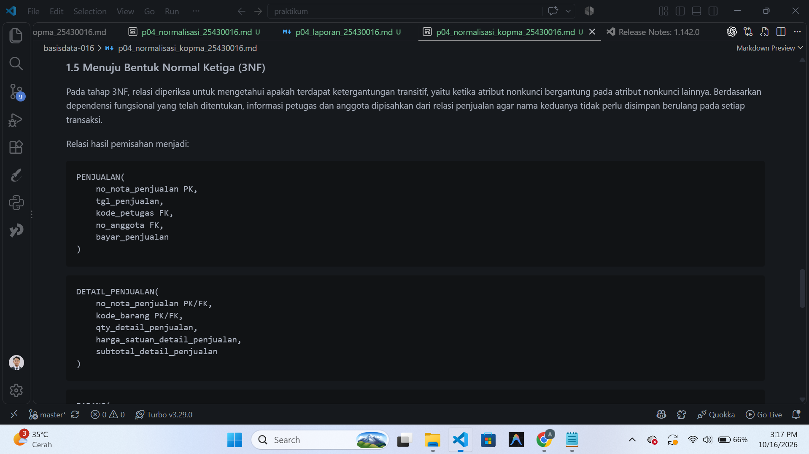

Struktur relasi hasil normalisasi 3NF beserta atribut dan kunci masing-masing ditampilkan pada gambar berikut.

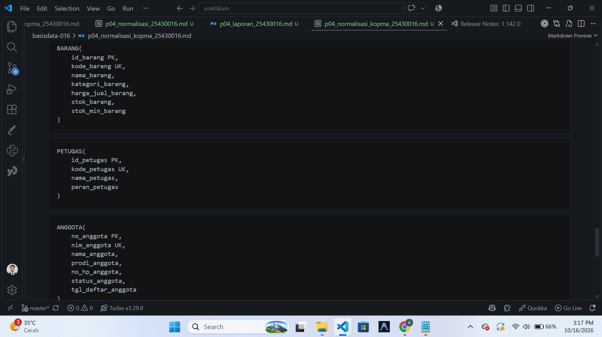

### 3.6 Pemeriksaan Boyce-Codd Normal Form (BCNF)

Tahap selanjutnya adalah pemeriksaan BCNF. Pemeriksaan dilakukan dengan melihat apakah determinan pada dependensi fungsional nontrivial merupakan *superkey* pada relasi terkait. Hasil pemeriksaan digunakan untuk menilai apakah masih terdapat ketergantungan yang berpotensi menimbulkan redundansi data.

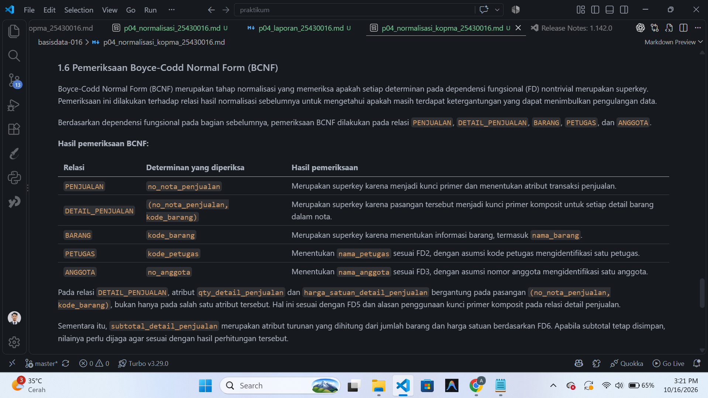

Kesimpulan pemeriksaan BCNF disusun berdasarkan dependensi fungsional yang telah dicatat. Pemenuhan BCNF secara formal tetap bergantung pada kelengkapan dependensi fungsional dan aturan bisnis yang berlaku.

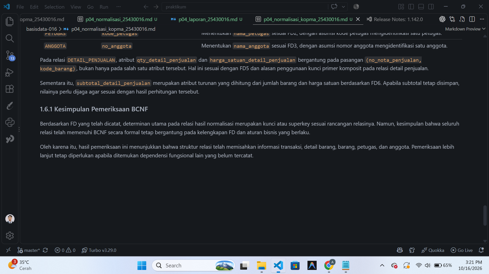

## 4. Jawaban Titik Analisis

### 4.1 Titik Analisis 1

**Mengapa FD5 menempatkan `harga_satuan_detail_penjualan` pada kunci `(no_nota_penjualan, kode_barang)`, bukan pada `kode_barang` saja? Apa yang terjadi pada laporan omzet tahun lalu jika `harga_satuan_detail_penjualan` dipindah ke tabel barang?**

FD5 menempatkan `harga_satuan_detail_penjualan` pada kunci gabungan `(no_nota_penjualan, kode_barang)` karena harga satuan yang digunakan dalam transaksi merupakan harga barang pada saat penjualan berlangsung. Harga tersebut tidak selalu sama dengan harga jual barang saat ini. Oleh karena itu, harga satuan bergantung pada kombinasi nomor nota penjualan dan kode barang, bukan hanya pada kode barang.

Jika `harga_satuan_detail_penjualan` dipindahkan ke tabel `BARANG`, laporan omzet tahun lalu berisiko menjadi tidak akurat ketika harga jual barang diperbarui. Harga lama yang digunakan pada transaksi sebelumnya dapat tergantikan oleh harga terbaru, sehingga perhitungan omzet historis tidak lagi mencerminkan nilai transaksi yang sebenarnya. Dengan menyimpan harga satuan pada tabel `DETAIL_PENJUALAN`, harga yang berlaku pada setiap transaksi dapat dipertahankan sebagai catatan historis.

### 4.2 Titik Analisis 2

**Mengapa keputusan “total tidak disimpan” tetap konsisten meskipun tabel arsip penjualan pada Buku 2 Modul 2 menyimpan total?**

Keputusan tersebut tetap konsisten karena data operasional dan arsip historis memiliki kebutuhan yang berbeda. Pada data operasional, total penjualan dapat dihitung dari jumlah barang dikalikan harga satuan pada setiap detail transaksi, kemudian dijumlahkan sesuai kebutuhan. Dengan cara ini, total tidak perlu disimpan berulang apabila nilainya dapat diperoleh dari data yang sudah tersedia.

Sementara itu, tabel arsip penjualan dapat menyimpan total sebagai bagian dari potret historis transaksi yang telah terjadi. Nilai tersebut dipertahankan untuk kebutuhan dokumentasi atau pelaporan historis, sehingga tidak otomatis berubah ketika data operasional mengalami pembaruan. Jadi, perbedaan keputusan penyimpanan total bergantung pada tujuan penggunaan data dan kebutuhan untuk mempertahankan nilai historis, bukan merupakan pertentangan dalam proses normalisasi.

### 4.3 Titik Analisis 3

**Di mana informasi “barang ini dipasok oleh siapa” disimpan setelah kolom `pemasok_brg` dihapus dari tabel barang? Apa keuntungannya dibandingkan menyimpan satu nama pemasok di tabel barang?**

Setelah kolom `pemasok_brg` dihapus dari tabel `BARANG`, informasi pemasok disimpan pada tabel `PEMASOK` dan dihubungkan dengan data barang melalui relasi yang sesuai. Jika satu barang dapat dipasok oleh lebih dari satu pemasok atau satu pemasok memasok banyak barang, hubungan tersebut sebaiknya dicatat dalam tabel penghubung agar setiap pasangan barang dan pemasok dapat direpresentasikan dengan jelas.

Keuntungan struktur tersebut adalah informasi pemasok tidak perlu ditulis berulang kali pada tabel barang, sehingga pengelolaan data menjadi lebih teratur dan risiko ketidakkonsistenan dapat dikurangi. Selain itu, perubahan nama atau alamat pemasok cukup dilakukan pada tabel `PEMASOK`, tanpa harus memperbarui data yang sama pada banyak baris barang. Struktur ini juga lebih fleksibel apabila hubungan antara barang dan pemasok berkembang.

## 5. Hasil Latihan dan Modifikasi

Pada bagian ini, dilakukan dua latihan sesuai dengan instruksi pada Modul 4. Latihan pertama membahas normalisasi nomor telepon pemasok, sedangkan latihan kedua membahas contoh pelanggaran Third Normal Form (3NF) dan anomali ubah pada data penjualan Kopma.

### 5.1 Normalisasi Nomor Telepon Pemasok

Pada latihan pertama, Kopma membutuhkan struktur data yang dapat mencatat beberapa nomor telepon untuk setiap pemasok. Apabila beberapa nomor telepon disimpan dalam satu kolom pada tabel `PEMASOK`, nilai atribut tersebut tidak bersifat atomik. Oleh karena itu, data nomor telepon dipisahkan ke dalam relasi tersendiri agar setiap nomor telepon dapat dicatat pada baris yang berbeda.

Relasi setelah normalisasi terdiri atas:

```text
PEMASOK(
    id_pemasok PK,
    nama_pemasok,
    alamat_pemasok
)

TELEPON_PEMASOK(
    id_pemasok PK/FK,
    nomor_telepon PK
)
```

Pada relasi `TELEPON_PEMASOK`, kunci primer komposit terdiri atas `id_pemasok` dan `nomor_telepon`. `id_pemasok` juga menjadi kunci tamu yang menghubungkan data nomor telepon dengan pemasok terkait. Dengan struktur ini, satu pemasok dapat memiliki beberapa nomor telepon tanpa harus menyimpan beberapa nilai dalam satu kolom.

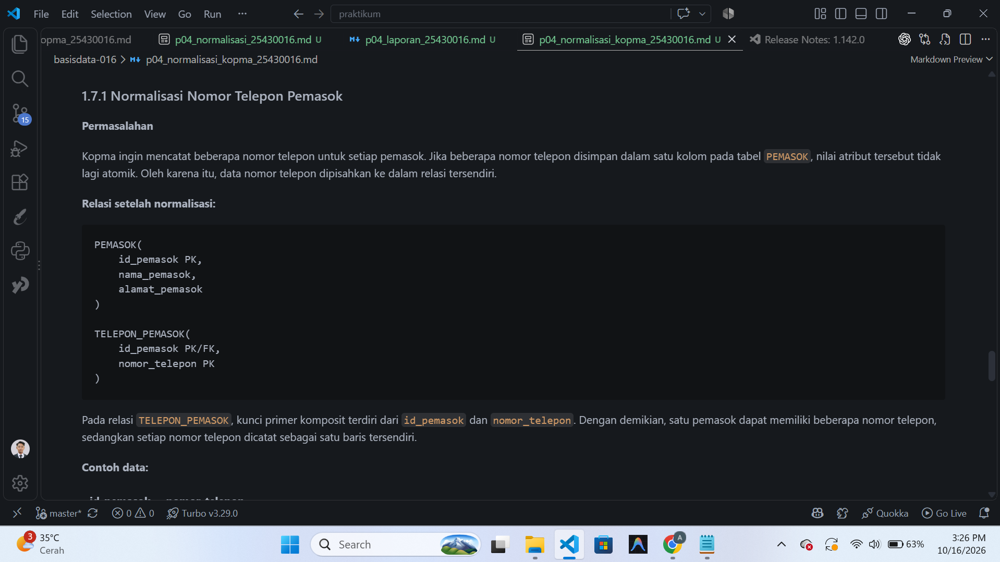

### 5.2 Contoh Pelanggaran 3NF dan Anomali Ubah

Pada latihan kedua, dibuat contoh permasalahan ketika atribut `nama_anggota` disimpan langsung pada tabel `PENJUALAN`. Apabila `no_anggota` menentukan `nama_anggota`, maka terdapat ketergantungan transitif dari kunci transaksi menuju nama anggota melalui nomor anggota.

Dependensi fungsional yang menggambarkan permasalahan tersebut adalah:

```text
no_nota_penjualan -> no_anggota
no_anggota        -> nama_anggota
```

Sebagai contoh, anggota dengan nomor `A001` melakukan beberapa transaksi. Jika nama anggota disimpan berulang pada setiap transaksi, perubahan nama anggota dapat menyebabkan data menjadi tidak konsisten apabila hanya sebagian baris yang diperbarui.

Contoh kueri yang memperlihatkan anomali ubah adalah:

```sql
UPDATE PENJUALAN
SET nama_anggota = 'Nadia Pratama'
WHERE no_nota_penjualan = 'N001';
```

Kueri tersebut hanya mengubah nama anggota pada transaksi `N001`. Jika transaksi `N002` dan `N003` masih menyimpan nama sebelumnya, informasi anggota yang sama akan memiliki nilai berbeda pada tabel penjualan.

Perbaikan dilakukan dengan memisahkan informasi anggota ke dalam tabel `ANGGOTA`, sedangkan tabel `PENJUALAN` hanya menyimpan `no_anggota` sebagai referensi.

```text
ANGGOTA(
    no_anggota PK,
    nama_anggota
)

PENJUALAN(
    no_nota_penjualan PK,
    tgl_penjualan,
    kode_petugas FK,
    no_anggota FK
)
```

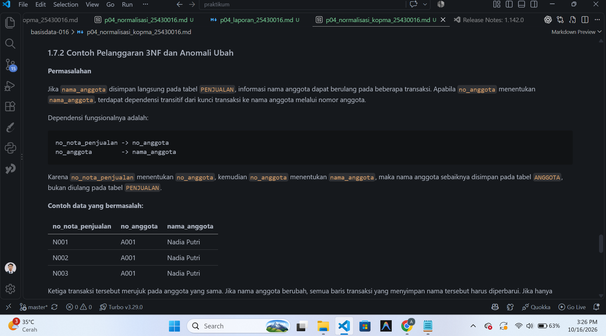

Berdasarkan kedua latihan tersebut, normalisasi membantu menyusun data agar setiap atribut disimpan pada relasi yang sesuai. Pemisahan nomor telepon pemasok mengatasi masalah nilai atribut yang tidak atomik, sedangkan pemisahan data anggota dari penjualan mengurangi pengulangan informasi dan risiko anomali ubah.

## 6. Tugas Mandiri: Milestone Proyek

Pada tahap ini, normalisasi diterapkan pada proyek basis data Perpustakaan Lentera AYP. Proses dimulai dari Slip Peminjaman Buku sebagai dokumen sumber, kemudian dilanjutkan dengan identifikasi dependensi fungsional, pemisahan relasi pada tahap 1NF, 2NF, dan 3NF, serta pemeriksaan BCNF. Selain itu, dilakukan peninjauan terhadap penyimpanan nilai turunan dan kesesuaian rancangan ERD dengan hasil normalisasi.

### 6.1 Bentuk Tidak Normal (UNF)

Tahap awal normalisasi menggunakan Slip Peminjaman Buku yang memuat informasi transaksi, anggota, petugas, dan eksemplar buku yang dipinjam. Pada satu transaksi, terdapat kemungkinan beberapa eksemplar dicatat sekaligus. Kondisi tersebut membentuk kelompok data berulang pada atribut `id_eksemplar` dan `judul_buku`.

Bentuk tidak normal atau *Unnormalized Form* (UNF) digunakan untuk menggambarkan struktur data awal sebelum kelompok data berulang dipisahkan menjadi baris-baris tersendiri.

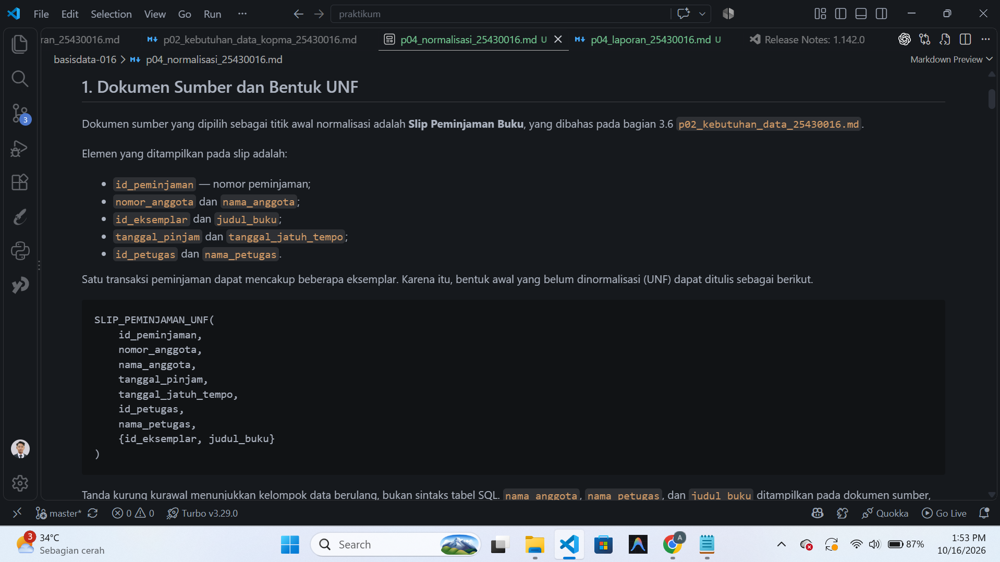

### 6.2 Bentuk Normal Pertama (1NF)

Pada tahap 1NF, kelompok data eksemplar yang berulang diubah menjadi baris-baris terpisah. Setiap baris mewakili satu eksemplar dalam suatu transaksi peminjaman sehingga setiap atribut memiliki satu nilai dan tidak lagi disimpan dalam kelompok data berulang.

Kandidat kunci untuk mengidentifikasi satu baris detail dirancang menggunakan pasangan `id_peminjaman` dan `id_eksemplar`. Meskipun kelompok data berulang telah dipisahkan, beberapa atribut masih perlu ditinjau berdasarkan ketergantungannya terhadap kunci sebelum dilanjutkan ke tahap berikutnya.

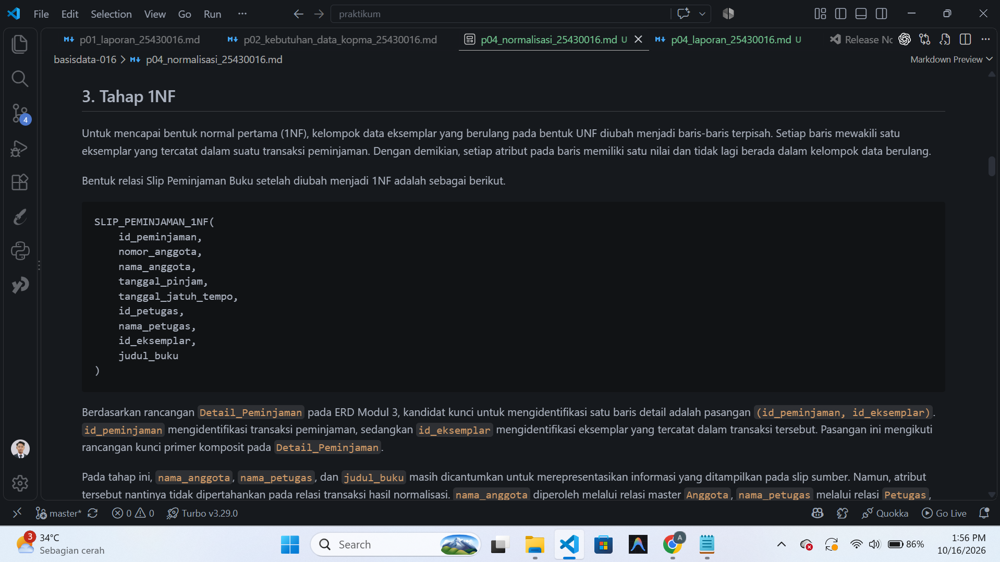

### 6.3 Identifikasi Dependensi Fungsional

Setelah tahap 1NF, dependensi fungsional (FD) diidentifikasi berdasarkan aturan bisnis, kamus data, dan rancangan ERD Modul 3. Identifikasi ini digunakan untuk mengetahui hubungan antara atribut penentu dan atribut yang ditentukan, sekaligus menjadi dasar dalam memisahkan data transaksi, detail peminjaman, dan informasi master.

Beberapa dependensi yang diperiksa antara lain hubungan `id_peminjaman` dengan atribut transaksi, hubungan `id_eksemplar` dengan `id_buku`, serta hubungan kunci pada entitas anggota, petugas, pengembalian, dan denda. FD yang bergantung pada aturan tertentu, seperti perhitungan nominal denda berdasarkan jumlah hari keterlambatan, juga dicatat sebagai dependensi bersyarat.

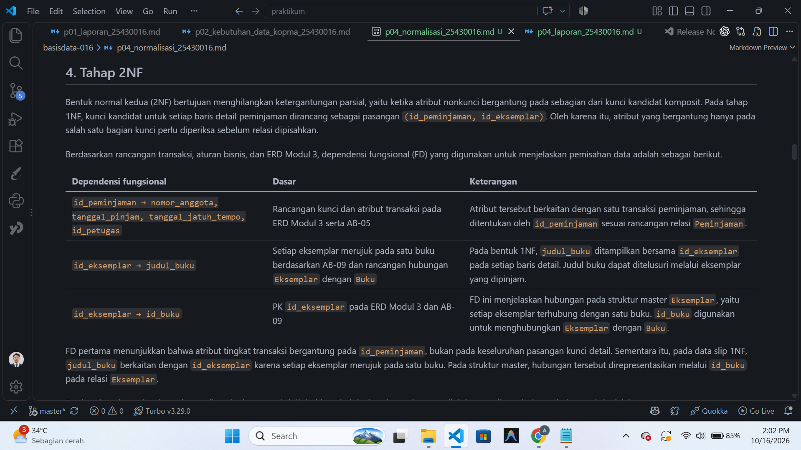

### 6.4 Bentuk Normal Kedua (2NF)

Tahap 2NF dilakukan dengan memeriksa ketergantungan parsial pada relasi yang menggunakan kunci kandidat komposit. Atribut yang bergantung pada identitas transaksi dipisahkan dari atribut yang berkaitan dengan detail eksemplar.

Hasil pemisahan menghasilkan relasi `PEMINJAMAN` untuk menyimpan informasi pada tingkat transaksi dan `DETAIL_PEMINJAMAN` untuk mencatat eksemplar yang termasuk dalam transaksi tersebut. Relasi `DETAIL_PEMINJAMAN` menggunakan kunci primer komposit `(id_peminjaman, id_eksemplar)`.

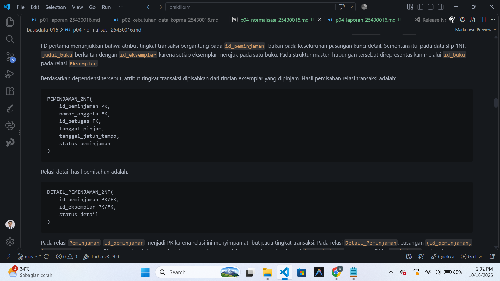

Pemisahan tersebut juga dijelaskan melalui penempatan atribut sesuai tingkat ketergantungannya. Informasi anggota, petugas, dan judul buku tidak perlu disalin berulang pada relasi transaksi karena dapat diperoleh melalui relasi master yang sesuai.

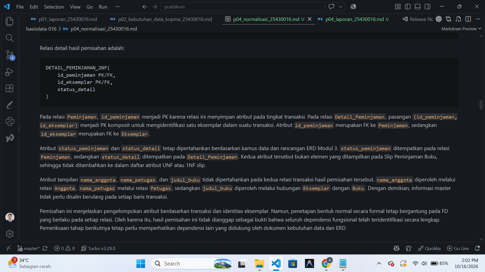

### 6.5 Bentuk Normal Ketiga (3NF)

Pada tahap 3NF, struktur relasi ditinjau untuk mengurangi ketergantungan transitif dan pengulangan informasi. Atribut master anggota ditempatkan pada relasi `ANGGOTA`, informasi buku pada `BUKU`, identitas eksemplar pada `EKSEMPLAR`, dan informasi petugas pada `PETUGAS`. Sementara itu, informasi transaksi dan detail peminjaman tetap ditempatkan pada relasi masing-masing.

Hasil rancangan mempertahankan delapan relasi, yaitu `ANGGOTA`, `BUKU`, `EKSEMPLAR`, `PETUGAS`, `PEMINJAMAN`, `DETAIL_PEMINJAMAN`, `PENGEMBALIAN`, dan `DENDA`. Pemisahan ini membantu menjaga keteraturan data, tetapi pemenuhan 3NF secara formal tetap bergantung pada kelengkapan dependensi fungsional yang berlaku.

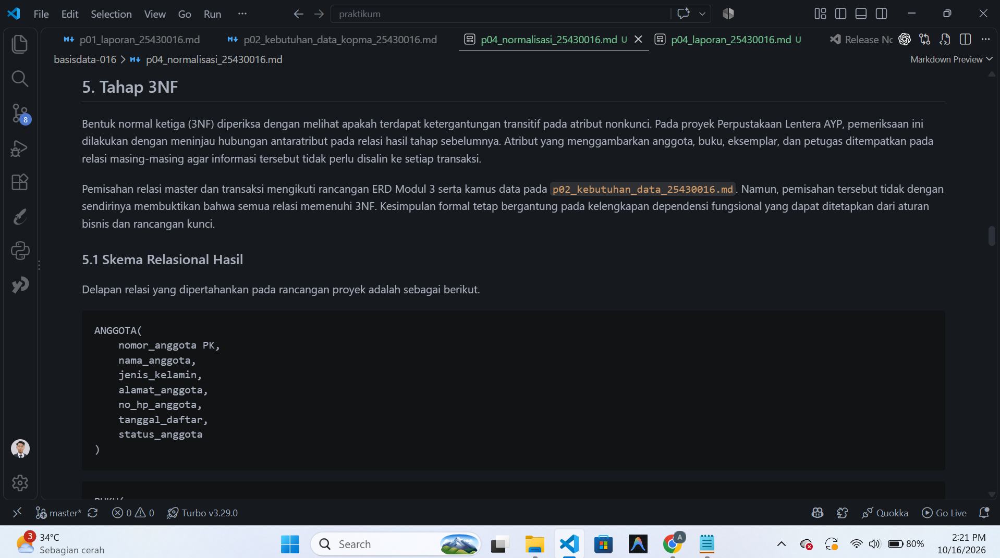

### 6.6 Pemeriksaan Boyce-Codd Normal Form (BCNF)

Pemeriksaan BCNF dilakukan dengan meninjau apakah setiap determinan pada dependensi fungsional nontrivial merupakan *superkey*. Pemeriksaan tidak hanya didasarkan pada keberadaan kunci primer, tetapi juga mempertimbangkan dependensi fungsional lain yang berlaku pada setiap relasi.

Berdasarkan rancangan yang telah disusun, kunci primer pada masing-masing relasi merupakan superkey. Pasangan `(id_peminjaman, id_eksemplar)` pada `PENGEMBALIAN` juga dirancang sebagai kunci unik apabila constraint `UNIQUE` pada pasangan tersebut diterapkan. Pada relasi `DENDA`, `id_pengembalian` dirancang sebagai kunci tamu sekaligus kunci unik.

Perhatian khusus diberikan pada hubungan `hari_terlambat → nominal_denda`. Apabila tarif Rp8.000 per hari diterapkan secara tetap tanpa faktor penyesuaian lain dan `hari_terlambat` bukan superkey, relasi `DENDA` tidak memenuhi BCNF berdasarkan dependensi tersebut. Oleh karena itu, hasil pemeriksaan belum digunakan untuk menyatakan bahwa seluruh relasi secara formal telah memenuhi BCNF.

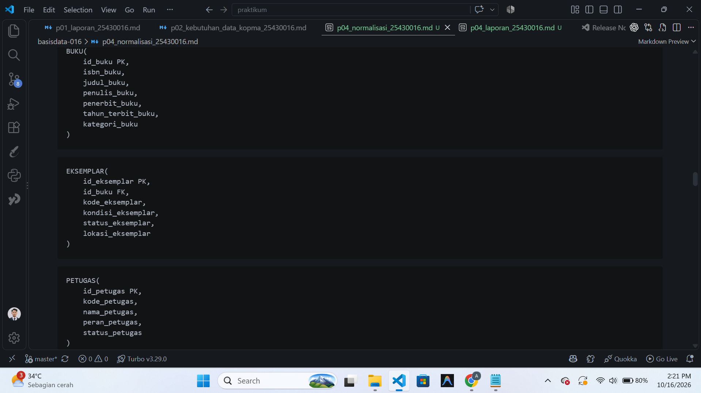

### 6.7 Keputusan Penyimpanan Nilai Turunan

Nilai turunan yang ditinjau pada proyek ini adalah `hari_terlambat` dan `nominal_denda`. Jumlah hari keterlambatan dapat ditentukan berdasarkan tanggal jatuh tempo dan tanggal pengembalian sesuai aturan yang diterapkan. Sementara itu, nominal denda mengacu pada ketentuan tarif Rp8.000 per hari sebagaimana tercantum dalam aturan bisnis proyek.

Kedua atribut tetap dipertahankan pada relasi `DENDA` sebagai keputusan desain untuk mencatat riwayat denda. Namun, penyimpanan keduanya secara bersamaan dapat menimbulkan ketidaksesuaian apabila nilai hari keterlambatan dan nominal denda diperbarui secara terpisah. Karena itu, nilai yang disimpan perlu diperiksa agar tetap sesuai dengan tanggal sumber dan aturan perhitungan yang berlaku.

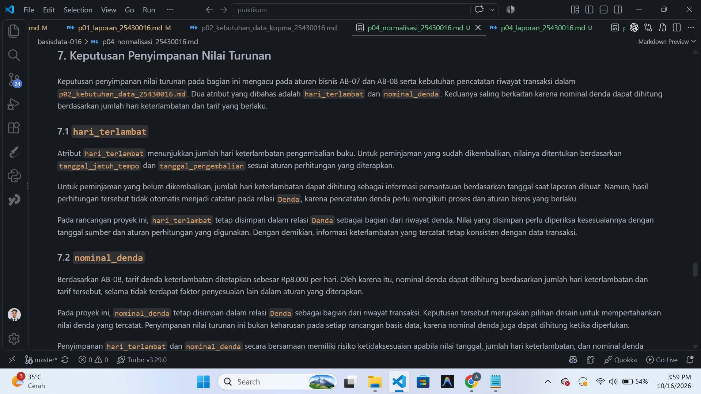

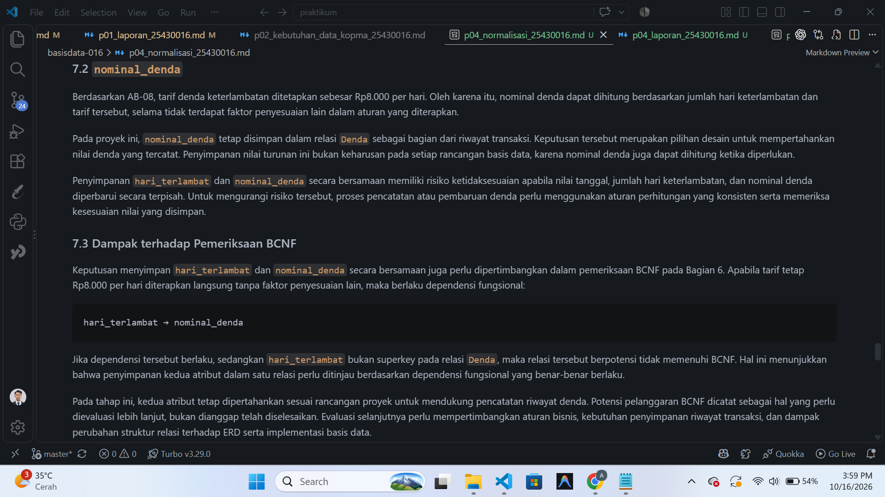

### 6.8 Catatan Perubahan ERD Modul 3

Tahap terakhir dilakukan dengan meninjau kesesuaian hasil normalisasi dengan rancangan ERD Modul 3. Pemeriksaan mencakup delapan entitas, penempatan atribut, kunci primer, kunci tamu, kunci primer komposit, serta constraint `UNIQUE` pada hubungan pengembalian dan denda.

Pasangan `(id_peminjaman, id_eksemplar)` pada `PENGEMBALIAN` dirancang sebagai satu kunci tamu gabungan yang mengacu pada `DETAIL_PEMINJAMAN`, sekaligus memiliki constraint `UNIQUE` pada kombinasi kedua atribut. Sementara itu, `id_pengembalian` pada `DENDA` dirancang sebagai kunci tamu sekaligus kunci unik. Rancangan tersebut perlu diterapkan dan diuji pada implementasi basis data agar tidak hanya tercatat dalam dokumentasi.

Selain itu, ERD mencatat batas maksimal sepuluh eksemplar dalam satu transaksi peminjaman. Aturan tersebut perlu diperhatikan pada tahap implementasi karena tidak otomatis dijamin hanya dengan penggunaan kunci primer dan kunci tamu.

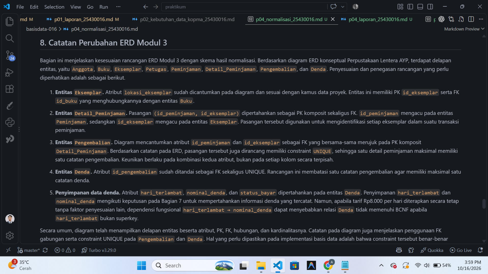

### 6.9 Kesimpulan Milestone Proyek

Berdasarkan proses yang telah dilakukan, normalisasi proyek Perpustakaan Lentera AYP dimulai dari Slip Peminjaman Buku dalam bentuk UNF, dilanjutkan dengan 1NF, 2NF, 3NF, dan pemeriksaan BCNF. Proses tersebut menghasilkan rancangan yang memisahkan data master dari data transaksi serta mempertahankan delapan relasi sesuai ERD Modul 3.

Pemeriksaan juga menghasilkan beberapa catatan desain, terutama mengenai penyimpanan nilai turunan `hari_terlambat` dan `nominal_denda`, konsistensi kunci dan constraint, serta kebutuhan verifikasi pada implementasi basis data. Dengan demikian, hasil normalisasi menjadi dasar untuk melanjutkan perancangan skema fisik dan implementasi basis data pada tahap praktikum berikutnya.

## 7. Pembahasan dan Kendala

### 7.1 Pembahasan

Modul 4 berfokus pada normalisasi basis data, yaitu merapikan struktur tabel supaya data tidak berulang dan informasinya tetap konsisten. Pada kasus Kopma, langkah awalnya adalah mencari kelompok data yang berulang, lalu memetakan dependensi fungsional dan keterkaitan antaratribut. Dari hasil itu, data transaksi, detail penjualan, barang, petugas, dan anggota dipisahkan menjadi relasi-relasi yang lebih tertata.

Prosesnya berjalan bertahap, dari bentuk tidak normal (UNF) ke 1NF, 2NF, lalu 3NF. Di tahap 1NF, kelompok data berulang dipisahkan agar setiap atribut hanya berisi satu nilai (atomik). Di tahap 2NF, atribut yang hanya bergantung pada sebagian kunci komposit dikeluarkan dari relasi detail. Di tahap 3NF, ketergantungan transitif dihilangkan. Contohnya, informasi anggota cukup disimpan di tabel `ANGGOTA` dan tidak perlu ditulis berulang di tabel `PENJUALAN`.

Pemeriksaan Boyce-Codd Normal Form (BCNF) dilakukan dengan melihat apakah determinan pada setiap dependensi fungsional nontrivial merupakan superkey. Latihan nomor telepon pemasok menunjukkan bahwa satu pemasok bisa memiliki lebih dari satu nomor, sehingga nomor-nomor tersebut lebih tepat dicatat pada relasi tersendiri. Latihan pelanggaran 3NF juga memperlihatkan bahwa nama anggota yang disimpan berulang pada transaksi dapat menyebabkan anomali perubahan data.

Pada proyek Perpustakaan Lentera AYP, normalisasi berangkat dari dokumen sumber, yaitu Slip Peminjaman Buku. Satu transaksi peminjaman bisa mencakup beberapa eksemplar, jadi kelompok data eksemplar yang berulang dipisahkan pada tahap 1NF. Pada tahap 2NF, data tingkat transaksi dipisahkan dari detail eksemplar. Informasi anggota, buku, eksemplar, dan petugas kemudian ditempatkan di relasi master masing-masing, sehingga tidak perlu disalin ulang ke relasi transaksi.

Rancangan akhir proyek tetap terdiri dari delapan relasi: `Anggota`, `Buku`, `Eksemplar`, `Petugas`, `Peminjaman`, `Detail_Peminjaman`, `Pengembalian`, dan `Denda`. Susunan ini sesuai dengan ERD pada Modul 3. Kunci primer, kunci tamu, kunci primer komposit, dan constraint `UNIQUE` diperhatikan agar hubungan antarrelasi tetap terjaga. Atribut `hari_terlambat` dan `nominal_denda` juga dipertahankan, sesuai keputusan proyek, untuk mendukung pencatatan riwayat denda.

Meski begitu, pemeriksaan BCNF menunjukkan masih ada bagian yang perlu dicermati pada relasi `Denda`. Jika nominal denda selalu dihitung langsung dengan tarif tetap Rp8.000 per hari tanpa faktor penyesuaian lain, maka berlaku dependensi fungsional `hari_terlambat → nominal_denda`. Karena `hari_terlambat` bukan superkey, relasi tersebut tidak memenuhi BCNF berdasarkan dependensi itu. Artinya, hasil normalisasi tidak hanya berguna untuk menyusun relasi, tetapi juga untuk menemukan bagian rancangan yang masih perlu dievaluasi.

### 7.2 Kendala

Selama mengerjakan Modul 4, ada beberapa hal yang menuntut ketelitian. Pada kasus Kopma, kesulitan pertama adalah menentukan mana atribut yang bergantung pada seluruh kunci komposit dan mana yang hanya bergantung pada sebagian kunci. Hal ini penting karena pemisahan relasi di tahap 2NF harus sesuai dengan dependensi fungsional yang sudah diidentifikasi.

Kesulitan berikutnya adalah membedakan ketergantungan parsial dari ketergantungan transitif. Keduanya diperiksa dengan cara berbeda, sehingga setiap atribut harus ditinjau satu per satu terhadap kunci dan hubungan fungsionalnya. Pemeriksaan BCNF juga menuntut seluruh dependensi fungsional nontrivial teridentifikasi, tidak cukup hanya memeriksa kunci primer.

Pada latihan nomor telepon pemasok, hal yang perlu diperhatikan adalah penentuan kunci primer komposit pada relasi `TELEPON_PEMASOK`. Pasangan `id_pemasok` dan `nomor_telepon` dipakai untuk membedakan setiap catatan nomor telepon milik pemasok. Latihan anomali ubah, di sisi lain, membantu memahami dampak dari menyimpan nama anggota secara berulang di tabel transaksi.

Pada proyek Perpustakaan Lentera AYP, tantangannya adalah menjaga agar hasil normalisasi tetap konsisten dengan kebutuhan data dan ERD Modul 3. Hubungan antara `Pengembalian` dan `Detail_Peminjaman` memerlukan perhatian khusus karena memakai kunci tamu gabungan. Constraint `UNIQUE` pada pasangan atribut pengembalian dan pada `id_pengembalian` di relasi `Denda` juga harus dituliskan dan diterapkan sesuai rancangan.

Kendala lainnya ada pada penyimpanan nilai turunan `hari_terlambat` dan `nominal_denda`. Kedua atribut tetap dipertahankan untuk mencatat riwayat denda, tetapi nilainya harus dijaga agar cocok dengan tanggal pengembalian dan aturan tarif yang berlaku. Keputusan ini juga ikut dipertimbangkan dalam pemeriksaan BCNF, sebab tarif tetap yang diterapkan langsung dapat memunculkan ketergantungan fungsional.

### 7.3 Upaya Penyelesaian Kendala

Untuk menghadapi kendala tersebut, dependensi fungsional, kunci primer, kunci tamu, dan hubungan antarrelasi ditinjau ulang. Pada kasus Kopma, hasil di setiap tahap normalisasi diperiksa kembali supaya pemisahan relasi punya alasan yang jelas. Latihan nomor telepon pemasok dan anomali ubah ikut membantu memahami penerapan normalisasi pada masalah yang berbeda.

Pada proyek Perpustakaan Lentera AYP, hasil normalisasi dibandingkan dengan kebutuhan data dan ERD Modul 3 agar atribut dan relasi yang dipertahankan tetap selaras dengan rancangan sebelumnya. Penggunaan kunci komposit dan constraint `UNIQUE` juga diperiksa untuk memastikan aturan hubungan antarrelasi dijelaskan dengan tepat.

Khusus untuk relasi `Denda`, keputusan mempertahankan `hari_terlambat` dan `nominal_denda` dicatat sebagai keputusan desain yang masih perlu diawasi. Konsistensi kedua nilai itu perlu diuji saat basis data diimplementasikan. Penerapan constraint dan aturan bisnis, termasuk batas maksimal sepuluh eksemplar dalam satu transaksi peminjaman, juga masih perlu diverifikasi lewat pengujian pada tahap implementasi.

Dengan pemeriksaan tersebut, hasil praktikum dapat menjadi dasar untuk memahami proses normalisasi dan menyusun rancangan basis data yang lebih terstruktur. Namun, kesimpulan tentang pemenuhan 3NF dan BCNF secara formal tetap harus berpijak pada dependensi fungsional yang benar-benar berlaku pada setiap relasi.

## 8. Kesimpulan

Berdasarkan praktikum Modul 4, dapat disimpulkan bahwa normalisasi merupakan proses penyusunan relasi basis data untuk mengurangi pengulangan informasi dan membantu menjaga konsistensi data. Proses ini dilakukan melalui tahapan UNF, 1NF, 2NF, 3NF, dan pemeriksaan BCNF dengan memperhatikan dependensi fungsional, kunci primer, serta hubungan antaratribut.

Pada kasus Kopma, proses normalisasi membantu memisahkan data transaksi, detail penjualan, barang, petugas, dan anggota ke dalam relasi yang lebih terstruktur. Latihan normalisasi nomor telepon pemasok menunjukkan bahwa beberapa nomor telepon dari satu pemasok dapat dicatat dalam relasi tersendiri. Sementara itu, latihan pelanggaran 3NF memperlihatkan bahwa penyimpanan nama anggota secara berulang pada tabel penjualan dapat menimbulkan pengulangan data dan anomali perubahan.

Pada proyek Perpustakaan Lentera AYP, normalisasi dilakukan berdasarkan Slip Peminjaman Buku dan rancangan ERD dari modul sebelumnya. Hasilnya mempertahankan delapan relasi, yaitu `Anggota`, `Buku`, `Eksemplar`, `Petugas`, `Peminjaman`, `Detail_Peminjaman`, `Pengembalian`, dan `Denda`. Pemisahan data master, transaksi, serta detail peminjaman membantu mengurangi pengulangan informasi dan memperjelas hubungan antarrelasi melalui penggunaan kunci primer dan kunci tamu.

Pemeriksaan BCNF juga menunjukkan pentingnya meninjau setiap dependensi fungsional nontrivial, bukan hanya memastikan bahwa relasi memiliki kunci primer. Pada relasi `Denda`, penyimpanan `hari_terlambat` dan `nominal_denda` tetap dipertahankan sesuai keputusan proyek, tetapi berpotensi menimbulkan pelanggaran BCNF apabila tarif tetap Rp8.000 per hari berlaku secara langsung dan `hari_terlambat` bukan superkey. Oleh karena itu, aturan bisnis dan konsistensi nilai kedua atribut tersebut masih perlu diperhatikan.

Secara keseluruhan, praktikum ini memberikan pemahaman mengenai penerapan normalisasi pada kasus yang berbeda serta pentingnya menyusun relasi berdasarkan kebutuhan data dan dependensi fungsional yang dapat dipertanggungjawabkan. Hasil normalisasi proyek Perpustakaan Lentera AYP dapat menjadi dasar untuk tahap implementasi berikutnya, dengan tetap melakukan pemeriksaan terhadap aturan bisnis, constraint, dan dependensi fungsional yang belum dapat dipastikan sepenuhnya.

## 9. Pernyataan Penggunaan AI

Dalam penyusunan laporan praktikum Modul 4, AI digunakan sebagai alat bantu untuk memahami materi normalisasi basis data, memeriksa ketergantungan fungsional, menyusun penjelasan setiap tahap normalisasi, serta membantu merapikan penulisan laporan dalam format Markdown.

Penggunaan AI tidak menggantikan proses pengerjaan praktikum. Penentuan struktur relasi, pemeriksaan hasil normalisasi, penyusunan dokumentasi proyek Perpustakaan, dan pengambilan tangkapan layar dilakukan dengan mengacu pada modul praktikum serta berkas proyek yang dikerjakan.

Hasil bantuan AI ditinjau kembali dan disesuaikan dengan kebutuhan tugas. Tanggung jawab atas isi akhir laporan dan kesesuaiannya dengan hasil praktikum tetap berada pada penulis.

## 10. Bukti Git (Tautan Repositori + Hash Commit)

Pengerjaan praktikum Modul 4 didokumentasikan dalam repositori GitHub sebagai bagian dari penyimpanan dan pengelolaan berkas praktikum Basis Data. Berkas yang berkaitan dengan praktikum ini mencakup dokumen normalisasi untuk kasus Kopma, dokumen normalisasi proyek Perpustakaan, laporan praktikum, serta bukti tangkapan layar hasil pengerjaan.

### 10.1 Tautan Repositori

- **Nama repositori:** `basisdata-25430016`
- **Tautan repositori:** [Masukkan tautan GitHub repositori di sini]

### 10.2 Informasi Commit

- **Hash commit:** [Masukkan hash commit aktual di sini]
- **Pesan commit:** [Masukkan pesan commit yang digunakan]


