# Laporan Praktikum Basis Data - Pertemuan 5

**Nama:** Arya Yoga Pratama  
**NPM:** 25430016  
**Kelas:** A  
**Tanggal:** 19 Oktober 2026  
**Asisten/Dosen:** Dedi Irawan, S.Kom., M.T.I.

## 1. Tujuan Praktikum

Praktikum ini bertujuan untuk memahami cara membuat struktur tabel basis data menggunakan perintah DDL (*Data Definition Language*) pada MySQL/MariaDB. Selain itu, praktikum ini melatih penggunaan tipe data, primary key, foreign key, serta constraint seperti `UNIQUE` dan `CHECK` untuk menjaga agar data yang dimasukkan sesuai dengan aturan yang telah ditentukan. Melalui pengujian constraint, mahasiswa dapat mengetahui bagaimana basis data menolak data yang tidak sesuai dengan aturan bisnis. Praktikum ini juga menjadi dasar untuk menerapkan rancangan struktur basis data pada proyek mandiri.

## 2. Ringkasan Teori

DDL (*Data Definition Language*) merupakan bagian dari SQL yang digunakan untuk membuat dan mengatur struktur basis data. Salah satu perintah DDL adalah `CREATE TABLE`, yang berfungsi untuk membuat tabel beserta kolom dan aturan penyimpanan datanya. Dalam menentukan struktur tabel, tipe data harus disesuaikan dengan jenis informasi yang disimpan, misalnya `VARCHAR` untuk teks, `DATE` untuk tanggal, dan `YEAR` untuk tahun.

Selain tipe data, tabel juga memerlukan constraint untuk menjaga konsistensi data. `PRIMARY KEY` digunakan sebagai identitas unik setiap baris, sedangkan `FOREIGN KEY` menghubungkan tabel dengan tabel lain agar data yang dirujuk benar-benar tersedia. Constraint `UNIQUE` mencegah nilai yang sama pada kolom atau kombinasi kolom tertentu, sementara `CHECK` membatasi nilai agar sesuai dengan aturan yang ditetapkan. Adapun `NOT NULL` memastikan kolom wajib memiliki nilai. Penerapan aturan tersebut perlu disesuaikan dengan kebutuhan sistem agar data yang tersimpan tetap valid dan hubungan antartabel terjaga.

## 3. Hasil Langkah Percobaan

### 3.1 Membuat Tabel Induk

Pada tahap pertama, dibuat tabel induk untuk basis data Kopma, yaitu `petugas`, `barang`, `anggota`, dan `pemasok`. Setiap tabel memiliki struktur kolom, tipe data, dan constraint sesuai kebutuhan. Pemeriksaan dilakukan menggunakan perintah `SHOW CREATE TABLE` untuk melihat definisi tabel yang tersimpan di MariaDB.

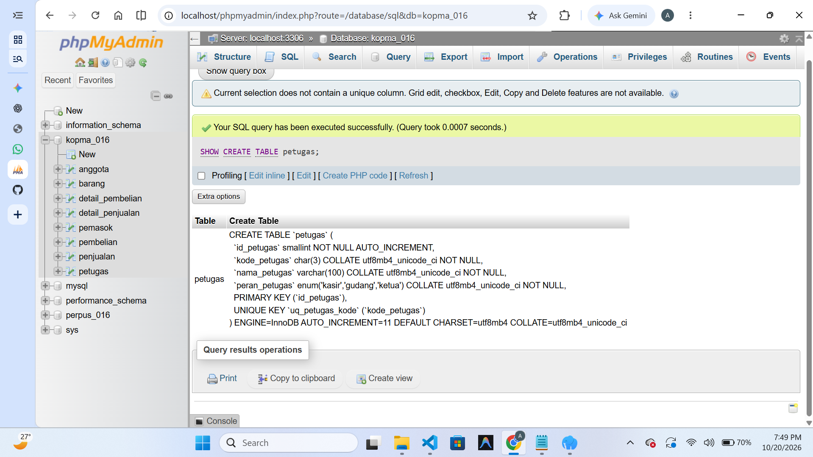

**Gambar 3.1.** Hasil `SHOW CREATE TABLE` pada tabel `petugas`, yang memperlihatkan struktur kolom dan constraint yang diterapkan.

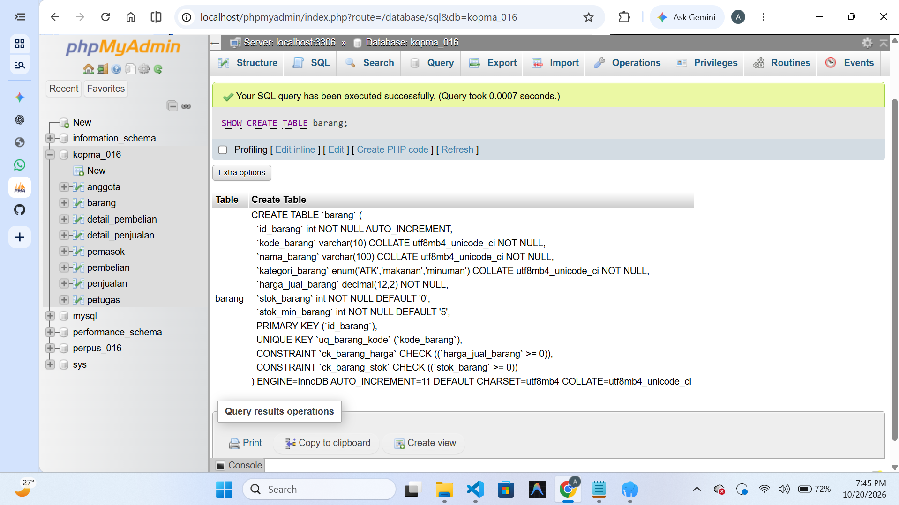

**Gambar 3.2.** Hasil `SHOW CREATE TABLE` pada tabel `barang`, termasuk aturan untuk kode barang, stok, harga jual, dan kategori barang.

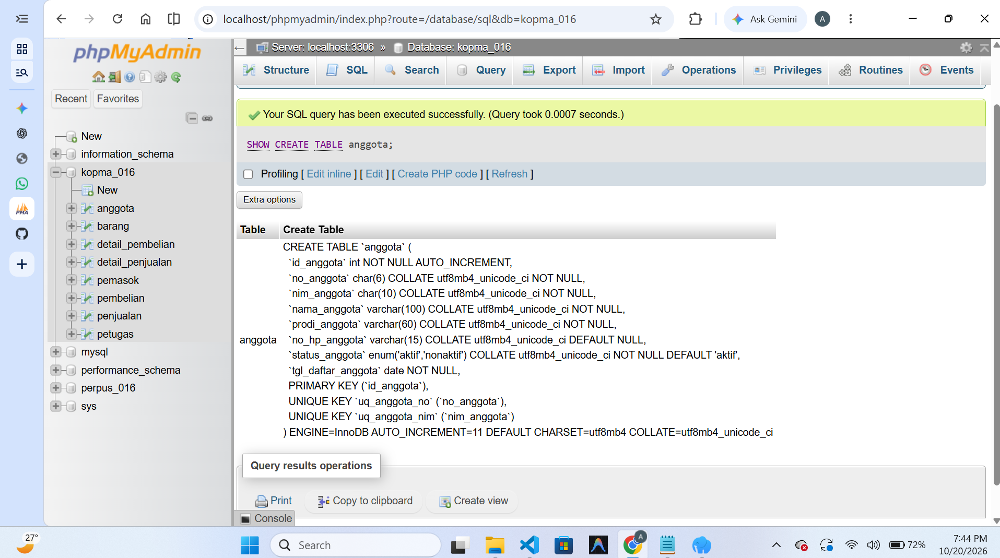

**Gambar 3.3.** Hasil `SHOW CREATE TABLE` pada tabel `anggota` untuk memeriksa struktur kolom dan constraint yang digunakan.

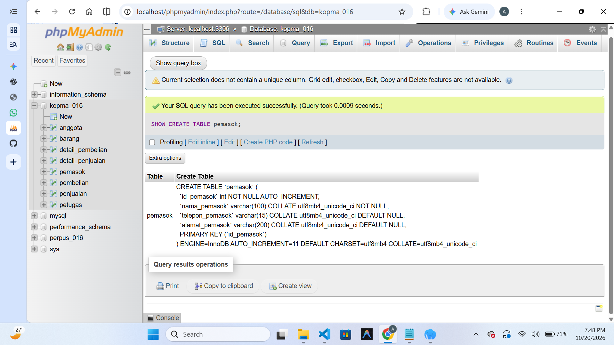

**Gambar 3.4.** Hasil `SHOW CREATE TABLE` pada tabel `pemasok` untuk memeriksa definisi tabel yang telah dibuat.

### 3.2 Membuat Tabel dengan Kunci Tamu

Setelah tabel induk dibuat, tahap berikutnya adalah membuat tabel transaksi `penjualan` dan `pembelian`, beserta tabel detailnya. Kunci tamu (*foreign key*) digunakan untuk menghubungkan tabel transaksi dengan tabel induk. Hubungan pada tabel detail juga diperiksa untuk memastikan bahwa data transaksi dan barang yang dirujuk mengikuti aturan referensial.

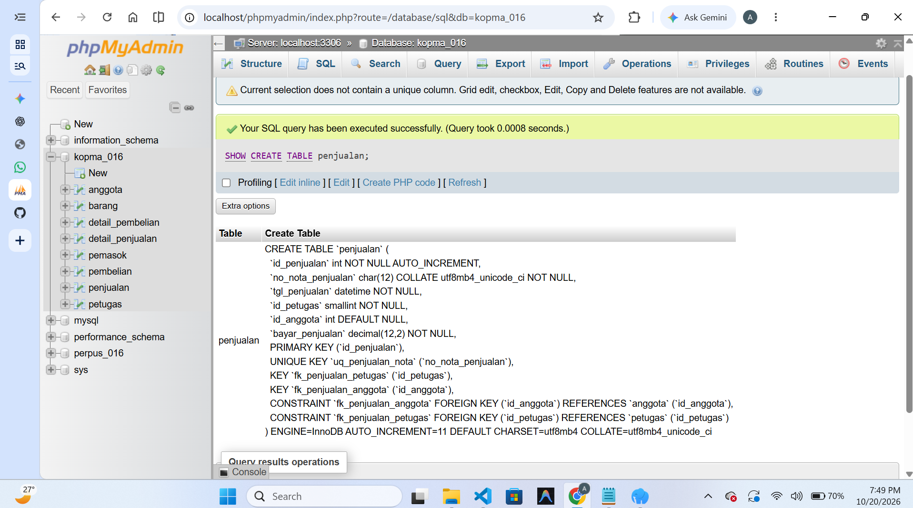

**Gambar 3.5.** Hasil `SHOW CREATE TABLE` pada tabel `penjualan`, yang menunjukkan struktur transaksi dan relasinya dengan tabel lain.

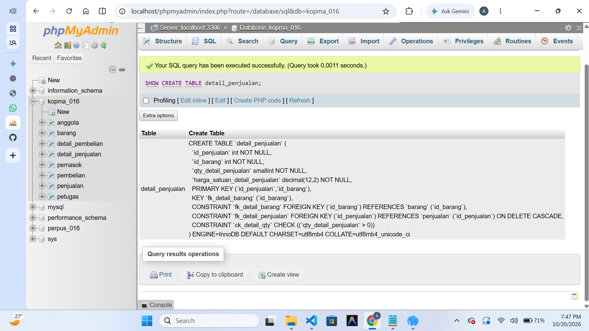

**Gambar 3.6.** Hasil `SHOW CREATE TABLE` pada tabel `detail_penjualan` untuk memeriksa kolom detail dan constraint relasinya.

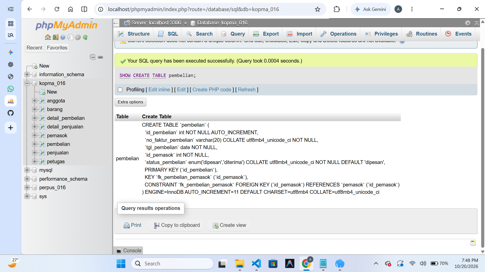

**Gambar 3.7.** Hasil `SHOW CREATE TABLE` pada tabel `pembelian`, yang digunakan untuk mencatat transaksi pembelian barang.

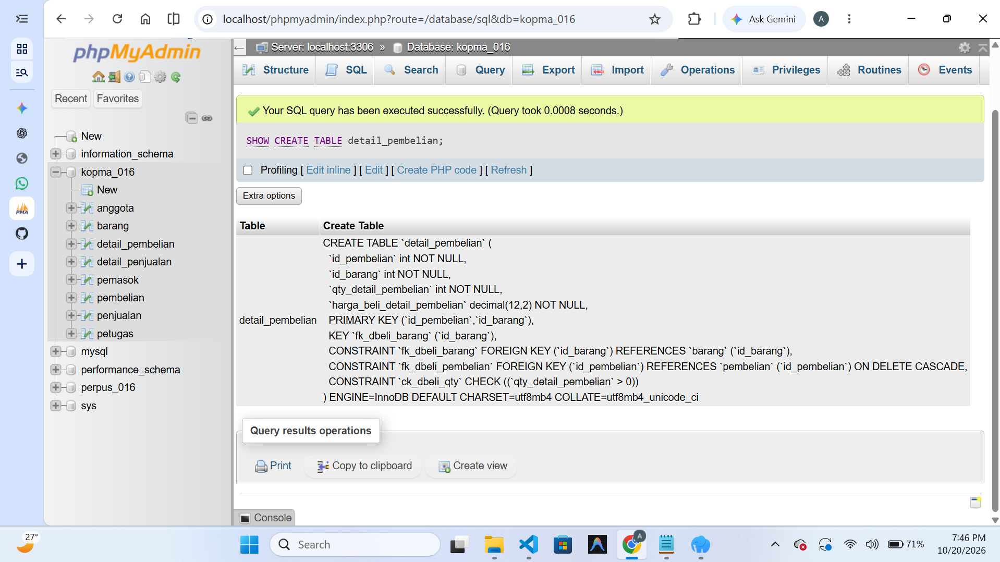

**Gambar 3.8.** Hasil `SHOW CREATE TABLE` pada tabel `detail_pembelian` untuk memeriksa struktur detail pembelian dan hubungan antartabel.

### 3.3 Membuktikan Constraint Bekerja

Pengujian constraint dilakukan dengan mencoba memasukkan atau mengubah data yang tidak sesuai dengan aturan tabel. Pengujian ini meliputi kunci tamu, nilai unik, dan constraint `CHECK`. Pesan hasil eksekusi digunakan untuk mengetahui apakah MariaDB menerima data atau menolaknya karena melanggar aturan yang telah ditentukan.

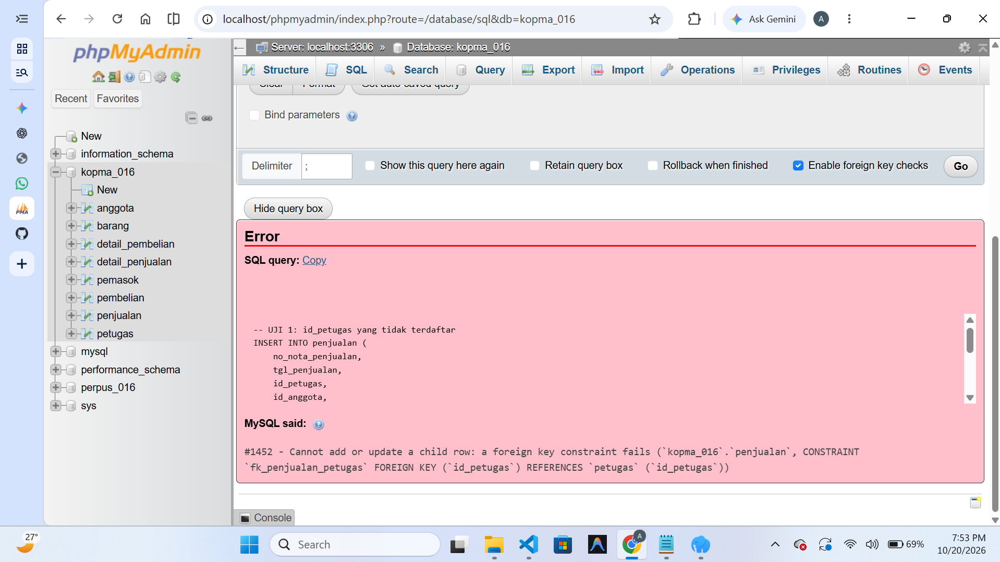

**Gambar 3.9.** Pengujian kunci tamu pada tabel `penjualan` dengan referensi data petugas atau anggota yang tidak sesuai dengan data yang tersedia.

**Gambar 3.10.** Pengujian kunci tamu pada tabel `detail_penjualan` untuk memeriksa penolakan referensi yang tidak valid.

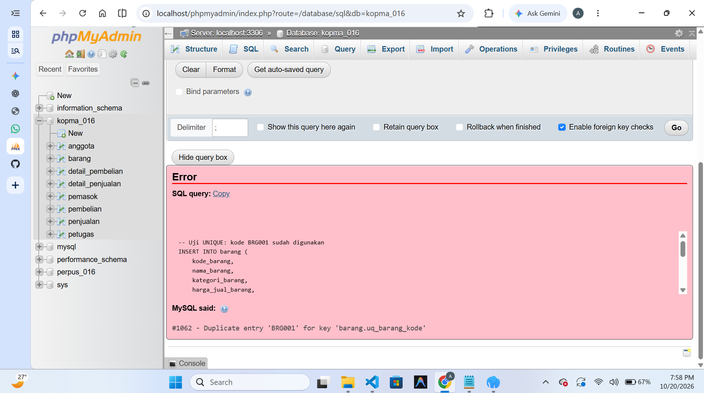

**Gambar 3.11.** Pengujian constraint `UNIQUE` pada `kode_barang` dengan menggunakan kode yang sudah terdaftar.

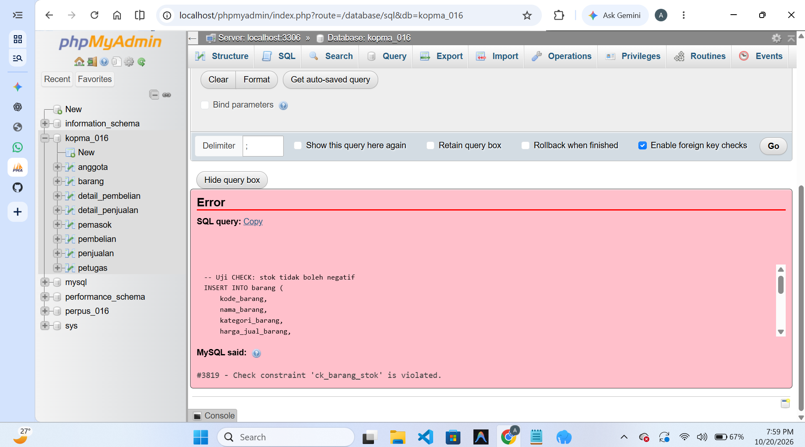

**Gambar 3.12.** Pengujian constraint `CHECK` pada kolom stok dengan mencoba menggunakan nilai stok negatif.

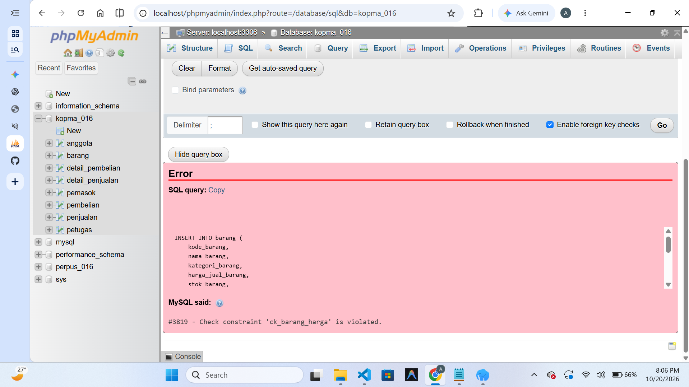

**Gambar 3.13.** Pengujian constraint `CHECK` pada harga jual barang untuk memeriksa apakah nilai yang tidak memenuhi aturan ditolak.

### 3.4 Mengubah Struktur dan Membandingkan dengan ERD

Pada tahap ini, struktur tabel `barang` diubah menggunakan perintah `ALTER TABLE` dengan menambahkan kolom tanggal kedaluwarsa. Setelah perubahan diperiksa, kolom tersebut dihapus kembali menggunakan `ALTER TABLE ... DROP COLUMN`. Tahap ini memperlihatkan bahwa struktur tabel dapat disesuaikan tanpa membuat ulang seluruh tabel.

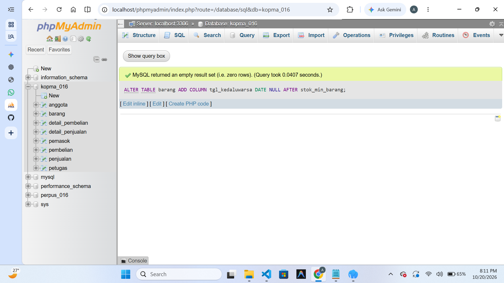

**Gambar 3.14.** Hasil pengujian perubahan struktur tabel `barang` setelah penambahan atau penghapusan kolom.

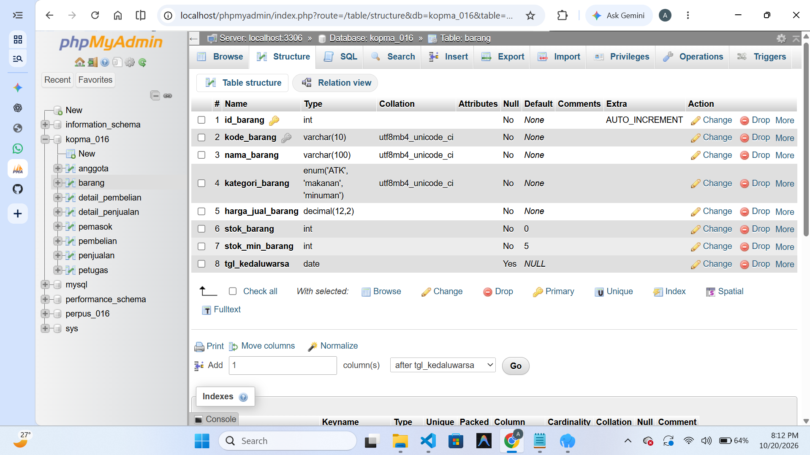

**Gambar 3.15.** Tampilan struktur tabel `barang` setelah perubahan dilakukan dan diperiksa kembali.

Selanjutnya, ERD fisik Kopma diperiksa melalui phpMyAdmin. Pemeriksaan ini digunakan untuk melihat hubungan antartabel yang terbentuk dari struktur basis data yang telah dibuat.

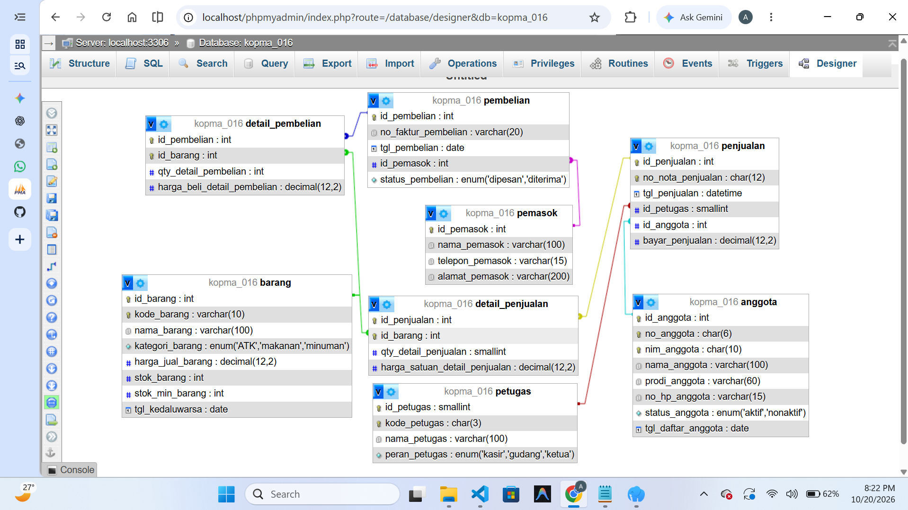

**Gambar 3.16.** ERD fisik Kopma dari phpMyAdmin yang memperlihatkan tabel-tabel dan hubungan antartabel berdasarkan struktur basis data.

## 4. Jawaban Titik Analisis

### 4.1 Titik Analisis 1: Penggunaan ON DELETE CASCADE

Constraint `fk_detail_penjualan` menggunakan `ON DELETE CASCADE` karena setiap baris pada tabel `detail_penjualan` bergantung pada data transaksi di tabel `penjualan`. Jika suatu transaksi dihapus, baris detail yang terkait akan ikut terhapus. Sementara itu, `fk_detail_barang` tidak menggunakan `ON DELETE CASCADE` agar data barang yang masih tercatat dalam detail transaksi tidak dapat dihapus begitu saja.

Jika barang yang pernah dijual dihapus bersama seluruh detailnya, informasi mengenai barang pada transaksi lama dapat hilang. Hal ini dapat menyulitkan pemeriksaan riwayat penjualan dan penyusunan laporan. Oleh karena itu, penghapusan data barang perlu dibatasi apabila barang tersebut masih digunakan dalam transaksi. Dengan demikian, penggunaan `ON DELETE CASCADE` pada relasi detail terhadap penjualan perlu mempertimbangkan kebutuhan penyimpanan riwayat transaksi.

### 4.2 Titik Analisis 2: Pemetaan Kode Galat dan Aturan Bisnis

Berdasarkan pengujian constraint, kode galat yang muncul menunjukkan bahwa MariaDB menolak data yang melanggar aturan tertentu. Pemetaan kode galatnya adalah sebagai berikut.

1. **Kode galat 1452 — pelanggaran foreign key.** Galat ini muncul ketika data transaksi merujuk pada data induk yang tidak tersedia, misalnya `id_petugas` yang belum terdaftar. Constraint foreign key menjaga konsistensi hubungan antartabel, khususnya agar transaksi tidak merujuk pada petugas, anggota, atau barang yang tidak ada.

2. **Kode galat 4025 — pelanggaran CHECK.** Galat ini muncul ketika nilai yang dimasukkan tidak memenuhi kondisi `CHECK`, misalnya stok barang bernilai negatif. Pengujian ini berkaitan dengan **AB-03**, yaitu stok barang tidak boleh negatif. Constraint `CHECK` dapat menolak nilai negatif, tetapi belum cukup untuk memastikan bahwa jumlah barang yang dijual tidak melebihi stok yang tersedia karena aturan tersebut melibatkan data transaksi dan stok yang saling berkaitan.

3. **Kode galat 1062 — pelanggaran nilai unik.** Galat ini muncul ketika nilai yang seharusnya unik dimasukkan kembali, misalnya `kode_barang` yang sudah digunakan. Constraint `UNIQUE` atau `PRIMARY KEY` mencegah terjadinya duplikasi pada kolom yang ditentukan. Aturan ini mendukung keunikan identitas data. Dalam aturan bisnis Kopma, keunikan NIM anggota berkaitan langsung dengan **AB-05**, sedangkan keunikan nomor nota penjualan berkaitan dengan **AB-01**.

Walaupun beberapa aturan sudah dapat dijaga menggunakan constraint, tidak semua aturan bisnis dapat dipenuhi hanya dengan `PRIMARY KEY`, `FOREIGN KEY`, `UNIQUE`, dan `CHECK`. Sebagai contoh, **AB-01** mengharuskan setiap nota memiliki minimal satu baris barang. Foreign key pada tabel `detail_penjualan` hanya memastikan bahwa detail merujuk pada transaksi yang tersedia, bukan memastikan bahwa setiap transaksi pasti mempunyai detail. Aturan ini perlu ditangani melalui logika aplikasi, prosedur tersimpan, atau mekanisme lain yang sesuai.

Selain itu, **AB-02** berkaitan dengan status anggota dan pemberian diskon 5%, sedangkan **AB-06** berkaitan dengan keputusan pemesanan barang ketika stok berada di bawah batas minimum. Keduanya membutuhkan logika proses bisnis tambahan. Dengan demikian, constraint berperan penting untuk menjaga integritas data, tetapi beberapa aturan tetap memerlukan pemeriksaan pada tingkat proses transaksi.

### 4.3 Titik Analisis 3: Urutan DROP TABLE IF EXISTS

Perintah `DROP TABLE IF EXISTS` perlu dimulai dari tabel anak, yaitu `detail_pembelian` dan `detail_penjualan`, sebelum menghapus tabel induk yang dirujuknya. Hal ini karena tabel detail memiliki foreign key yang mengacu pada tabel `pembelian`, `penjualan`, dan `barang`.

Jika urutan penghapusan dibalik, MariaDB dapat menolak penghapusan tabel induk karena masih terdapat tabel lain yang bergantung padanya. Penolakan tersebut menjaga konsistensi hubungan antartabel agar struktur yang masih memiliki referensi tidak dihapus secara sembarangan.

Oleh karena itu, urutan penghapusan tabel harus disusun berkebalikan dengan urutan pembuatannya. Tabel detail dihapus terlebih dahulu, kemudian tabel transaksi, dan terakhir tabel induk yang tidak lagi dirujuk oleh tabel lain. Penggunaan `IF EXISTS` hanya mencegah galat ketika tabel yang hendak dihapus tidak ditemukan; klausa tersebut tidak menghilangkan ketergantungan foreign key.

## 5. Hasil Latihan dan Modifikasi

### 5.1 Menambahkan Constraint CHECK pada `stok_min_barang`

Pada latihan pertama, tabel `barang` dimodifikasi dengan menambahkan constraint `CHECK` untuk memastikan nilai `stok_min_barang` tidak boleh negatif. Aturan ini digunakan agar batas minimum stok barang tetap bernilai nol atau lebih. Setelah constraint ditambahkan, pengujian dilakukan dengan mencoba memasukkan data yang memiliki nilai stok minimum negatif.

Berdasarkan hasil pengujian, MariaDB menolak perintah tersebut dan menampilkan pesan kesalahan bahwa constraint `ck_barang_stok` dilanggar. Hasil ini menunjukkan bahwa constraint `CHECK` bekerja sesuai dengan aturan yang diterapkan pada tabel `barang`.

*Gambar 5.1. Hasil pengujian constraint `CHECK` yang menolak nilai stok minimum negatif pada tabel `barang`.*

### 5.2 Mengubah Foreign Key `fk_penjualan_anggota` menjadi `ON DELETE SET NULL`

Pada latihan kedua, foreign key `fk_penjualan_anggota` pada tabel `penjualan` diubah agar menggunakan aturan `ON DELETE SET NULL`. Dengan aturan ini, penghapusan data anggota tidak menyebabkan transaksi penjualan terkait ikut terhapus. Sebaliknya, nilai `id_anggota` pada transaksi tersebut akan diubah menjadi `NULL`.

Sebelum melakukan penghapusan, data anggota dan transaksi penjualan yang saling terhubung diperiksa terlebih dahulu. Pemeriksaan ini dilakukan untuk memastikan bahwa transaksi yang digunakan sebagai bahan pengujian memang merujuk pada anggota yang akan dihapus.

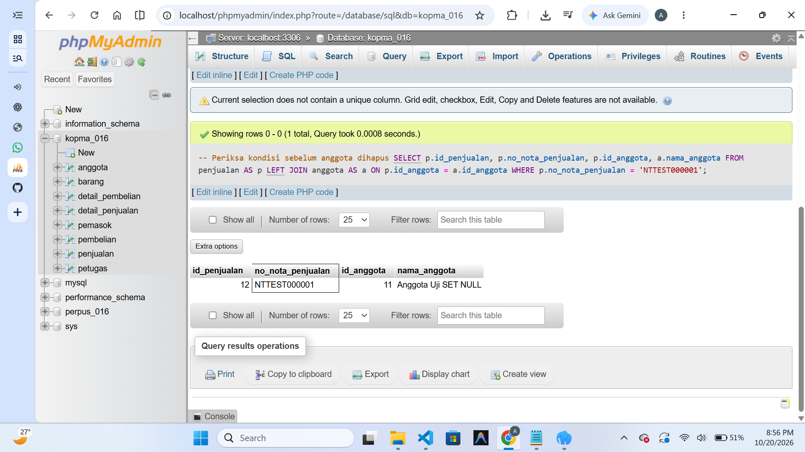

*Gambar 5.2. Data anggota dan transaksi penjualan sebelum penghapusan anggota dilakukan.*

Selanjutnya, struktur tabel `penjualan` diperiksa untuk memastikan bahwa foreign key `fk_penjualan_anggota` telah menggunakan aturan `ON DELETE SET NULL`. Struktur tersebut juga memperlihatkan bahwa kolom `id_anggota` dapat menerima nilai `NULL`, sehingga perubahan nilai dapat dilakukan ketika data anggota dihapus.

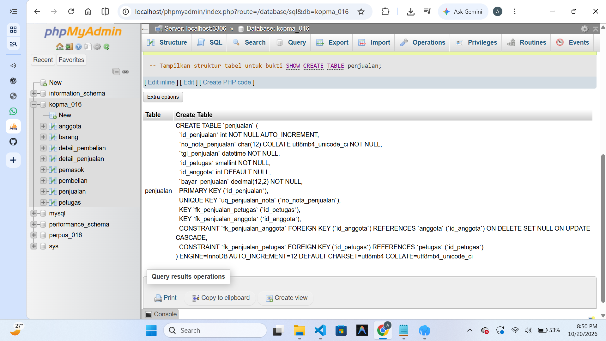

*Gambar 5.3. Struktur tabel `penjualan` yang menunjukkan penerapan `ON DELETE SET NULL` pada foreign key `fk_penjualan_anggota`.*

Setelah data anggota dihapus, transaksi penjualan diperiksa kembali menggunakan perintah `SELECT`. Hasil pemeriksaan menunjukkan bahwa transaksi dengan nomor nota `NTTEST000001` masih tersimpan, sedangkan nilai `id_anggota` berubah menjadi `NULL`. Hal ini membuktikan bahwa aturan `ON DELETE SET NULL` berjalan sesuai dengan perilaku yang diharapkan.

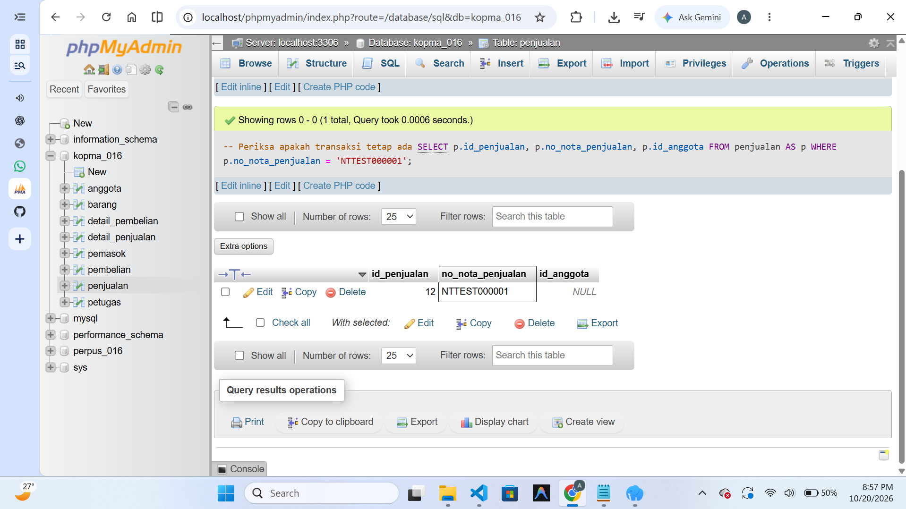

*Gambar 5.4. Hasil pengujian yang menunjukkan transaksi penjualan tetap tersimpan dengan nilai `id_anggota` menjadi `NULL` setelah data anggota dihapus.*

Penerapan aturan ini perlu dipertimbangkan kembali berdasarkan AB-02 dan UU Perlindungan Data Pribadi (UU PDP), sebagaimana diminta dalam modul. Meskipun data transaksi tetap tersimpan, hubungan transaksi dengan anggota yang bersangkutan tidak lagi tercatat melalui kolom `id_anggota`. Oleh karena itu, keputusan menggunakan `ON DELETE SET NULL` perlu mempertimbangkan kebutuhan menjaga riwayat transaksi sekaligus pengelolaan data pribadi anggota.

## 6. Tugas Mandiri: Milestone Proyek

### 6.1 Milestone Pertemuan 5

Pada Pertemuan 5, milestone proyek Perpustakaan Lentera AYP berfokus pada penyusunan dan penerapan Data Definition Language (DDL) berdasarkan rancangan basis data yang telah dibuat pada pertemuan sebelumnya. DDL digunakan untuk membentuk tabel, menentukan tipe data atribut, menetapkan kunci utama (*primary key*) dan kunci tamu (*foreign key*), serta menerapkan constraint sesuai aturan bisnis yang telah ditentukan.

Implementasi DDL dilakukan pada basis data `perpus_016` menggunakan MySQL melalui phpMyAdmin. Struktur basis data terdiri atas tabel anggota, buku, eksemplar, petugas, peminjaman, detail_peminjaman, pengembalian, dan denda. Selain tabel utama tersebut, terdapat view yang digunakan untuk membantu penyajian informasi sesuai kebutuhan.

Penyusunan struktur tabel memperhatikan hubungan antartabel dan konsistensi data. Constraint seperti `PRIMARY KEY`, `FOREIGN KEY`, `UNIQUE`, `NOT NULL`, `DEFAULT`, dan `CHECK` digunakan sesuai kebutuhan masing-masing atribut. Setelah struktur diterapkan, dilakukan pengujian untuk memastikan beberapa aturan dapat menolak data yang tidak sesuai.

Struktur tabel diperiksa menggunakan perintah `SHOW CREATE TABLE` melalui phpMyAdmin. Pemeriksaan ini bertujuan untuk memastikan definisi tabel telah diterapkan pada basis data, termasuk atribut, tipe data, primary key, foreign key, constraint unik, dan constraint pemeriksaan yang digunakan sesuai kebutuhan.

Bukti struktur tabel yang disertakan adalah sebagai berikut.

**Gambar 6.1. Struktur Tabel Anggota**

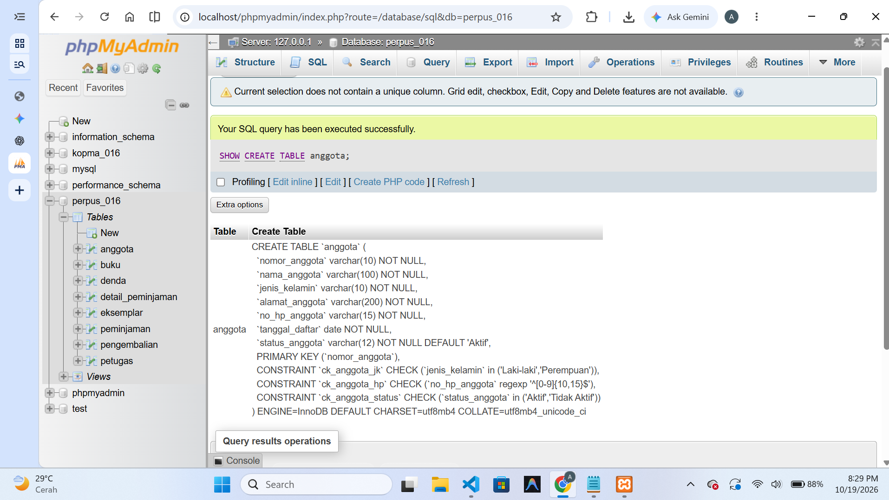

**Gambar 6.2. Struktur Tabel Buku**

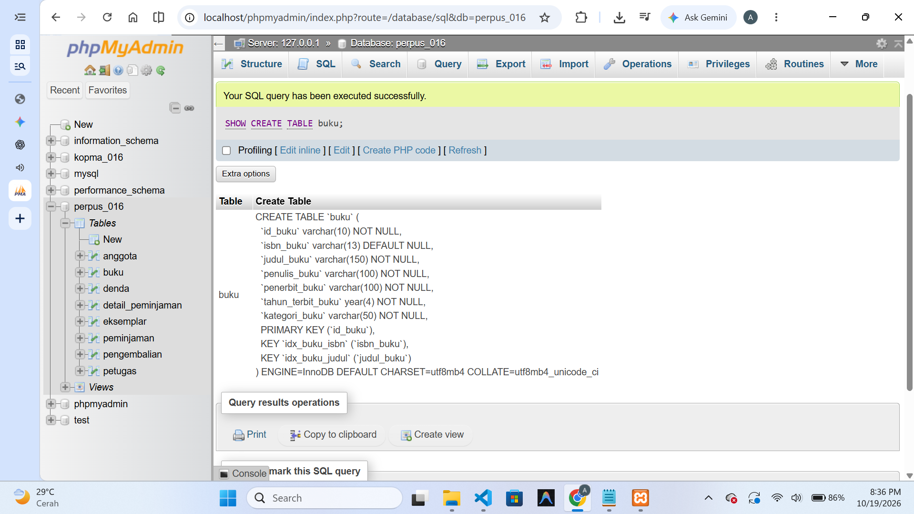

**Gambar 6.3. Struktur Tabel Eksemplar**

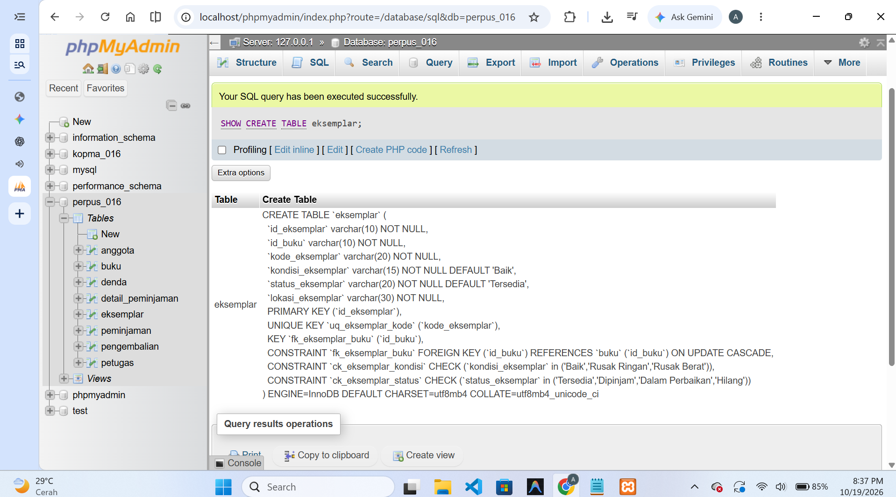

**Gambar 6.4. Struktur Tabel Petugas**

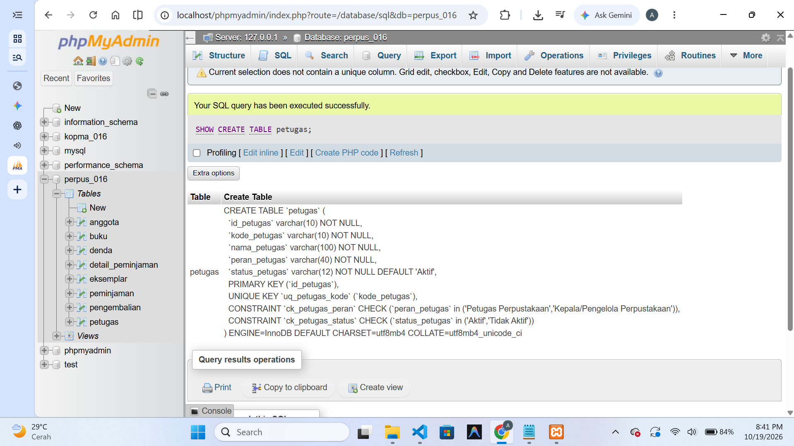

**Gambar 6.5. Struktur Tabel Peminjaman**

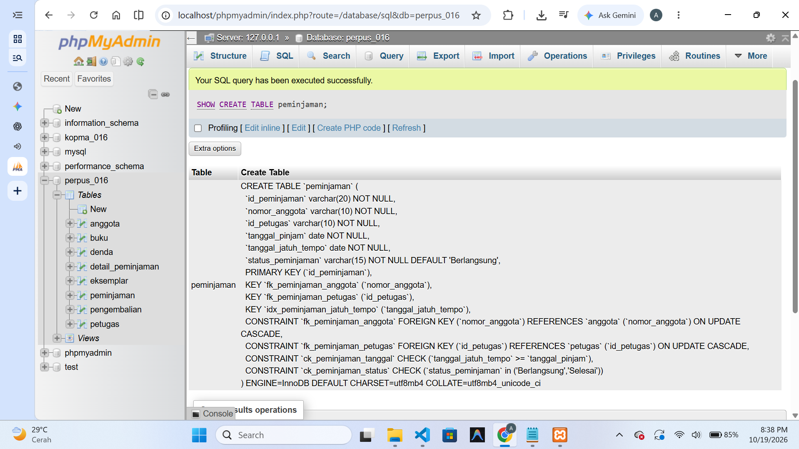

**Gambar 6.6. Struktur Tabel Detail Peminjaman**

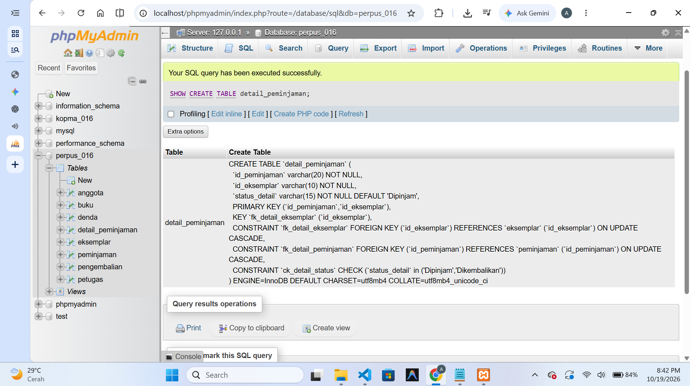

**Gambar 6.7. Struktur Tabel Pengembalian**

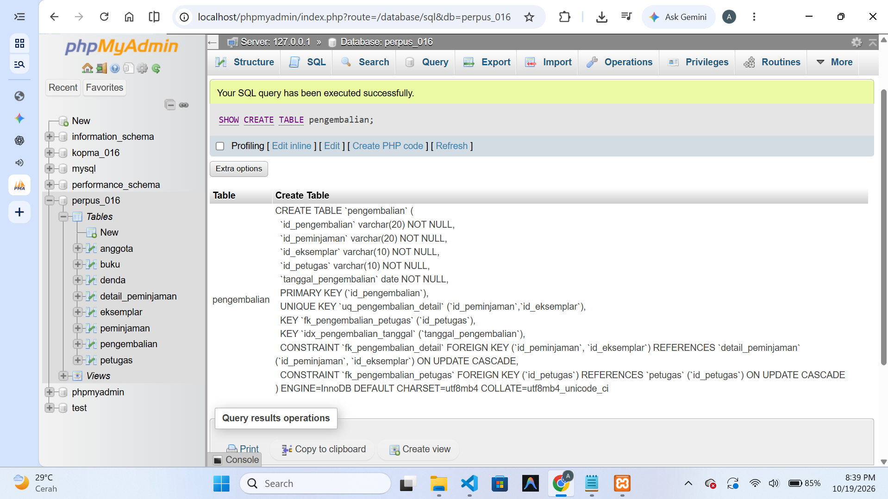

**Gambar 6.8. Struktur Tabel Denda**

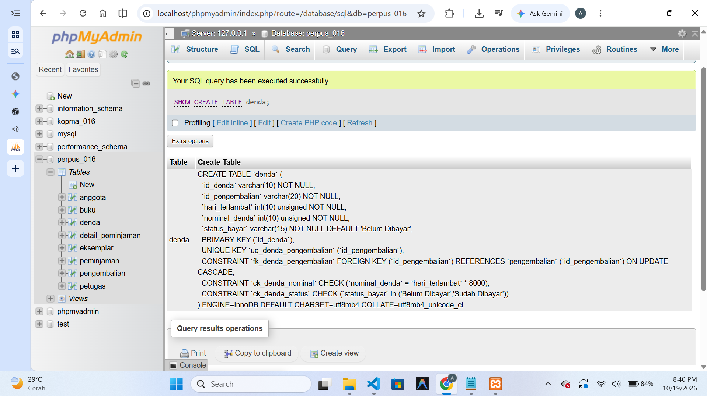

Berdasarkan struktur yang diperiksa, implementasi DDL mencakup delapan tabel utama yang digunakan dalam sistem perpustakaan. Setiap tabel memiliki primary key, sedangkan hubungan antartabel diterapkan menggunakan foreign key. Constraint tambahan digunakan untuk menjaga keunikan data dan membatasi nilai atribut sesuai aturan yang ditetapkan.

### 6.2 Bukti Skrip DDL dan Kemampuan Menjalankan Ulang

Skrip `p05_ddl_25430016.sql` digunakan untuk membuat struktur basis data `perpus_016`. Skrip tersebut memuat pembuatan basis data, definisi tabel, constraint, trigger, view, data contoh, serta kueri pemeriksaan sesuai rancangan proyek.

**Gambar 6.9. Skrip DDL Proyek Perpustakaan Lentera AYP**

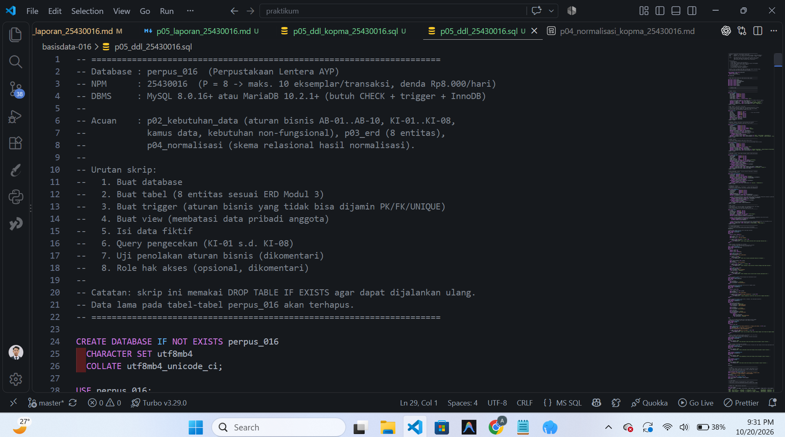

Skrip juga menggunakan perintah `DROP TABLE IF EXISTS` dengan urutan penghapusan tabel anak sebelum tabel induk. Pengaturan ini membantu proses pembangunan ulang struktur tabel ketika skrip dijalankan kembali. Namun, perintah tersebut juga menyebabkan data lama pada tabel yang dihapus ikut terhapus sehingga skrip perlu dijalankan dengan memperhatikan basis data yang digunakan.

**Gambar 6.10. Keterangan Skrip DDL Dapat Dijalankan Ulang**

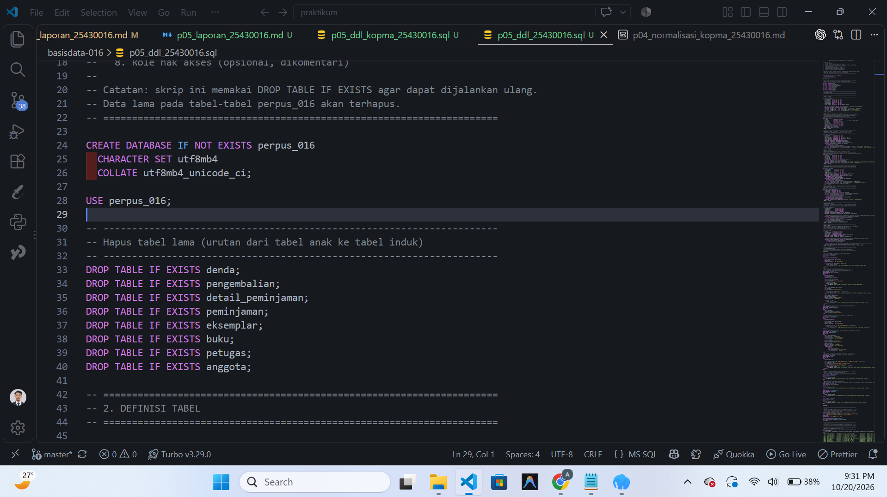

### 6.3 Bukti Pengujian Constraint

Pengujian constraint dilakukan untuk memeriksa apakah basis data menolak data yang tidak memenuhi ketentuan. Pengujian ini mencakup `CHECK`, `UNIQUE`, dan `FOREIGN KEY`. Ketiga jenis constraint tersebut memiliki fungsi yang berbeda dalam menjaga konsistensi data.

**Gambar 6.11. Pengujian Constraint CHECK**

Constraint `CHECK` digunakan untuk membatasi nilai atribut agar memenuhi kondisi yang ditentukan. Pengujian ini dilakukan dengan memberikan nilai yang melanggar kondisi constraint. Apabila basis data menolak perintah tersebut, hasilnya menunjukkan bahwa constraint bekerja untuk kondisi yang diuji.

**Gambar 6.12. Pengujian Constraint UNIQUE**

Constraint `UNIQUE` digunakan untuk mencegah duplikasi nilai pada kolom atau kombinasi kolom yang ditetapkan unik. Pengujian dilakukan dengan memasukkan nilai duplikat pada atribut yang memiliki constraint tersebut. Penolakan oleh basis data menunjukkan bahwa keunikan data berhasil dijaga pada pengujian tersebut.

**Gambar 6.13. Pengujian Constraint FOREIGN KEY**

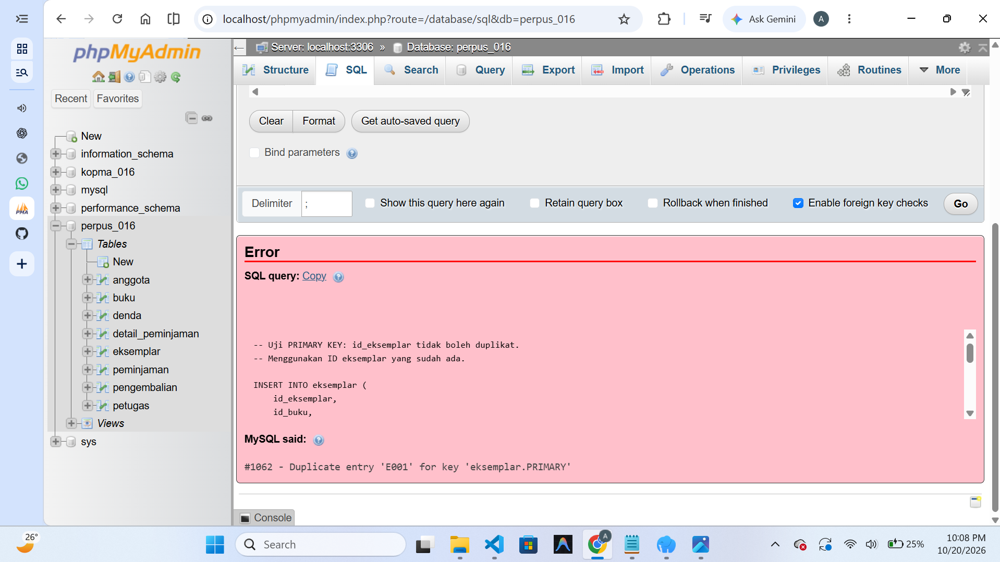

Constraint `FOREIGN KEY` digunakan untuk menjaga integritas referensial antara tabel yang saling berhubungan. Pengujian dilakukan dengan memasukkan nilai kunci tamu yang tidak memiliki pasangan pada tabel induk. Apabila perintah ditolak, hasil tersebut menunjukkan bahwa hubungan antartabel telah dilindungi oleh foreign key pada kasus yang diuji.

### 6.4 Analisis Hasil Pengujian

Berdasarkan bukti struktur tabel dan pengujian yang disertakan, implementasi DDL proyek Perpustakaan Lentera AYP telah mencakup struktur tabel dan mekanisme constraint yang diperlukan. Primary key berfungsi sebagai identitas setiap data, foreign key menjaga hubungan antartabel, `UNIQUE` mencegah duplikasi pada atribut yang ditetapkan unik, sedangkan `CHECK` membatasi nilai atribut sesuai ketentuan.

Skrip DDL juga disusun agar struktur basis data dapat dibangun ulang melalui satu berkas SQL. Meskipun demikian, keberhasilan implementasi tidak hanya ditentukan oleh keberadaan definisi constraint, tetapi juga oleh hasil pengujian terhadap data yang memenuhi dan melanggar ketentuannya. Oleh karena itu, bukti pada bagian ini digunakan untuk mendokumentasikan struktur yang diterapkan dan hasil pengujian constraint yang dilakukan.

## 7. Pembahasan dan Kendala

### 7.1 Pembahasan

Pada Pertemuan 5, saya mempelajari penerapan DDL (*Data Definition Language*) untuk membangun struktur basis data berdasarkan rancangan proyek Perpustakaan Lentera AYP. Tahap ini menjadi lanjutan dari proses perancangan ERD dan normalisasi yang telah dikerjakan pada pertemuan sebelumnya. Rancangan tersebut kemudian diterapkan ke dalam delapan tabel, yaitu `anggota`, `buku`, `eksemplar`, `petugas`, `peminjaman`, `detail_peminjaman`, `pengembalian`, dan `denda`.

Dalam proses pembuatannya, setiap tabel dilengkapi dengan kunci primer sebagai identitas data. Hubungan antartabel diatur menggunakan *foreign key* agar data transaksi merujuk pada data yang tersedia. Selain itu, constraint `UNIQUE` digunakan untuk mencegah nilai tertentu tercatat lebih dari satu kali, sedangkan `CHECK` digunakan untuk membatasi nilai atribut sesuai ketentuan yang telah ditentukan. Penerapan constraint ini membantu menjaga konsistensi data sejak proses penyimpanan, bukan hanya mengandalkan ketelitian pengguna saat memasukkan data.

Skrip DDL juga memuat trigger untuk menerapkan aturan bisnis yang tidak cukup dijamin hanya dengan kunci primer, kunci tamu, atau constraint unik. Salah satu contohnya adalah aturan bahwa anggota harus berstatus aktif agar dapat melakukan peminjaman. Pada bagian denda, terdapat pula ketentuan bahwa nominal denda harus sesuai dengan jumlah hari keterlambatan dikalikan tarif Rp8.000 per hari. Dengan demikian, aturan bisnis yang sebelumnya ditulis dalam dokumen kebutuhan data mulai diterapkan dalam struktur dan mekanisme basis data.

Pemeriksaan struktur dilakukan melalui perintah `SHOW CREATE TABLE` pada phpMyAdmin. Hasil pemeriksaan ini dapat digunakan untuk melihat definisi tabel yang telah dibuat, termasuk tipe data dan constraint yang diterapkan. Pengujian terhadap `CHECK`, `UNIQUE`, dan `FOREIGN KEY` juga penting karena keberadaan constraint pada skrip saja belum cukup untuk membuktikan bahwa aturan tersebut benar-benar menolak data yang tidak sesuai. Hasil pengujian perlu dilihat dari respons basis data ketika diberikan masukan yang melanggar ketentuan.

Skrip juga disusun agar proses pembangunan ulang dapat dilakukan dengan urutan yang sesuai. Perintah `DROP TABLE IF EXISTS` digunakan untuk menghapus tabel lama sebelum tabel dibuat kembali, dengan memperhatikan hubungan antara tabel anak dan tabel induk. Cara ini memudahkan pengulangan proses implementasi, tetapi perlu digunakan dengan hati-hati karena data lama pada tabel yang dihapus akan ikut hilang.

### 7.2 Kendala dan Penyelesaian

Salah satu hal yang perlu diperhatikan selama implementasi adalah kesesuaian antara rancangan tabel dan definisi SQL. Penentuan tipe data, kunci primer, serta kolom yang menjadi *foreign key* harus dilakukan secara konsisten. Jika tipe data atau atribut yang dirujuk tidak sesuai, proses pembuatan hubungan antartabel dapat mengalami kesalahan. Oleh karena itu, struktur setiap tabel perlu diperiksa kembali sebelum seluruh skrip dijalankan.

Kendala lainnya adalah memastikan bahwa constraint tidak hanya berhasil dibuat, tetapi juga bekerja sesuai tujuannya. Pengujian perlu dilakukan dengan membandingkan data yang memenuhi aturan dan data yang melanggarnya. Sebagai contoh, pengujian `UNIQUE` menggunakan nilai yang sudah tercatat, sedangkan pengujian `FOREIGN KEY` menggunakan nilai referensi yang tidak tersedia pada tabel induk. Untuk `CHECK`, nilai masukan harus dipilih agar benar-benar melanggar kondisi yang ditetapkan. Hasil pengujian tersebut kemudian didokumentasikan melalui tangkapan layar.

Selain itu, penggunaan perintah untuk membangun ulang basis data perlu diperhatikan karena penghapusan tabel dapat menghilangkan data yang sudah tersimpan. Urutan penghapusan juga harus mempertimbangkan hubungan antartabel agar tidak terhambat oleh constraint referensial. Untuk mengurangi risiko tersebut, skrip perlu diperiksa sebelum dijalankan dan sebaiknya diuji pada basis data pengujian yang tidak berisi data penting.

Dari proses ini, saya memahami bahwa pembuatan basis data bukan hanya menuliskan perintah SQL sampai berhasil dijalankan. Struktur tabel harus sesuai dengan rancangan, aturan bisnis perlu diterapkan pada bagian yang tepat, dan constraint harus diuji menggunakan skenario yang sesuai. Dokumentasi berupa hasil `SHOW CREATE TABLE` dan pengujian constraint menjadi bagian penting untuk menunjukkan bahwa implementasi telah diperiksa, bukan sekadar dibuat.

## 8. Kesimpulan

Berdasarkan praktikum yang telah dilakukan, saya memahami bahwa pembuatan basis data tidak hanya berfokus pada pembentukan tabel, tetapi juga perlu memperhatikan hubungan antartabel dan aturan yang berlaku pada data. Pada proyek Perpustakaan Lentera AYP, rancangan yang telah dibuat pada pertemuan sebelumnya diterapkan menggunakan perintah SQL DDL ke dalam delapan tabel yang saling berhubungan.

Penggunaan *primary key*, *foreign key*, `UNIQUE`, dan `CHECK` membantu menjaga agar data yang disimpan tetap sesuai dengan ketentuan yang telah ditentukan. Selain itu, penerapan trigger digunakan untuk menangani beberapa aturan bisnis yang memerlukan pemeriksaan lebih lanjut. Struktur tabel yang telah dibuat dapat diperiksa melalui perintah `SHOW CREATE TABLE`, sedangkan pengujian constraint diperlukan untuk mengetahui apakah aturan tersebut berjalan sesuai dengan tujuannya.

Melalui praktikum ini, saya memperoleh pemahaman bahwa keberhasilan pembuatan basis data tidak cukup dinilai dari skrip yang berhasil dijalankan. Struktur yang dibuat juga harus sesuai dengan rancangan, aturan bisnis perlu diterapkan secara tepat, dan hasilnya perlu diperiksa melalui pengujian. Dengan demikian, implementasi DDL menjadi salah satu tahap penting untuk membangun basis data perpustakaan yang terstruktur dan menjaga konsistensi data.

## 9. Pernyataan Penggunaan AI

Dalam pengerjaan praktikum ini, saya menggunakan ChatGPT sebagai alat bantu untuk memahami beberapa bagian skrip SQL, memeriksa kesesuaian struktur tabel dan aturan bisnis, serta membantu menyusun penjelasan hasil praktikum ke dalam laporan. Bantuan AI digunakan sebagai pendamping selama proses pengerjaan, bukan sebagai pengganti proses pemeriksaan dan pengujian yang saya lakukan sendiri.

Skrip SQL tetap saya periksa kembali melalui VS Code dan phpMyAdmin untuk melihat struktur tabel serta hasil penerapan perintah yang dijalankan. Saya bertanggung jawab atas isi skrip, hasil pengujian, dan laporan yang dikumpulkan.

## 10. Bukti Git

Repositori GitHub digunakan untuk menyimpan berkas praktikum Basis Data, termasuk skrip SQL dan laporan Pertemuan 5. Melalui Git, perubahan berkas dapat tercatat dalam riwayat commit sehingga proses pengerjaan dapat diperiksa kembali.

- **Tautan repositori:** https://github.com/arya-yoga-pratama/basisdata-25430016
- **Hash commit:** `c95e61905b8b2a4fc746dc3e1c3e320c6f25743f`
- **Skrip DDL:** `p05_ddl_25430016.sql`
- **Laporan praktikum:** `p05_laporan_25430016.md`

Hash commit tersebut diperoleh melalui perintah `git log -1 --format="%H"` dan menunjukkan commit terakhir yang tercatat pada repositori lokal saat pemeriksaan dilakukan.