# Laporan Praktikum Basis Data - Pertemuan 6

**Nama:** Arya Yoga Pratama  
**NPM:** 25430016  
**Kelas:** A  
**Tanggal:** 31 Oktober 2026  
**Dosen:** Dedi Irawan, S.Kom., M.T.I.

**Basis data:** `kopma_016` (studi kasus Kopma) dan `perpus_016` (proyek Perpustakaan Lentera AYP)   **Parameter P:** 8

---

## 1. Tujuan Praktikum

1. Mengisi data ke tabel dengan `INSERT` satu baris, banyak baris, dan `INSERT ... SELECT`.
2. Mengubah dan menghapus data secara aman dengan `UPDATE`/`DELETE` dan mode `sql_safe_updates`.
3. Menyusun dan menjalankan skenario uji positif dan negatif, lalu mencatat hasil nyatanya.
4. Menyiapkan data sampel proyek yang dapat dibangun ulang dari skrip dengan hasil yang sama.

## 2. Ringkasan Dasar Teori

DML (`INSERT`, `UPDATE`, `DELETE`, `SELECT`) dipakai untuk mengelola isi tabel. Karena ada kunci tamu, pengisian harus berurutan dari tabel induk ke tabel anak, sedangkan penghapusan dilakukan sebaliknya, kecuali relasi memakai `ON DELETE CASCADE`.

`UPDATE` atau `DELETE` tanpa `WHERE` mengenai seluruh baris dan tidak menimbulkan galat, sehingga berbahaya. Variabel `sql_safe_updates` membuat server menolak perintah seperti itu (ERROR 1175) kecuali `WHERE` memakai kolom kunci atau ada `LIMIT`.

Pengujian basis data terdiri atas uji positif (data benar harus diterima) dan uji negatif (data salah harus ditolak dengan galat yang tepat). Setiap uji dicatat dalam format tetap: kode, masukan, hasil yang diharapkan, hasil nyata, dan status, sehingga orang lain dapat mengulanginya. Aturan yang tidak bisa dijaga oleh constraint (misalnya aturan yang melibatkan lebih dari satu tabel) akan muncul sebagai uji yang gagal dan dicatat sebagai utang desain.

## 3. Hasil Langkah Percobaan

Percobaan dijalankan lewat phpMyAdmin pada basis data `kopma_016`. 

### D.1 Mengisi data induk

Skrip `p06_data_kopma_25430016.sql` dijalankan setelah DDL Modul 5 (`p05_ddl_kopma_25430016.sql`). Data induk diisi dengan `INSERT` banyak baris: 5 petugas, 8 barang (4 baris pertama sama dengan contoh buku), 7 anggota (3 di antaranya `nonaktif`), dan 3 pemasok.

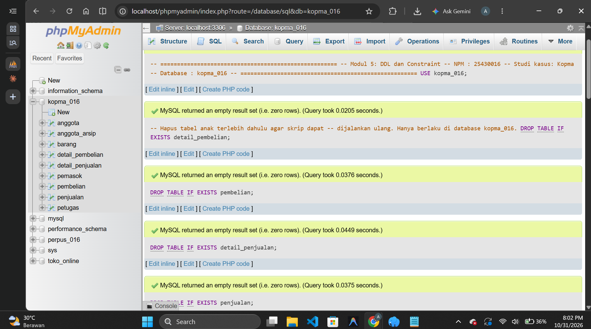

*Gambar 1. DDL Modul 5 berhasil diimpor ke `kopma_016`.*

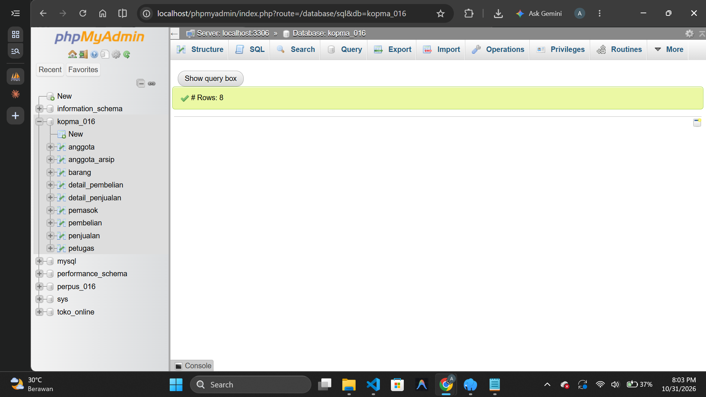

*Gambar 2. Skrip data Modul 6 berhasil diimpor tanpa galat (kotak "Enable foreign key checks" tetap tercentang).*

### D.2 Mencatat nota penjualan

Nota contoh `PJ-2609-0142` dicatat sebagai `id_penjualan = 1`. Detailnya diisi dengan `INSERT ... SELECT` sehingga harga satuan disalin dari `barang.harga_jual_barang` (AB-04). Tujuh nota lain dicatat pada tanggal 22 sampai 25 September 2026, lalu stok tiap barang dikurangi dengan `UPDATE ... WHERE id_barang = ...`. Tiga pembelian dari pemasok juga dicatat.

```sql
INSERT INTO detail_penjualan (id_penjualan, id_barang, qty_detail_penjualan, harga_satuan_detail_penjualan)
SELECT p.id_penjualan, b.id_barang, 3, b.harga_jual_barang
FROM penjualan p JOIN barang b ON b.kode_barang = 'ATK-001'
WHERE p.no_nota_penjualan = 'PJ-2609-0142';
```

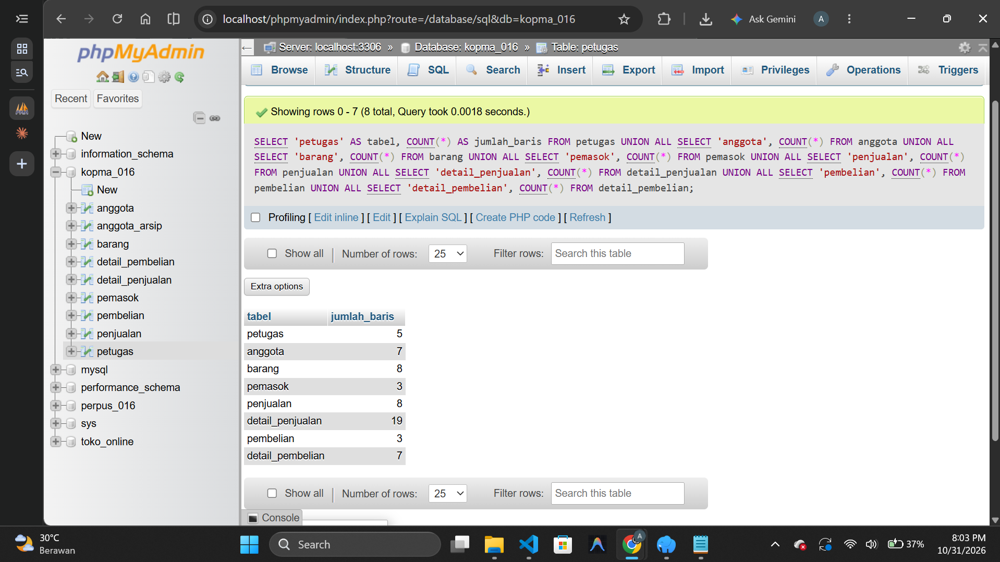

*Gambar 3. Jumlah baris per tabel setelah data diisi.*

| Tabel | Jumlah baris |
|---|---|
| petugas | 5 |
| anggota | 7 (3 nonaktif) |
| barang | 8 |
| pemasok | 3 |
| penjualan | 8 |
| detail_penjualan | 19 |
| pembelian | 3 |
| detail_pembelian | 7 |

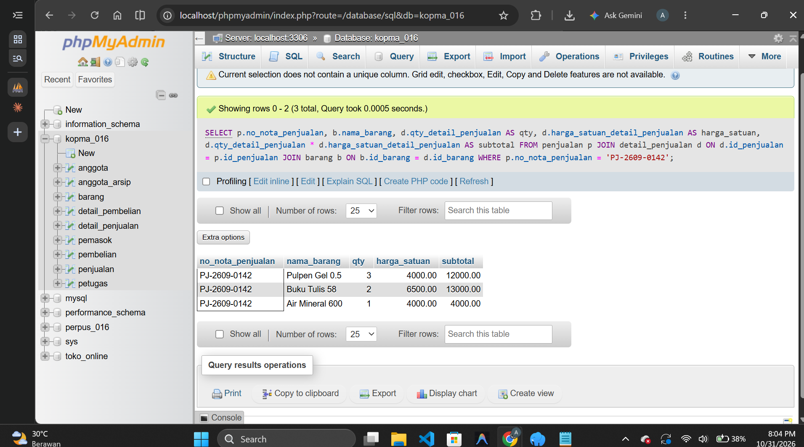

*Gambar 4. Nota `PJ-2609-0142` terdiri atas tiga baris: pulpen 3 × 4.000, buku tulis 2 × 6.500, air mineral 1 × 4.000. Total Rp29.000 (dibayar Rp30.000).*

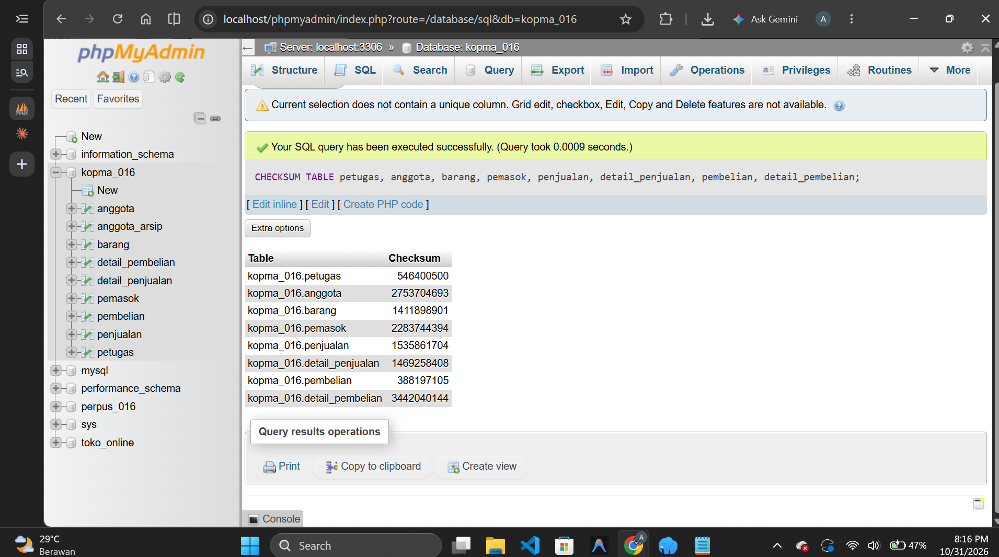

*Gambar 5. `CHECKSUM TABLE` untuk delapan tabel sebelum percobaan apa pun. Nilai ini dipakai sebagai pembanding setelah pembangunan ulang (Gambar 21).*

### D.3 Mengubah dan menghapus dengan aman

**Langkah 5, mode aman.** `UPDATE` tanpa `WHERE` ditolak dengan ERROR 1175. `UPDATE` dengan `WHERE kategori_barang = 'ATK' AND id_barang > 0` diterima karena memuat kolom kunci.

```sql
SET SESSION sql_safe_updates = 1;
UPDATE barang SET harga_jual_barang = harga_jual_barang * 1.1;   -- ditolak (1175)
UPDATE barang SET harga_jual_barang = harga_jual_barang * 1.1
WHERE kategori_barang = 'ATK' AND id_barang > 0;                 -- diterima
```

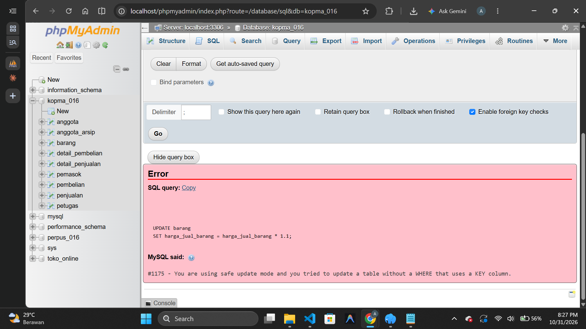

*Gambar 6. `UPDATE` tanpa `WHERE` ditolak oleh mode aman (ERROR 1175).*

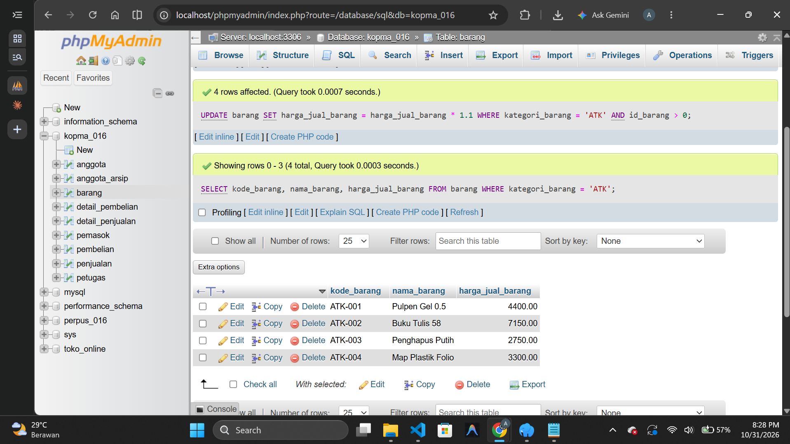

*Gambar 7. `UPDATE` dengan `WHERE` pada kolom kunci diterima; harga barang ATK naik 10% (pulpen menjadi 4.400).*

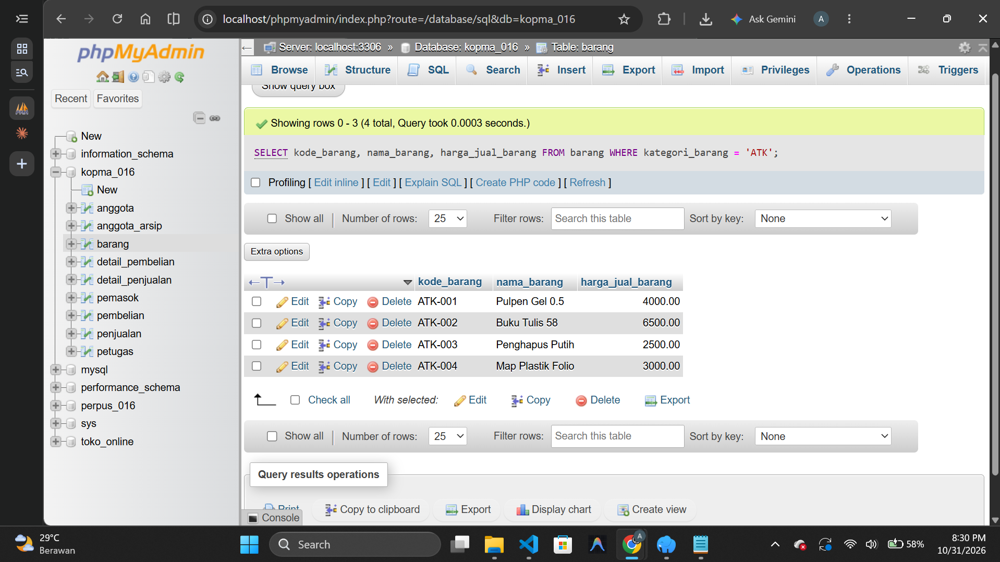

*Gambar 8. Perubahan dibatalkan dengan `ROLLBACK`, harga kembali ke nilai awal sehingga data sampel tetap bersih.*

**Langkah 6, `ON DELETE CASCADE` dan hapus petugas.** Dibuat nota uji `PJ-2609-9999` beserta satu detail (9 nota dan 20 detail). Setelah nota itu dihapus, detailnya ikut terhapus (kembali 8 nota dan 19 detail). Penghapusan petugas Rina (`id_petugas = 3`) yang pernah melayani penjualan ditolak dengan ERROR 1451.

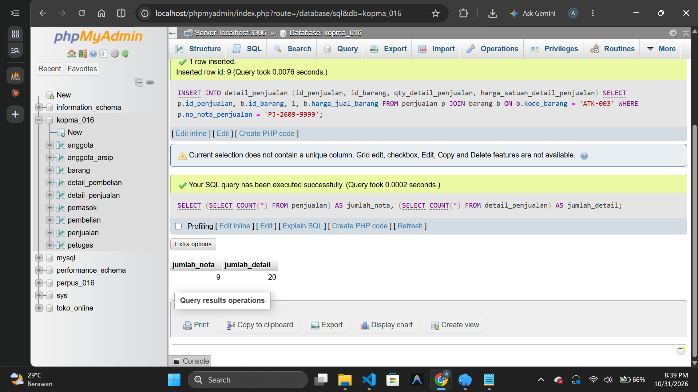

*Gambar 9. Setelah nota uji dibuat: 9 nota dan 20 detail.*

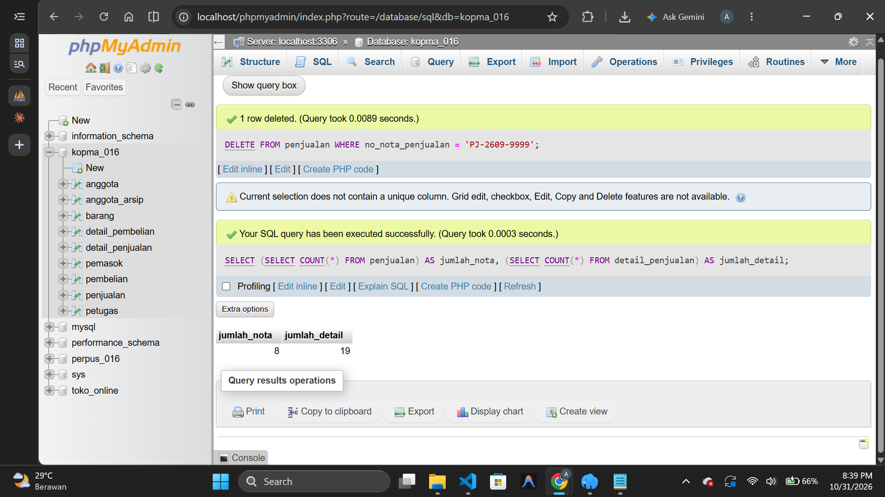

*Gambar 10. Setelah nota uji dihapus: 8 nota dan 19 detail. Baris detail ikut terhapus karena `ON DELETE CASCADE`.*

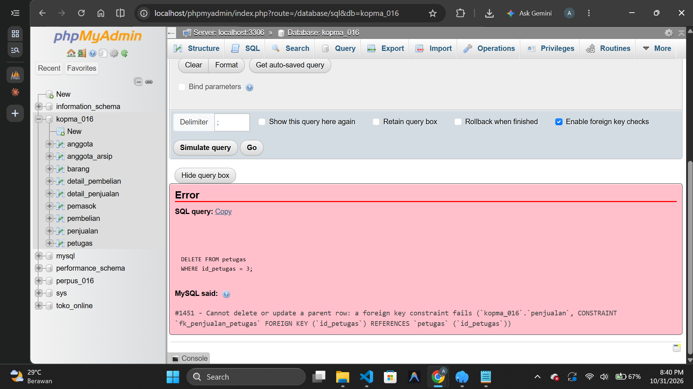

*Gambar 11. `DELETE FROM petugas WHERE id_petugas = 3` ditolak (ERROR 1451) oleh `fk_penjualan_petugas`.*

### D.4 Menjalankan skenario uji

Delapan skenario dijalankan satu per satu dan didokumentasikan pada `p06_uji_kopma_25430016.md`. Server menampilkan ERROR **3819** untuk pelanggaran `CHECK` (kode versi MySQL 8.0.16 ke atas), sedangkan contoh buku memakai ERROR 4025 (kode MariaDB). Perbedaan ini hanya pada nomor galat; constraint yang menolak tetap sama.

| Kode | Masukan | Hasil yang diharapkan | Hasil nyata | Aturan | Status |
|---|---|---|---|---|---|
| UJ-01 | Nota penjualan baru dengan anggota aktif | Diterima | Diterima dengan nomor nota `NT1001`. Percobaan pertama gagal (ERROR 1406, nomor nota terlalu panjang), lalu berhasil setelah nomor diperbaiki. | AB-02 | PASS |
| UJ-02 | Nota tanpa anggota (umum) | Diterima, `id_anggota` NULL | Nota `NT1002` diterima dengan `id_anggota = NULL`. | AB-02 | PASS |
| UJ-03 | Stok diubah menjadi `-5` | Ditolak | ERROR 3819, `ck_barang_stok` dilanggar; stok tetap. | AB-03 | PASS |
| UJ-04 | Nota dengan nomor yang sudah ada | Ditolak, ERROR 1062 | ERROR 1062, nomor `NT1001` melanggar `uq_penjualan_nota`. | AB-01 | PASS |
| UJ-05 | Detail penjualan dengan qty `0` | Ditolak | ERROR 3819, `ck_detail_qty` dilanggar. | `ck_detail_qty` | PASS |
| UJ-06 | Anggota dengan NIM yang sudah terdaftar | Ditolak, ERROR 1062 | ERROR 1062, NIM `2543001601` melanggar `uq_anggota_nim`. | AB-05 | PASS |
| UJ-07 | Penjualan oleh petugas tidak dikenal (`id_petugas = 999`) | Ditolak, ERROR 1452 | ERROR 1452, `id_petugas = 999` tidak ada di tabel `petugas`. | `fk_penjualan_petugas` | PASS |
| UJ-08 | `UPDATE` tanpa `WHERE` pada mode aman | Ditolak, ERROR 1175 | ERROR 1175, ditolak oleh safe update mode. | kebijakan lab | PASS |

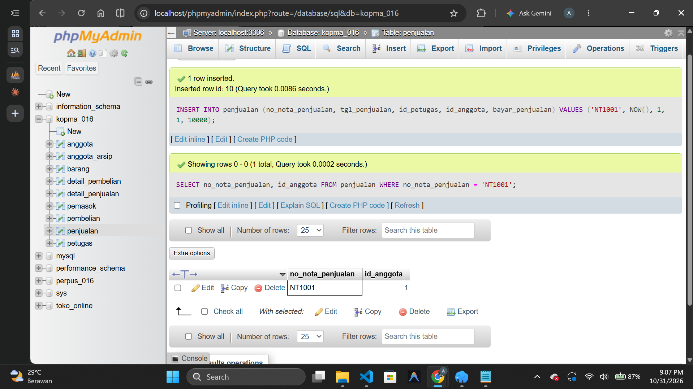

*Gambar 12. UJ-01: nota dengan anggota aktif diterima.*

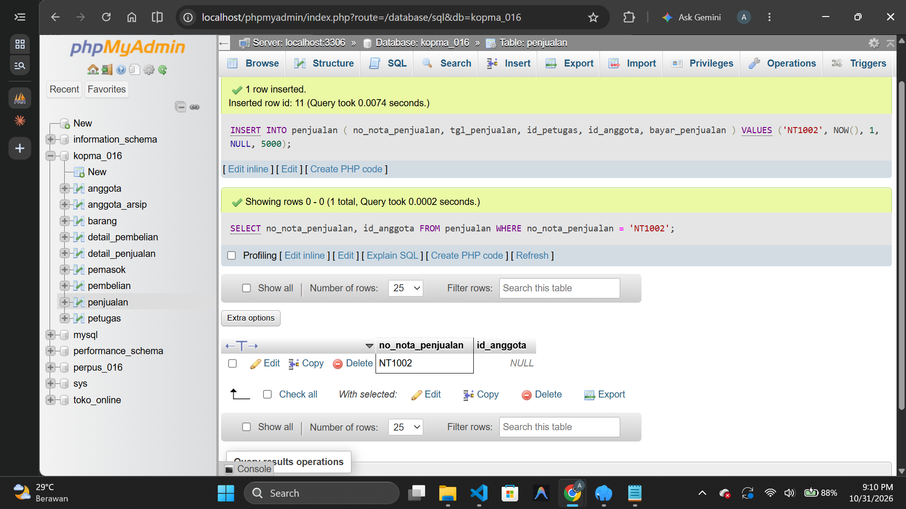

*Gambar 13. UJ-02: nota tanpa anggota diterima dengan `id_anggota` NULL.*

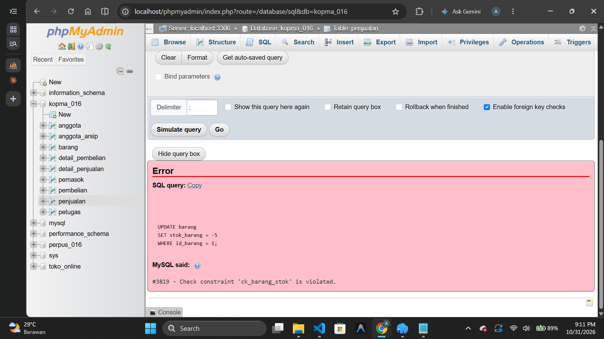

*Gambar 14. UJ-03: stok `-5` ditolak oleh `ck_barang_stok`.*

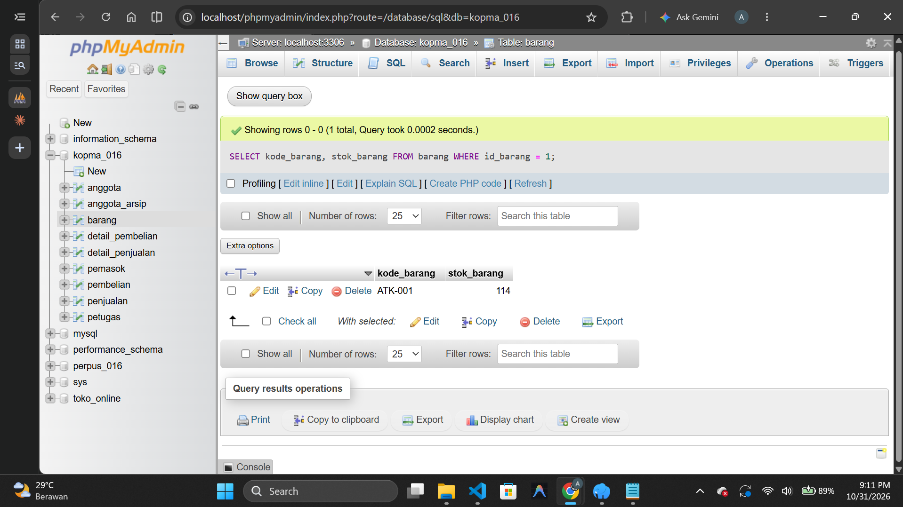

*Gambar 15. UJ-03: stok barang tidak berubah setelah penolakan.*

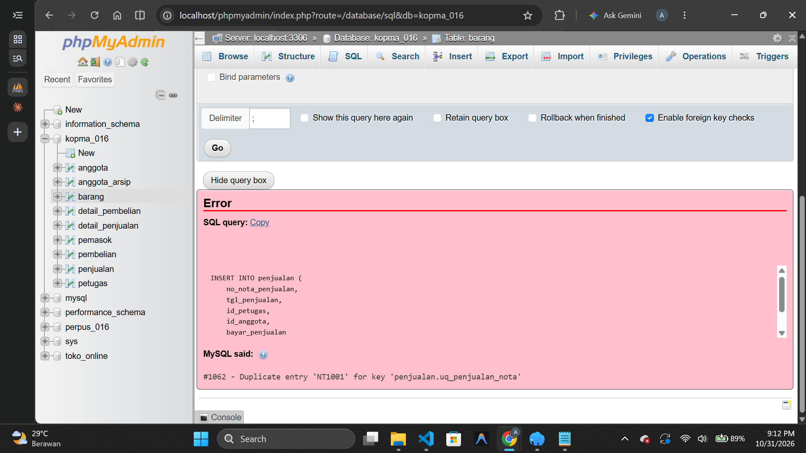

*Gambar 16. UJ-04: nomor nota ganda ditolak (ERROR 1062).*

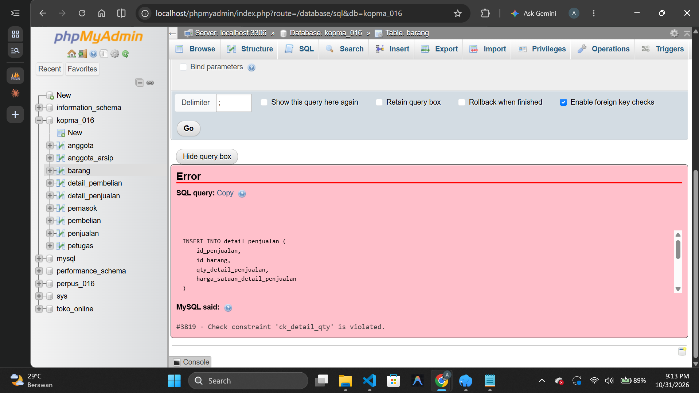

*Gambar 17. UJ-05: qty 0 ditolak oleh `ck_detail_qty`.*

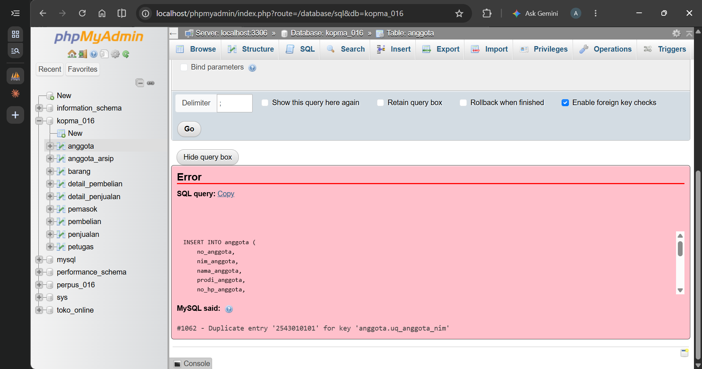

*Gambar 18. UJ-06: NIM ganda ditolak (ERROR 1062).*

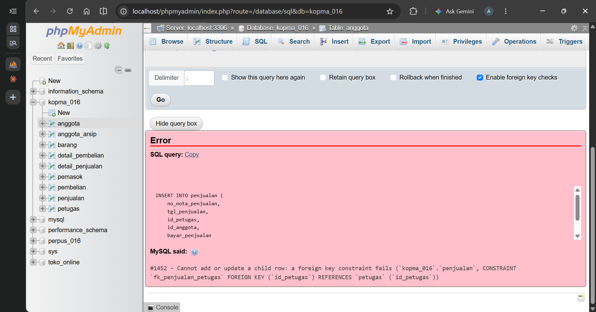

*Gambar 19. UJ-07: petugas tidak dikenal ditolak (ERROR 1452).*

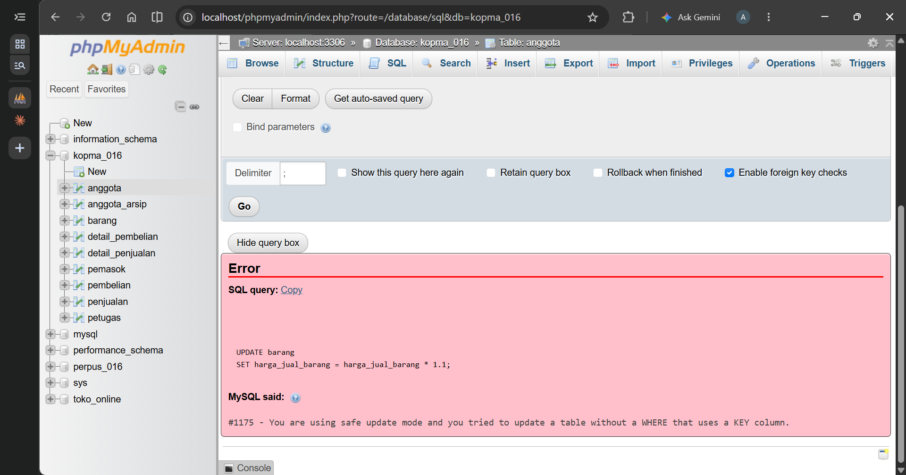

*Gambar 20. UJ-08: `UPDATE` tanpa `WHERE` ditolak mode aman (ERROR 1175).*

**Langkah 8, bangun ulang dari awal.** DDL Modul 5 dan data Modul 6 dijalankan ulang dari awal. Nilai `CHECKSUM TABLE` kedelapan tabel sama dengan nilai sebelum percobaan, sehingga skrip terbukti dapat diulang.

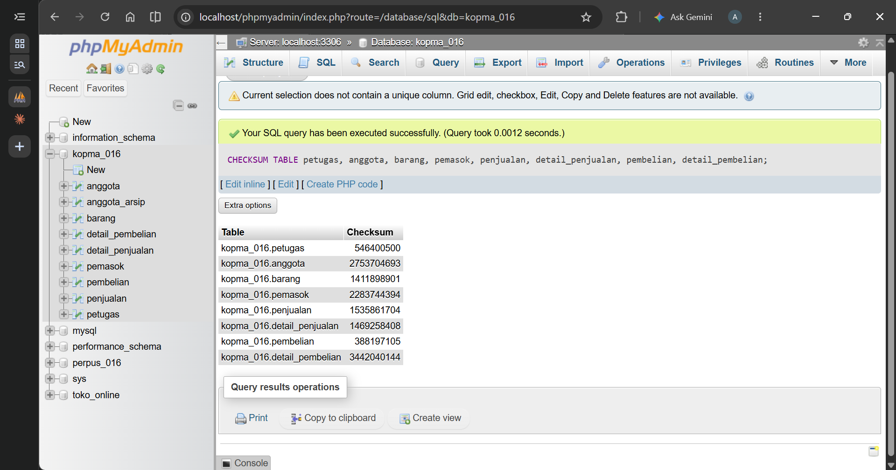

*Gambar 21. `CHECKSUM TABLE` setelah pembangunan ulang identik dengan Gambar 5.*

## 4. Jawaban Titik Analisis

**Titik Analisis 1 — `INSERT ... SELECT` dibanding mengetik 4000 secara manual**

Dengan `INSERT ... SELECT`, harga diambil langsung dari `barang.harga_jual_barang`, jadi tabel `barang` menjadi satu-satunya sumber kebenaran. Risiko salah ketik (misalnya 4000 tertulis 400 atau 40000) hilang, dan tidak ada angka "ajaib" yang tersebar di skrip. Barisnya juga dicari lewat kode alami (`kode_barang = 'ATK-001'`), sehingga saya tidak perlu menebak nilai `id_barang`.

Nota `PJ-2609-0142` **tidak ikut berubah** ketika harga pulpen naik menjadi Rp4.500. Harga sudah disalin sebagai nilai ke kolom `harga_satuan_detail_penjualan` pada saat transaksi, sehingga baris nota menyimpan harga saat itu, bukan rujukan ke harga yang berlaku sekarang. Inilah maksud AB-04. Bukti dari percobaan saya ada pada latihan E.2 (Gambar 27): harga barang makanan di tabel `barang` berubah, tetapi harga pada nota lama tetap.

**Titik Analisis 2 — `CASCADE` pada detail vs penghapusan petugas ditolak**

Perbedaannya ada pada definisi *foreign key* di Modul 5. `fk_detail_penjualan` didefinisikan `ON DELETE CASCADE`: detail penjualan tidak punya arti tanpa nota induknya, sehingga ikut dihapus bersama nota (Gambar 9 dan 10). Sebaliknya `fk_penjualan_petugas` tidak memakai `ON DELETE CASCADE`, sehingga memakai perilaku bawaan, yaitu menolak penghapusan induk yang masih dirujuk anak (ERROR 1451, Gambar 11). Ini disengaja: nota adalah riwayat transaksi yang harus tetap ada, dan petugas tidak boleh hilang begitu saja dari riwayat itu.

Jika seorang kasir berhenti bekerja, barisnya **tidak dihapus**. Cara yang benar adalah mempertahankan barisnya sebagai jejak riwayat nota, lalu menonaktifkannya, misalnya dengan penanda status pada tabel petugas atau dengan mencabut hak akses akunnya (dibahas di Modul 13). Pada proyek Perpustakaan saya, hal ini sudah diterapkan: petugas `PT004` berstatus `Tidak Aktif` tetapi barisnya tetap ada dan masih tercatat pada transaksi lama.

**Titik Analisis 3 — Uji yang diperkirakan GAGAL**

Uji yang saya perkirakan gagal pada Kopma: *penjualan dengan qty melebihi stok*, misalnya menjual 50 Roti Cokelat (`MKN-001`) padahal stoknya hanya 3. `INSERT` ke `detail_penjualan` akan **diterima** server. Uji ini tidak termasuk delapan skenario resmi Kopma di atas, sehingga tidak saya jalankan sebagai uji tercatat. Uji gagal yang benar-benar saya jalankan dan catat ada pada Milestone Proyek 6 (UJ-12 Perpustakaan, Bagian 6).

`ck_barang_stok` tidak mencegahnya karena `CHECK` hanya memeriksa satu baris pada tabel yang sedang ditulis, dan ia tidak dapat merujuk tabel lain. `INSERT` ke `detail_penjualan` tidak menyentuh tabel `barang`, sehingga `CHECK` pada kolom stok tidak pernah dievaluasi. Constraint baru bekerja pada langkah `UPDATE barang SET stok_barang = stok_barang - 50`, yaitu ketika stok akan menjadi negatif. Pada saat itu nota dan detail sudah tersimpan, sehingga data menjadi tidak konsisten. Penyelesaian yang tepat adalah membungkus seluruh proses dalam satu transaksi (atau memakai trigger), yang akan dibahas pada Modul 14.

## 5. Hasil Latihan dan Modifikasi

### E.1 Pengarsipan anggota nonaktif sebelum 2025

Data anggota nonaktif yang disiapkan: `A-0087` (daftar 2023, tanpa penjualan), `A-0094` (daftar 2024, masih punya nota), dan `A-0099` (daftar 2025). Hanya `A-0087` yang memenuhi semua syarat untuk diarsipkan.

```sql
DROP TABLE IF EXISTS anggota_arsip;
CREATE TABLE anggota_arsip LIKE anggota;

START TRANSACTION;

INSERT INTO anggota_arsip
SELECT a.*
FROM anggota a
WHERE a.status_anggota = 'nonaktif'
  AND a.tgl_daftar_anggota < '2025-01-01'
  AND NOT EXISTS (SELECT 1 FROM penjualan p WHERE p.id_anggota = a.id_anggota);

DELETE FROM anggota
WHERE id_anggota IN (SELECT id_anggota FROM anggota_arsip)
  AND id_anggota > 0;

COMMIT;
```

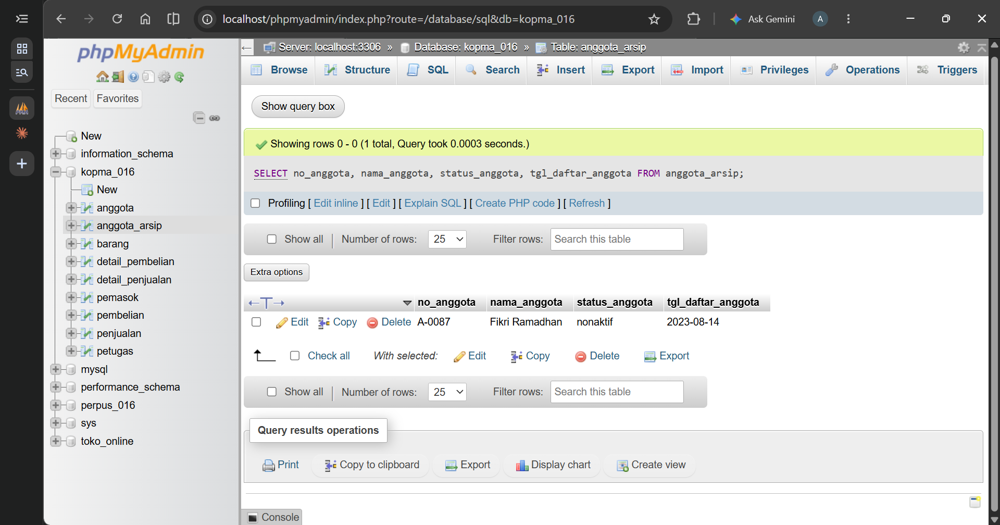

*Gambar 22. Isi `anggota_arsip`: satu baris, `A-0087` Fikri Ramadhan.*

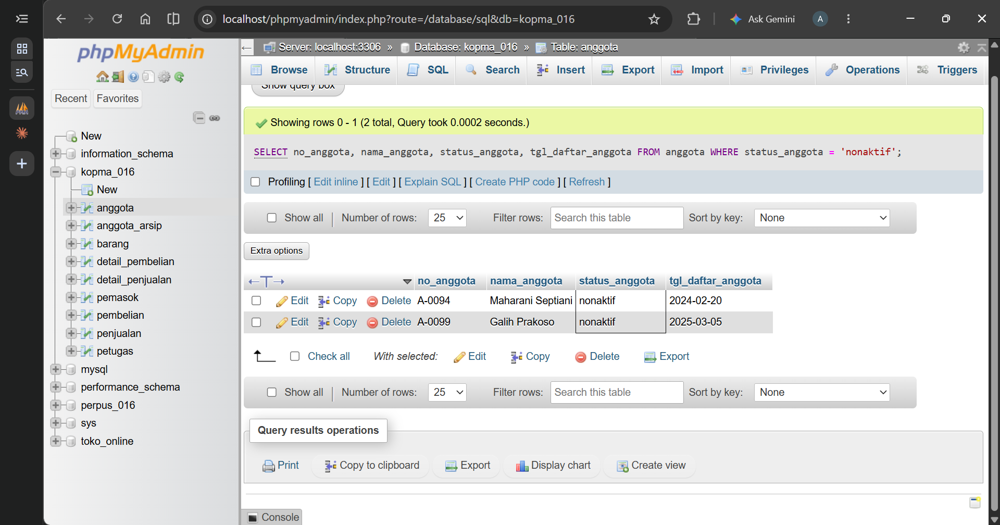

*Gambar 23. Anggota nonaktif yang tersisa di tabel asal: `A-0094` dan `A-0099`.*


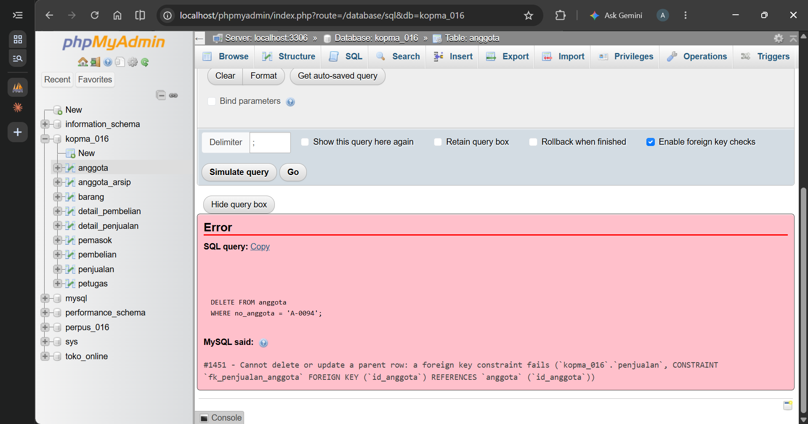

*Gambar 24 dan 25. `DELETE FROM anggota WHERE no_anggota = 'A-0094'` ditolak (ERROR 1451, `fk_penjualan_anggota`) karena anggota tersebut masih punya nota.*

Penjelasan:

1. **Mengapa `NOT EXISTS` diperlukan.** `A-0094` memenuhi syarat nonaktif dan terdaftar sebelum 2025, tetapi masih punya nota. Syarat `NOT EXISTS` menyaringnya agar tidak ikut diarsipkan dan tidak ikut dihapus, sehingga nota lamanya tetap punya anggota induk.
2. **Mengapa urutannya salin dulu, baru hapus.** Jika dihapus lebih dulu, datanya hilang sebelum sempat disalin. Dengan urutan salin lalu hapus, kegagalan di tengah jalan tidak menghilangkan data. Keduanya juga saya bungkus dalam satu transaksi agar tidak ada keadaan "sudah disalin tetapi belum dihapus". `CREATE TABLE` diletakkan sebelum `START TRANSACTION` karena perintah DDL menutup transaksi secara otomatis.
3. **Jika memakai `DELETE` tanpa penyaringan.** Penghapusan `A-0094` akan memicu ERROR 1451 karena `fk_penjualan_anggota` tidak memakai `ON DELETE`, dan seluruh perintah `DELETE` ikut gagal, termasuk penghapusan `A-0087` yang sebenarnya boleh. Ini terlihat pada Gambar 24 dan 25.

### E.2 Kenaikan harga makanan 5% dibulatkan ke ratusan

```sql
START TRANSACTION;

UPDATE barang
SET harga_jual_barang = ROUND(harga_jual_barang * 1.05, -2)
WHERE kategori_barang = 'makanan' AND id_barang > 0;

SELECT kode_barang, nama_barang, harga_jual_barang FROM barang WHERE kategori_barang = 'makanan';

ROLLBACK;   -- diganti COMMIT bila harga baru ingin dipertahankan
```

`ROUND(x, -2)` membulatkan ke ratusan terdekat. `id_barang > 0` ditambahkan agar `WHERE` memuat kolom kunci dan lolos mode aman.

| Kode | Harga lama | × 1,05 | Dibulatkan |
|---|---|---|---|
| MKN-001 Roti Cokelat | 5.000 | 5.250 | **5.300** |
| MKN-002 Keripik Singkong | 7.000 | 7.350 | **7.400** |

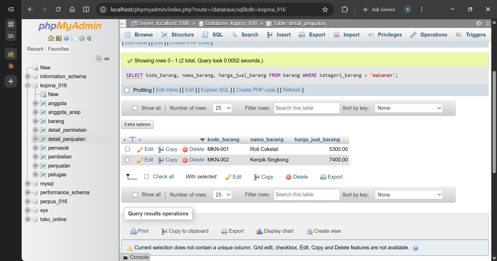

*Gambar 26. Harga barang kategori makanan setelah `UPDATE`.*

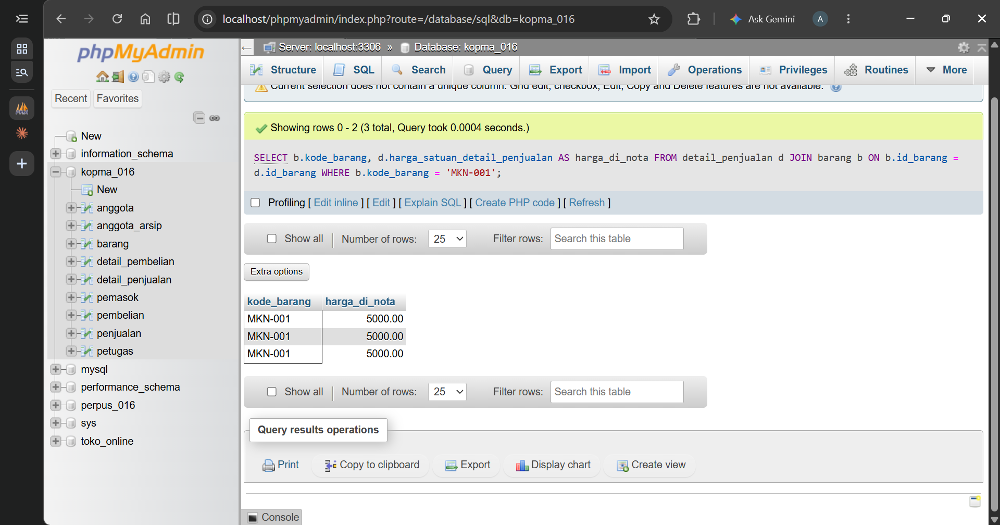

*Gambar 27. Harga pada nota lama tetap 5.000 walaupun harga di tabel `barang` berubah, sesuai AB-04.*

## 6. Tugas Mandiri: Milestone Proyek 06

Proyek: **Perpustakaan Lentera AYP** (`perpus_016`). Parameter **P = 8** (NPM 25430016), sehingga satu transaksi maksimal **10 eksemplar** (P + 2) dan denda **Rp8.000/hari**.

### 6.1 Berkas

| Berkas | Isi |
|---|---|
| `p06_data_25430016.sql` | Data sampel proyek, dapat dijalankan ulang setelah `p05_ddl_25430016.sql` |
| `p06_uji_25430016.md` | 12 skenario uji beserta skrip dan utang desain |

### 6.2 Data sampel berbasis P

| Tabel | Jenis | Jumlah baris | Syarat | Terpenuhi |
|---|---|---|---|---|
| petugas | induk | 6 | ≥ 5 | ya |
| anggota | induk | 12 | ≥ 5 | ya |
| buku | induk | 12 | ≥ 5 | ya |
| eksemplar | induk | 49 | ≥ 5 | ya |
| peminjaman | transaksi utama | 80 | ≥ 10 × P = 80 | ya |
| detail_peminjaman | transaksi | 95 | - | - |
| pengembalian | transaksi | 69 | - | - |
| denda | transaksi | 17 | - | - |

Peminjaman tersebar pada **8 tanggal** (5, 6, 12, 13, 19, 20, 22, dan 26 Oktober 2026), melebihi syarat minimal tiga tanggal. Data dibuat realistis (nama anggota, judul buku, dan alamat nyata untuk wilayah Lampung), bukan `abc` atau `test1`.

Keputusan desain data:

- Semua kunci memakai **kode alami** (`A001`, `E037`, `PJM-20261005-001`) dan tidak ada kolom `AUTO_INCREMENT`. Akibatnya hasil pembangunan ulang selalu identik.
- `status_peminjaman`, `status_detail`, dan `status_eksemplar` **tidak diisi manual**, melainkan diatur oleh trigger `trg_detail_ai` dan `trg_pengembalian_ai` dari DDL Modul 5, sehingga data konsisten dengan aturan bisnis.
- Satu petugas (`PT004`) dan dua anggota (`A011`, `A012`) sengaja berstatus tidak aktif sebagai data historis dan bahan uji AB-02, bukan dihapus.
- Eksemplar `E037`-`E048` dijadikan cadangan yang tidak pernah dipinjam pada data awal, khusus untuk skenario uji AB-03 dan AB-04. `E049` berstatus `Dalam Perbaikan`.
- Denda keterlambatan dihitung dari `hari_terlambat × 8000` (AB-07 dan AB-08).

### 6.3 Skenario uji (12 skenario: 3 positif, 9 negatif)

Setiap skenario positif dan yang menyentuh data dibungkus `START TRANSACTION ... ROLLBACK`, sehingga isi basis data tidak berubah setelah uji. Server menampilkan ERROR **3819** untuk pelanggaran `CHECK` (kode MySQL), sedangkan berkas uji memuat harapan ERROR 4025 (kode MariaDB, sesuai contoh buku).

| Kode | Jenis | Aturan / constraint | Masukan (ringkas) | Harapan | Hasil nyata | Status |
|---|---|---|---|---|---|---|
| UJ-01 | Positif | AB-02, AB-03, AB-05 | Peminjaman anggota Aktif `A001` dengan eksemplar Tersedia `E037` | Diterima; `E037` menjadi `Dipinjam` | `E037` berstatus `Dipinjam` | PASS |
| UJ-02 | Positif | AB-04 | Satu peminjaman berisi tepat 10 eksemplar (`E037`-`E046`) | Diterima; jumlah detail 10 | Jumlah detail = 10 | PASS |
| UJ-03 | Positif | AB-06, AB-07, AB-08 | Pengembalian `E017` pada 2026-10-31 (terlambat 2 hari) dengan denda 2 × 8000 | Diterima; denda 16000; detail `Dikembalikan`; `E017` `Tersedia` | `Dikembalikan`; `Tersedia`; 2; 16000 | PASS |
| UJ-04 | Negatif | AB-02, `trg_peminjaman_bi` | Peminjaman oleh anggota Tidak Aktif `A011` | Ditolak, ERROR 1644 (`AB-02: ...`) | ERROR 1644 | PASS |
| UJ-05 | Negatif | AB-03, `trg_detail_bi` | Meminjam `E012` yang sedang dipinjam | Ditolak, ERROR 1644 (`AB-03: ...`) | ERROR 1644 | PASS |
| UJ-06 | Negatif | AB-04, `trg_detail_bi` | Menambah eksemplar ke-11 pada satu transaksi | Ditolak, ERROR 1644 (`AB-04: ...`) | ERROR 1644 | PASS |
| UJ-07 | Negatif | AB-01, `pk_anggota` | Anggota baru dengan `nomor_anggota` `A001` yang sudah ada | Ditolak, ERROR 1062 | ERROR 1062 | PASS |
| UJ-08 | Negatif | AB-05, `ck_peminjaman_tanggal` | Jatuh tempo (2026-10-24) lebih awal dari tanggal pinjam (2026-10-31) | Ditolak, ERROR 4025/3819 | ERROR 3819 | PASS |
| UJ-09 | Negatif | AB-06, `fk_pengembalian_detail` | Pengembalian `E037` pada transaksi `PJM-20261022-002` yang tidak memuat `E037` | Ditolak, ERROR 1452 | ERROR 1452 | PASS |
| UJ-10 | Negatif | AB-08, `ck_denda_nominal` | Denda 2 hari dengan nominal 10000 (seharusnya 16000) | Ditolak, ERROR 4025/3819 | ERROR 3819 | PASS |
| UJ-11 | Negatif | AB-05, `fk_peminjaman_petugas` | Peminjaman oleh petugas `PT999` yang tidak dikenal | Ditolak, ERROR 1452 | ERROR 1452 | PASS |
| UJ-12 | Negatif (uji gagal) | AB-04, AB-05 | Peminjaman tanpa satu pun detail eksemplar | **Seharusnya ditolak** | `Query OK, 1 row affected` (diterima) | **GAGAL** |

Tangkapan layar tiap skenario:

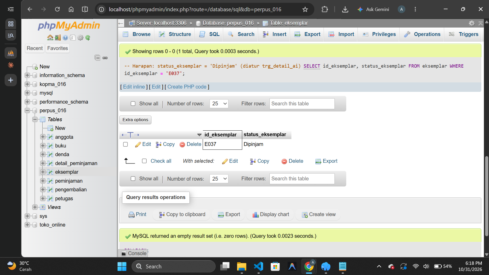
*Gambar 28. UJ-01 (positif): peminjaman diterima, `E037` menjadi `Dipinjam`.*

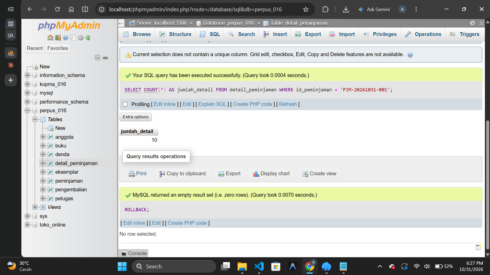
*Gambar 29. UJ-02 (positif): 10 eksemplar pada satu transaksi diterima.*

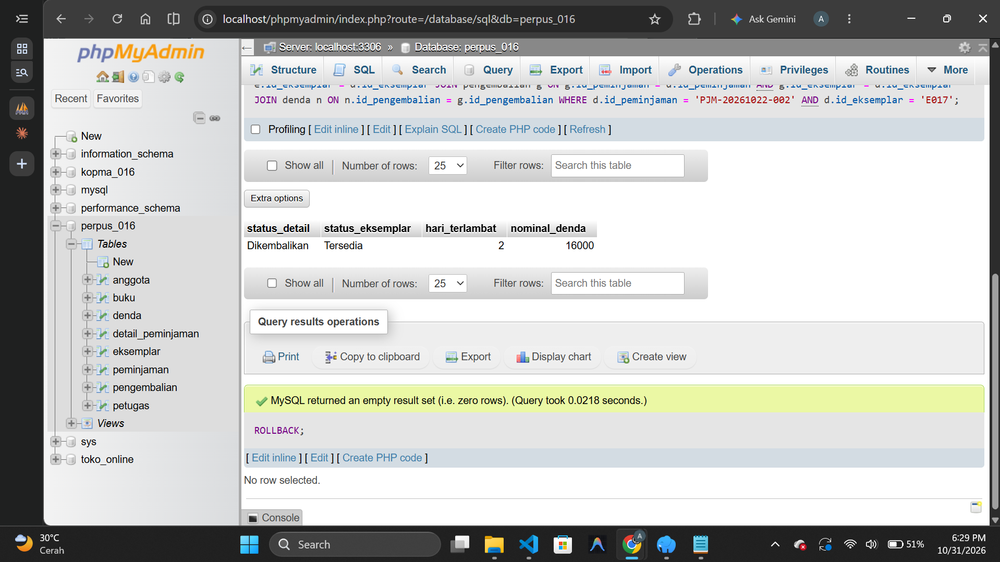
*Gambar 30. UJ-03 (positif): pengembalian terlambat 2 hari dengan denda Rp16.000 diterima.*

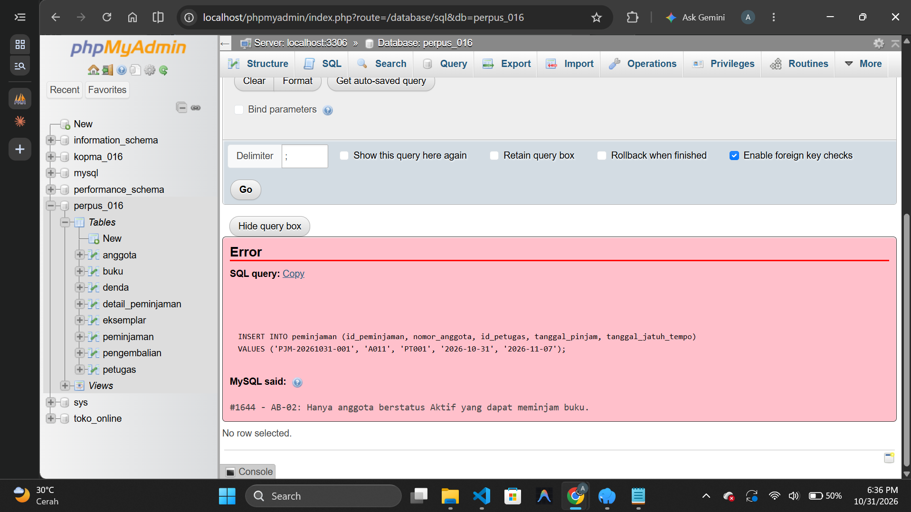
*Gambar 31. UJ-04 (negatif): anggota Tidak Aktif ditolak trigger (ERROR 1644).*


*Gambar 32. UJ-05 (negatif): eksemplar yang sedang dipinjam ditolak trigger (ERROR 1644).*

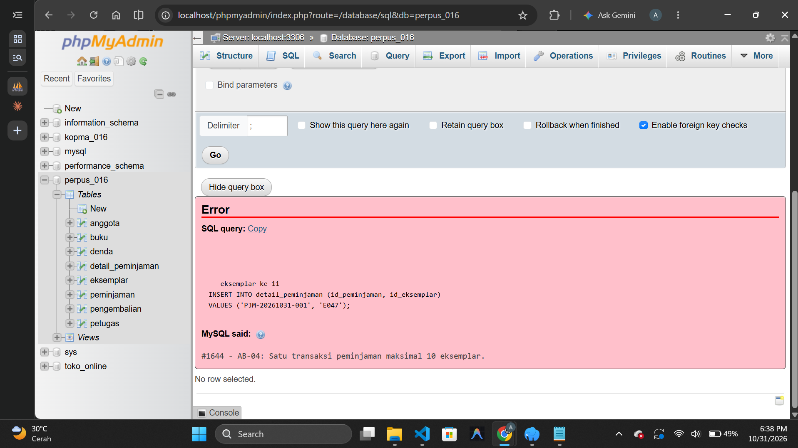
*Gambar 33. UJ-06 (negatif): eksemplar ke-11 ditolak trigger (ERROR 1644).*

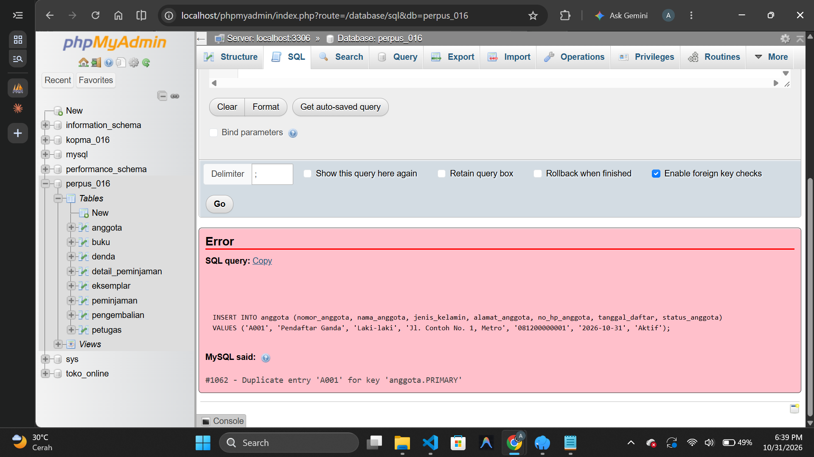
*Gambar 34. UJ-07 (negatif): nomor anggota ganda ditolak (ERROR 1062).*

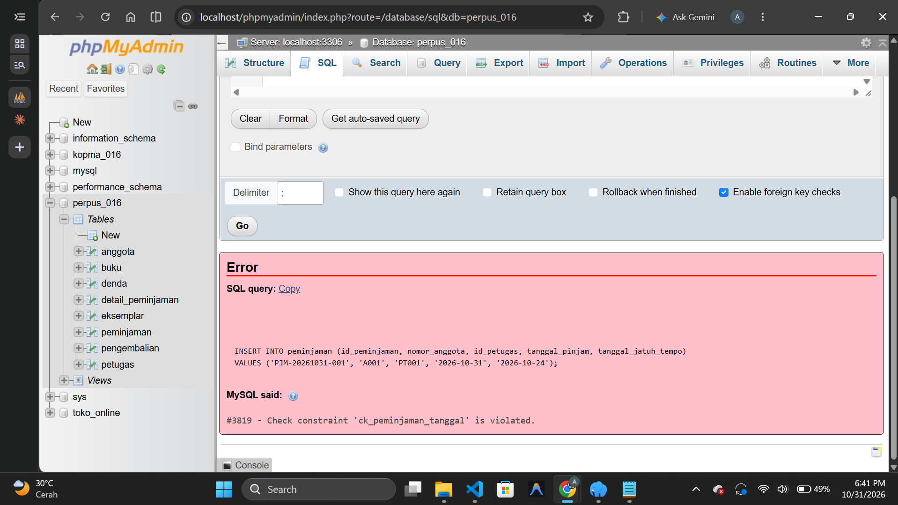
*Gambar 35. UJ-08 (negatif): jatuh tempo mendahului tanggal pinjam ditolak `ck_peminjaman_tanggal` (ERROR 3819).*

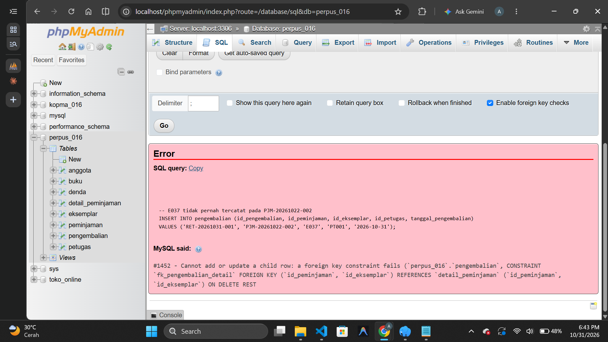
*Gambar 36. UJ-09 (negatif): pengembalian eksemplar yang tidak ada di transaksinya ditolak `fk_pengembalian_detail` (ERROR 1452).*

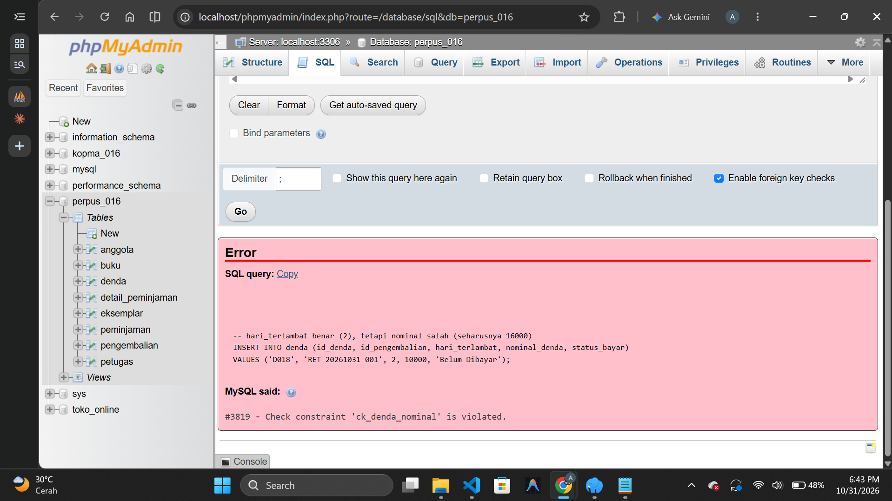
*Gambar 37. UJ-10 (negatif): nominal denda tidak sesuai tarif ditolak `ck_denda_nominal` (ERROR 3819).*

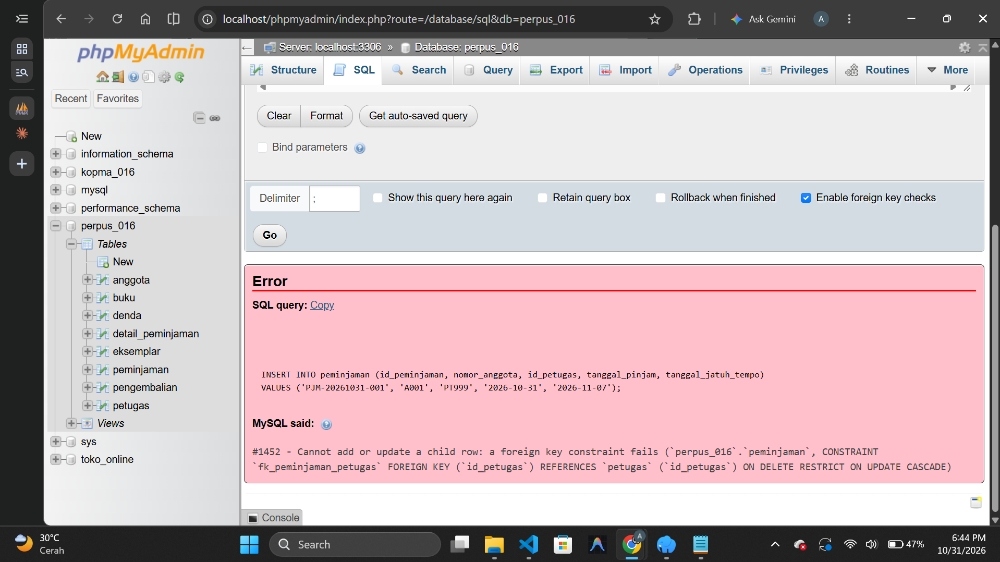
*Gambar 38. UJ-11 (negatif): petugas `PT999` ditolak `fk_peminjaman_petugas` (ERROR 1452).*

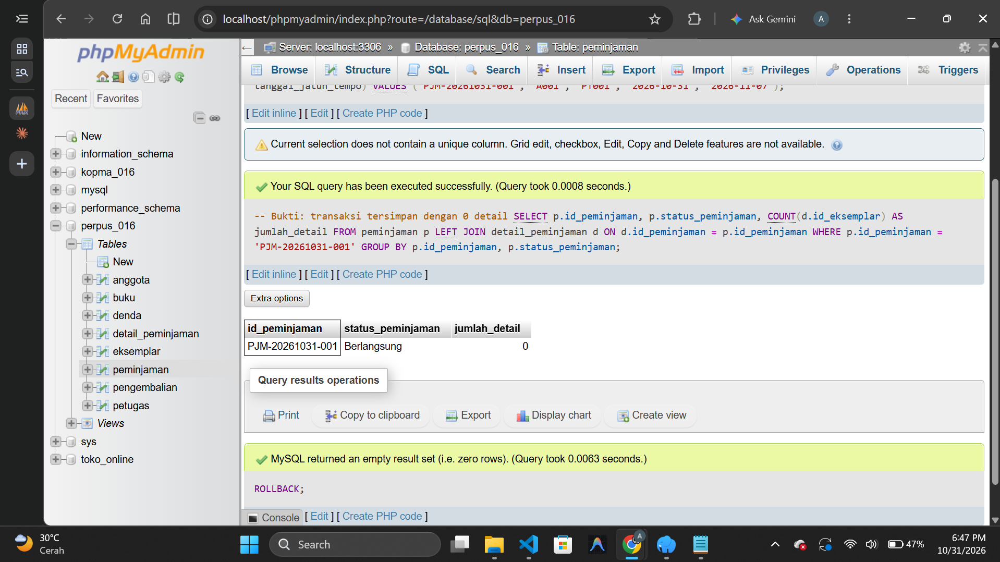
*Gambar 39. UJ-12 (uji gagal): header peminjaman tanpa detail diterima server, tersimpan dengan 0 detail.*

### 6.4 Uji yang gagal dan utang desain untuk Modul 14

| Butir | Isi |
|---|---|
| Kode utang | **UD-01** (dari **UJ-12**) |
| Aturan yang belum dijaga | Satu transaksi peminjaman wajib memuat minimal 1 eksemplar. Batas atas 10 eksemplar sudah dijaga (UJ-06), tetapi batas bawah belum. |
| Bukti | UJ-12: baris `peminjaman` tersimpan dengan 0 baris `detail_peminjaman` (Gambar 39). |
| Mengapa constraint tidak cukup | `PRIMARY KEY`, `FOREIGN KEY`, `UNIQUE`, dan `CHECK` hanya memeriksa satu baris atau satu hubungan ke baris induk. Aturan "induk harus punya anak" melibatkan baris di tabel lain yang belum ada saat header dimasukkan. Detail baru boleh masuk setelah header karena FK mensyaratkan header ada lebih dulu, sehingga trigger `BEFORE INSERT` pada `peminjaman` pun tidak dapat menolaknya. |
| Akibat jika dibiarkan | Header kosong menumpuk dengan status `Berlangsung` selamanya. Jika detail ke-11 ditolak (UJ-06) pada mode autocommit, 10 detail pertama tetap tersimpan sehingga peminjaman hanya selesai sebagian. |
| Rencana pelunasan (Modul 14) | Bungkus satu peminjaman sebagai satu transaksi: `START TRANSACTION` → `INSERT peminjaman` → `INSERT detail_peminjaman` (1 sampai 10 baris) → periksa `COUNT(*)` detail → `ROLLBACK` bila 0 atau ada galat, `COMMIT` bila 1 sampai 10. |
| Catatan dokumen | "Minimal 1 eksemplar" belum tertulis eksplisit pada AB-01 sampai AB-10. Saya mengusulkan menambahkannya sebagai AB-11 pada dokumen kebutuhan data. |

Temuan tambahan yang belum diuji: trigger AB-02, AB-03, dan AB-04 hanya aktif pada `BEFORE INSERT`, sehingga `UPDATE` yang memindahkan `nomor_anggota`, `id_peminjaman`, atau `status_eksemplar` berpotensi melewati aturan tersebut. Ini saya catat sebagai calon utang desain tambahan untuk Modul 14.

### 6.5 Keterulangan

`p05_ddl_25430016.sql` diawali `DROP TABLE IF EXISTS` untuk semua tabel dan data tidak memakai `AUTO_INCREMENT`, sehingga pembangunan ulang dari basis data kosong (DDL lalu data) selalu menghasilkan jumlah baris yang sama: petugas 6, anggota 12, buku 12, eksemplar 49, peminjaman 80, detail_peminjaman 95, pengembalian 69, denda 17. Skenario uji tidak mengubah isi basis data karena memakai `ROLLBACK` atau memang ditolak server.

## 7. Pembahasan dan Kendala

Semua skenario Kopma (8 uji) dan Perpustakaan (11 dari 12 uji) berstatus PASS. Satu-satunya uji berstatus GAGAL adalah UJ-12 Perpustakaan, yang memang dirancang untuk menunjukkan batas kemampuan constraint dan menjadi UD-01. Pelajaran terpentingnya: constraint bekerja per baris, sedangkan aturan yang membandingkan beberapa tabel atau menuntut kelengkapan induk-anak perlu transaksi atau trigger.

Galat yang ditemui dan cara mengatasinya:

| Galat | Penyebab (cara membaca) | Penanganan |
|---|---|---|
| 1175 | `UPDATE` tanpa `WHERE` pada kolom kunci di mode aman. Ini perlindungan, bukan kesalahan server. | Tambahkan syarat pada kolom kunci (`AND id_barang > 0`). Mode aman tidak dimatikan. |
| 1451 | Menghapus baris induk yang masih dirujuk anak (petugas, anggota). | Tidak menghapus. Gunakan penyaringan `NOT EXISTS`, atau nonaktifkan barisnya. |
| 1452 | Nilai kunci tamu tidak ada di tabel induk (UJ-07 Kopma, UJ-09 dan UJ-11 Perpustakaan). | Isi tabel induk lebih dulu, gunakan `INSERT ... SELECT` dengan kode alami. |
| 1062 | Nilai duplikat pada kolom `UNIQUE`/`PRIMARY KEY`. | Gunakan nilai yang unik. |
| 3819 (4025 di MariaDB) | Pelanggaran `CHECK`. Server saya menampilkan 3819. | Perbaiki nilai masukan; status uji tetap PASS karena constraint yang tepat yang menolak. |
| 1644 | `SIGNAL` dari trigger aturan bisnis Perpustakaan. | Pesan galat memuat kode aturan (AB-xx), sehingga mudah ditelusuri. |
| 1406 | Pada UJ-01 Kopma, nomor nota yang saya ketik melebihi panjang kolom. | Nomor nota diperpendek (`NT1001`) sesuai panjang kolom, lalu percobaan diulang. |

Kendala lain: phpMyAdmin hanya menampilkan hasil `SELECT` terakhir dalam satu kotak SQL, dan setiap penekanan **Go** memakai sesi baru. Karena itu `SET SESSION sql_safe_updates = 1` harus berada di kotak yang sama dengan `UPDATE`-nya, dan bukti (`SELECT`) saya letakkan sebagai pernyataan terakhir. Kotak "Enable foreign key checks" juga dibiarkan tercentang, sebab bila dimatikan uji kunci tamu (ERROR 1451 dan 1452) tidak akan muncul. Pada uji Perpustakaan, `ROLLBACK` dipakai agar data tetap bersih sehingga urutan uji bebas.

## 8. Kesimpulan

Pada pertemuan ini data sampel Kopma dan proyek Perpustakaan berhasil diisi dengan urutan induk ke anak, dan keduanya dapat dibangun ulang dengan hasil identik (dibuktikan dengan `CHECKSUM TABLE` pada Kopma). Mode `sql_safe_updates`, `ON DELETE CASCADE`, dan foreign key terbukti melindungi data dari perubahan yang tidak disengaja. Seluruh uji yang dirancang untuk ditolak memang ditolak dengan galat yang tepat. Uji gagal UJ-12 menunjukkan aturan yang belum dapat dijaga constraint sehingga dicatat sebagai utang desain UD-01 untuk Modul 14.

## 9. Pernyataan Penggunaan AI

Saya menggunakan asisten AI (Claude) untuk: (1) membantu menyusun panduan langkah pengerjaan studi kasus Kopma di phpMyAdmin (`p06_panduan_kopma_25430016.md`), (2) membantu memahami pesan galat dan perbedaan kode galat `CHECK` (3819 dan 4025), dan (3) membantu menyusun kerangka draf laporan ini dari hasil praktik saya. Seluruh perintah SQL dijalankan sendiri pada phpMyAdmin dan hasil nyata serta tangkapan layar berasal dari komputer saya. 

## 10. Bukti Git

- Repositori: https://github.com/arya-yoga-pratama/basisdata-25430016.git
- Pesan commit: milestone: pertemuan 6 - basis data
- Hash commit: 47556bb0606b34b5a3c1142406ad9b058d0a08e4

Berkas yang di-commit: `p06_data_kopma_25430016.sql`, `p06_uji_kopma_25430016.md`, `p06_data_25430016.sql`, `p06_uji_25430016.md`, `laporan/p06_laporan_25430016.md`, dan folder `laporan/img/`.

## Checklist

**Checklist khusus Pertemuan 6 (Tabel 6.2)**

- [x] **Berkas wajib:** `p06_data_<NIM>.sql` (data sampel berbasis parameter P) dan `p06_uji_<NIM>.md` (skenario uji)
- [x] **Bukti tangkapan layar:** hasil skenario uji positif dan negatif; jumlah baris per tabel
- [x] **Analisis wajib:** tabel skenario uji (masukan, hasil yang diharapkan, hasil nyata, status)

**Checklist umum (Tabel P.13)**

- [x] **Identitas:** nama, NIM, kelas, pertemuan, tanggal, nama asisten/dosen (kelas dan asisten/dosen masih perlu diisi)
- [x] **Tujuan:** ditulis dengan bahasa sendiri, maksimal 5 baris
- [x] **Ringkasan teori:** pemahaman sendiri, maksimal setengah halaman
- [x] **Langkah percobaan (D):** tangkapan layar hasil langkah kunci beserta keterangan
- [x] **Titik Analisis:** ketiganya dijawab lengkap dengan alasan
- [x] **Latihan (E):** skrip dan bukti berjalan E.1 dan E.2
- [x] **Tugas Mandiri (F):** berkas, bukti, dan penjelasan keputusan desain
- [x] **Pembahasan dan kendala:** galat, cara membaca, dan cara mengatasi
- [x] **Kesimpulan:** dua sampai empat kalimat
- [x] **Pernyataan Penggunaan AI:** perlu dikonfirmasi sebelum dikumpulkan
- [x] **Bukti Git:** tautan repositori dan hash commit belum diisi
- [x] **Keaslian:** pastikan setiap tangkapan layar memperlihatkan akun ber-NIM dan jam sistem
