# Laporan Praktikum Basis Data - Pertemuan 7

**Nama:** Arya Yoga Pratama  
**NPM:** 25430016  
**Kelas:** A  
**Tanggal:** 1 November 2026  
**Dosen:** Dedi Irawan, S.Kom., M.T.I.

**Basis data:** `kopma_016` (studi kasus Kopma) dan `perpus_016` (proyek Perpustakaan Lentera AYP)  
**Parameter P:** 8

---

## 1. Tujuan Praktikum

1. Menulis `SELECT` dengan proyeksi kolom, alias, dan `DISTINCT`, lalu menyaring baris dengan operator pembanding, logika, `BETWEEN`, `IN`, `LIKE`, dan `IS NULL`.
2. Mengurutkan dan membatasi hasil dengan `ORDER BY` dan `LIMIT`.
3. Memakai fungsi skalar (string, tanggal, numerik, kondisional) untuk menyajikan data sesuai kebutuhan informasi (KI).
4. Menulis kueri satu tabel untuk proyek, lengkap dengan komentar KI, pertanyaan, dan hasil yang diharapkan.

## 2. Ringkasan Dasar Teori

`SELECT` ditulis dengan urutan `SELECT → FROM → WHERE → ORDER BY → LIMIT`, tetapi server mengevaluasinya dengan urutan logis `FROM → WHERE → SELECT → ORDER BY → LIMIT`. Akibatnya alias yang dibuat di `SELECT` belum ada ketika `WHERE` dibaca, tetapi sudah dikenal di `ORDER BY`. Urutan ini menjelaskan galat `Unknown column ... in 'where clause'`.

Galat sintaks mudah ditemukan karena server menolaknya. Yang lebih berbahaya adalah **kesalahan semantik**: kueri berjalan tanpa galat, tetapi hasilnya tidak menjawab pertanyaan. Karena itu setiap kueri perlu dipasangkan dengan hasil yang diharapkan sebelum dijalankan, lalu dibandingkan dengan hasil nyata.

`NULL` berarti "tidak diketahui", bukan nol dan bukan string kosong. Perbandingan apa pun dengan `NULL` memakai `=` menghasilkan `NULL`, sedangkan `WHERE` hanya meloloskan baris bernilai `TRUE`, sehingga nilai kosong harus diperiksa dengan `IS NULL`. Fungsi skalar (`CONCAT`, `UPPER`, `DATE_FORMAT`, `DATEDIFF`, `IFNULL`, `CASE`, dan lain-lain) bekerja per baris dan mengubah tampilan atau hasil hitung satu baris, berbeda dengan fungsi agregat yang meringkas banyak baris menjadi satu nilai.

## 3. Hasil Langkah Percobaan

Bagian 3 sampai 5 membahas studi kasus **Kopma** (`kopma_016`), dijalankan lewat phpMyAdmin dan ditulis pada `p07_kueri_kopma_25430016.sql`. Setiap kueri diberi komentar `Tanya`, `Harapan`, dan `Nyata`.

**Pemeriksaan data awal.** Sebelum menjalankan kueri, data dipastikan masih bersih seperti hasil Modul 6 (7 anggota, 8 nota, stok roti 3, harga roti 5.000).

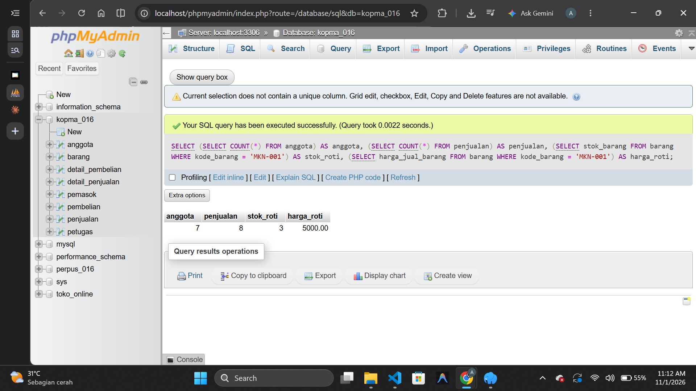

*Gambar 1. Pemeriksaan data awal `kopma_016` sebelum kueri dijalankan.*

### D.1 Proyeksi dan penyaringan

**Q01, KI-03: barang di bawah stok minimum.** Harapan: 1 baris (`MKN-001` Roti Cokelat). Nyata: 1 baris, stok 3, minimum 10, kurang 7. Stok roti 3 (bukan 6 seperti contoh di buku) karena nota penjualan sampel Modul 6 sudah mengurangi stok sebanyak 3.

```sql
SELECT kode_barang, nama_barang, stok_barang, stok_min_barang,
       stok_min_barang - stok_barang AS kurang
FROM barang
WHERE stok_barang < stok_min_barang
ORDER BY kurang DESC;
```

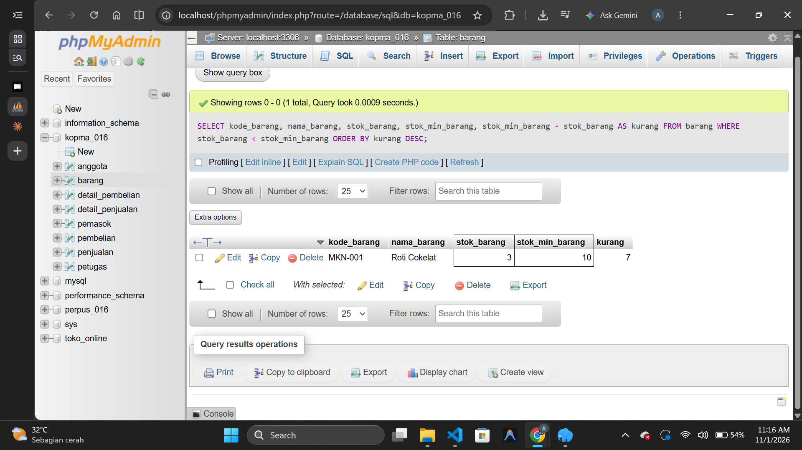

*Gambar 2. Q01: hanya Roti Cokelat yang stoknya di bawah minimum.*

**Q02, `IN`: barang kategori ATK atau minuman.** Harapan dan nyata: 6 baris (4 ATK, 2 minuman).

```sql
SELECT kode_barang, nama_barang, kategori_barang, harga_jual_barang
FROM barang
WHERE kategori_barang IN ('ATK', 'minuman')
ORDER BY kategori_barang, nama_barang;
```

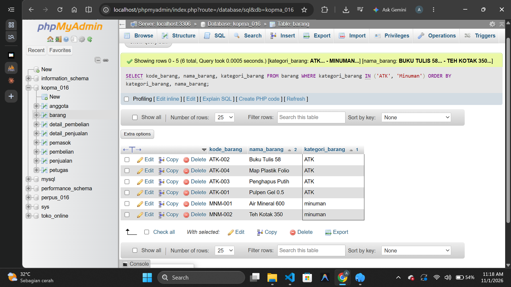

*Gambar 3. Q02: enam barang kategori ATK atau minuman.*

**Q03, `BETWEEN`: nota 23 sampai 24 September 2026.** Harapan dan nyata: 4 nota (`PJ-2609-0140` sampai `PJ-2609-0143`). Karena `tgl_penjualan` bertipe `DATETIME`, batas akhir ditulis eksplisit `23:59:59`.

```sql
SELECT no_nota_penjualan, tgl_penjualan, id_petugas, id_anggota, bayar_penjualan
FROM penjualan
WHERE tgl_penjualan BETWEEN '2026-09-23 00:00:00' AND '2026-09-24 23:59:59'
ORDER BY tgl_penjualan;
```

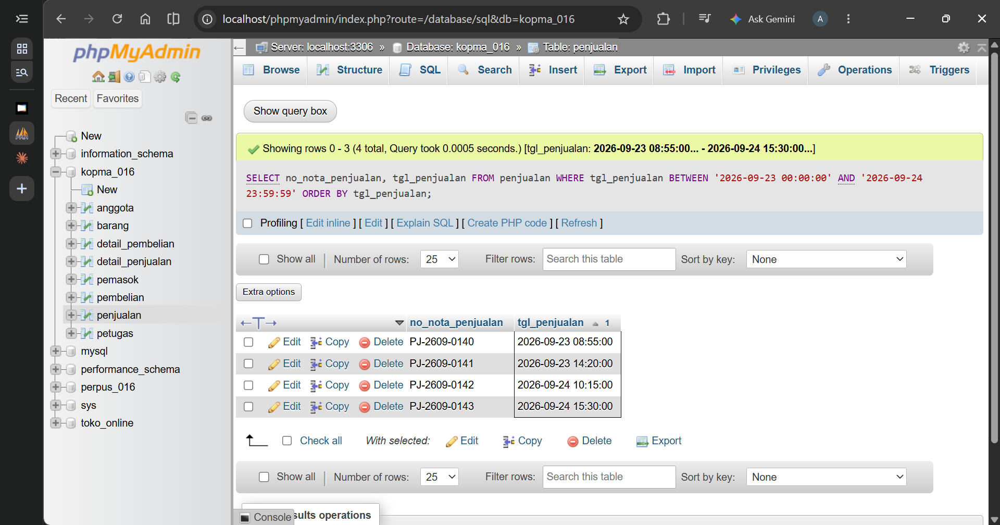

*Gambar 4. Q03: empat nota pada rentang 23 sampai 24 September.*

**Q04, `IS NULL`: anggota tanpa nomor HP.** Harapan dan nyata: 2 baris, yaitu `A-0087` Fikri Ramadhan dan `A-0103` Rangga Mahendra.

```sql
SELECT no_anggota, nama_anggota, status_anggota, no_hp_anggota
FROM anggota
WHERE no_hp_anggota IS NULL
ORDER BY no_anggota;
```

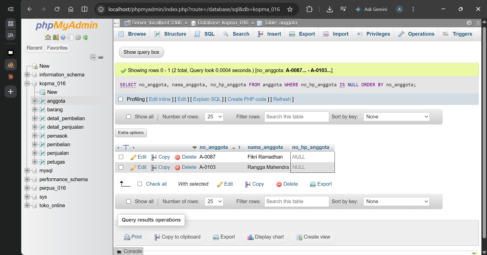

*Gambar 5. Q04: dua anggota dengan `no_hp_anggota` bernilai NULL.*

### D.2 Pola teks dan nilai kosong

**Q06, kueri persis buku.** Kueri memakai `CONCAT`, `DATE_FORMAT`, `IFNULL`, `CASE`, dan `LIKE`. Perkiraan awal saya: urutan lima anggota terbaru adalah Putri, Rangga, Naufal, Salsabila, Galih. Hasil nyata ternyata berbeda: Rangga Mahendra, Maharani Septiani, Naufal Ardiansyah, Salsabila Nur Aini, Fikri Ramadhan. Kolom HP yang NULL tampil `-`, dan kolom keterangan tampil `Diskon 5%` (anggota aktif) atau `Tanpa diskon`.

```sql
SELECT CONCAT(nama_anggota, ' (', no_anggota, ')')      AS anggota,
       DATE_FORMAT(tgl_daftar_anggota, '%d-%m-%Y')      AS tgl_daftar_anggota,
       IFNULL(no_hp_anggota, '-')                       AS hp,
       CASE status_anggota WHEN 'aktif' THEN 'Diskon 5%'
                           ELSE 'Tanpa diskon' END      AS keterangan
FROM anggota
WHERE nama_anggota LIKE '%a%'
ORDER BY tgl_daftar_anggota DESC
LIMIT 5;
```

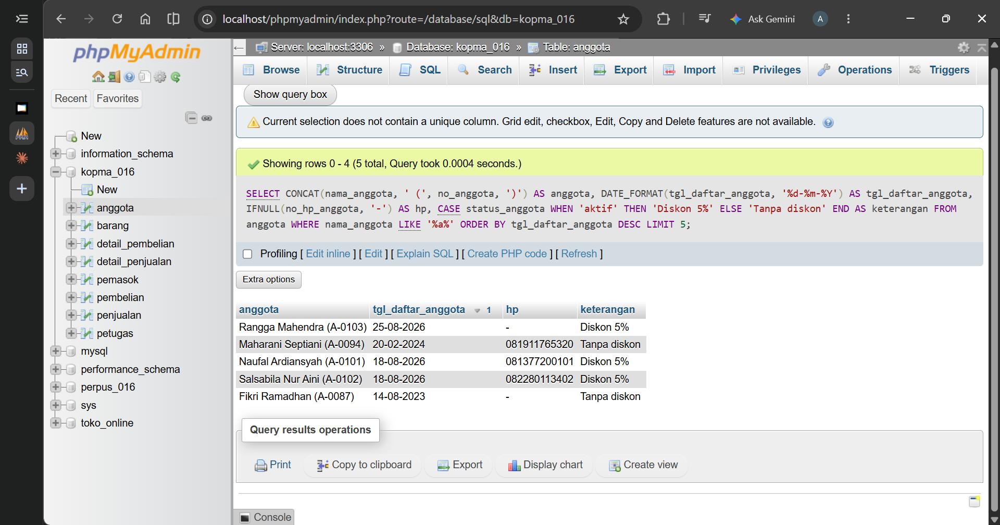

*Gambar 6. Q06: urutan tidak kronologis (lihat penjelasan di bawah).*

Penyebabnya adalah jebakan semantik tanpa galat. Alias `tgl_daftar_anggota` bernama **sama** dengan kolom aslinya, dan pada `ORDER BY` MySQL mendahulukan alias dibanding kolom tabel. Alias itu berisi teks `dd-mm-yyyy`, sehingga pengurutan dilakukan menurut teks, bukan menurut tanggal. Teks `'25-08-2026'` dianggap lebih besar dari `'01-09-2026'` karena dibandingkan karakter demi karakter dari depan.

**Q07, versi diperbaiki.** `ORDER BY` diarahkan ke kolom tabel dengan menulis nama tabelnya (`anggota.tgl_daftar_anggota`), ditambah `no_anggota` sebagai pengurut kedua agar urutan pasti saat tanggal sama. Nyata: Putri Ayu Wardani (`A-0104`), Rangga Mahendra (`A-0103`), Naufal Ardiansyah (`A-0101`), Salsabila Nur Aini (`A-0102`), Galih Prakoso (`A-0099`), sesuai harapan.

```sql
ORDER BY anggota.tgl_daftar_anggota DESC, no_anggota
LIMIT 5;
```

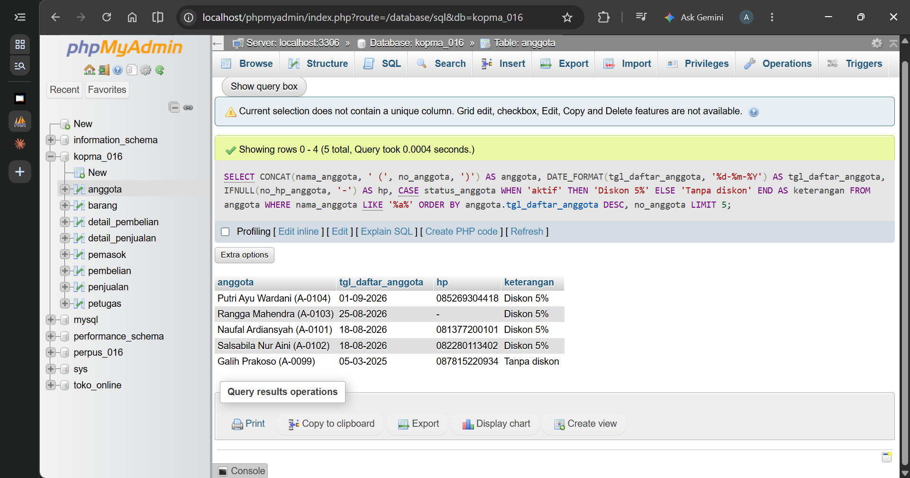

*Gambar 7. Q07: lima anggota terbaru, urut menurut tanggal sebenarnya.*

### D.3 Tanggal dan perhitungan per baris

**Q09: lama keanggotaan dan kategori baru/lama.** Memakai `DATEDIFF(CURDATE(), tgl_daftar_anggota)` dan `CASE` (kurang dari 180 hari = `baru`). Harapan dan nyata: 7 baris. Empat anggota `baru` (`A-0104` 61 hari, `A-0103` 68, `A-0101` 75, `A-0102` 75) dan tiga `lama` (`A-0099` 606, `A-0094` 985, `A-0087` 1175). Angka hari mengikuti `CURDATE()` pada saat kueri dijalankan (1 November 2026), sehingga bertambah tiap hari, sedangkan kategorinya tetap.

```sql
SELECT no_anggota, nama_anggota, tgl_daftar_anggota,
       DATEDIFF(CURDATE(), tgl_daftar_anggota) AS lama_hari,
       CASE WHEN DATEDIFF(CURDATE(), tgl_daftar_anggota) < 180 THEN 'baru'
            ELSE 'lama' END AS kategori
FROM anggota
ORDER BY lama_hari, no_anggota;
```

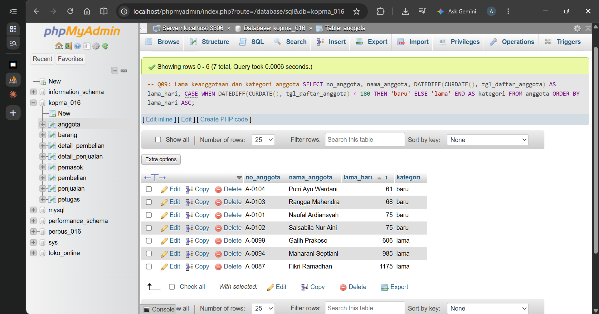

*Gambar 8. Q09: lama keanggotaan dan kategori.*

**Q10 dan Q11: isi nota `PJ-2609-0142` beserta subtotal.** Karena `detail_penjualan` hanya menyimpan `id_penjualan` (bukan nomor nota), Q10 mencari `id_penjualan` lebih dulu (hasilnya 1, bayar 30.000), lalu Q11 menghitung subtotal tiap baris dari satu tabel.

```sql
SELECT id_penjualan, id_barang, qty_detail_penjualan AS qty,
       harga_satuan_detail_penjualan AS harga_satuan,
       qty_detail_penjualan * harga_satuan_detail_penjualan AS subtotal
FROM detail_penjualan
WHERE id_penjualan = 1
ORDER BY id_barang;
```

| id_barang | qty | harga_satuan | subtotal |
|---:|---:|---:|---:|
| 1 | 3 | 4.000 | 12.000 |
| 2 | 2 | 6.500 | 13.000 |
| 3 | 1 | 4.000 | 4.000 |

Jumlah manual: 12.000 + 13.000 + 4.000 = **29.000**. Uang yang dibayar 30.000, sehingga kembalian 1.000. [CEK: cocokkan 29.000 dengan total pada nota contoh Modul 2 milik saya.]

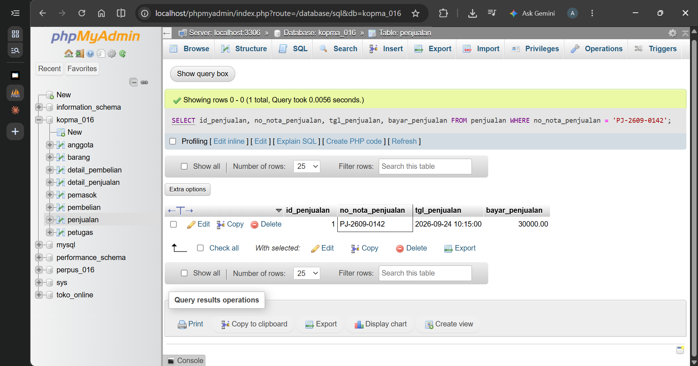

*Gambar 9. Q10: `id_penjualan` untuk nota `PJ-2609-0142`.*

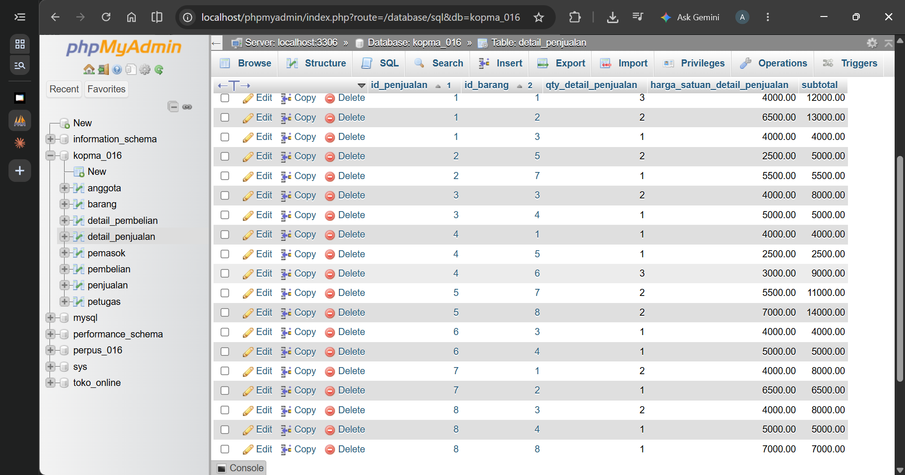

*Gambar 10. Q11: tiga baris detail nota beserta subtotal.*

## 4. Jawaban Titik Analisis

**Titik Analisis 1: alias di `WHERE`**

Kueri Q01 diubah dari `ORDER BY kurang` menjadi `WHERE kurang > 0` (Q05a). Hasilnya galat `#1054 - Unknown column 'kurang' in 'where clause'`.

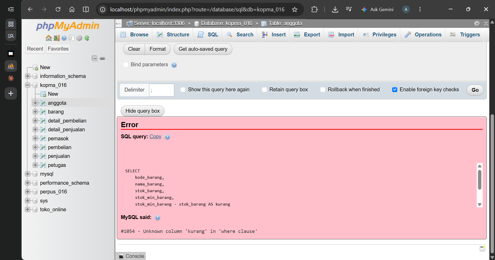

*Gambar 11. Q05a: galat #1054 karena alias `kurang` dipakai di `WHERE`.*

Penjelasannya ada pada urutan evaluasi. `WHERE` dievaluasi pada tahap kedua, sedangkan `SELECT` (tempat alias `kurang` dibuat) baru dievaluasi pada tahap ketiga. Saat `WHERE` dibaca, kolom bernama `kurang` belum ada, sehingga server melaporkan kolom tidak dikenal. `ORDER BY` dievaluasi setelah `SELECT`, itulah sebabnya alias yang sama boleh dipakai di sana.

Syarat yang setara tanpa alias ada dua cara. Pertama, mengulang ekspresinya (Q05b): `WHERE stok_min_barang - stok_barang > 0`. Kedua, menyederhanakannya menjadi `WHERE stok_barang < stok_min_barang`, seperti pada Q01. Hasil Q05b sama dengan Q01: satu baris, `MKN-001` dengan kekurangan 7.

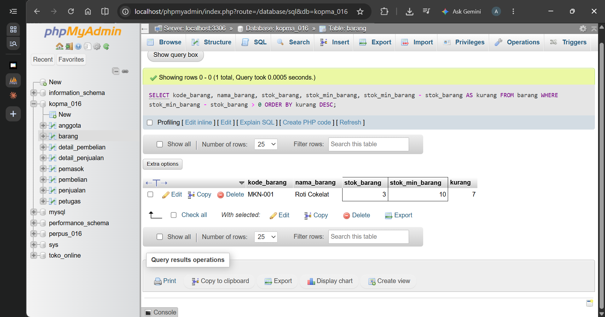

*Gambar 12. Q05b: perbaikan tanpa alias di `WHERE`, hasil sama dengan Q01.*

**Titik Analisis 2: `= NULL` dan perbedaan NULL dengan string kosong**

`WHERE no_hp_anggota = NULL` (Q08a) mengembalikan 0 baris tanpa galat, padahal ada dua anggota tanpa nomor HP. `NULL` berarti "tidak diketahui", sehingga membandingkannya dengan apa pun, termasuk dengan `NULL` lain, menghasilkan `NULL`, bukan `TRUE`. `WHERE` hanya meloloskan baris yang bernilai `TRUE`, jadi tidak ada baris yang lolos. Kueri yang benar memakai `IS NULL` (Q08b) dan menghasilkan 2 baris: `A-0087` dan `A-0103`.

```sql
SELECT NULL = NULL AS null_sama_null,
       NULL IS NULL AS null_is_null,
       '' IS NULL AS kosong_is_null,
       '' = '' AS kosong_sama_kosong;
```

Q08c membuktikan perilakunya: `NULL = NULL` menghasilkan `NULL`, `NULL IS NULL` menghasilkan `1`, `'' IS NULL` menghasilkan `0`, dan `'' = ''` menghasilkan `1`. Jadi `NULL` adalah **ketiadaan nilai**, sedangkan string kosong `''` adalah **nilai** berupa teks dengan panjang nol. Keduanya tidak sama, sehingga kolom yang berisi `''` tidak akan terjaring oleh `IS NULL`.

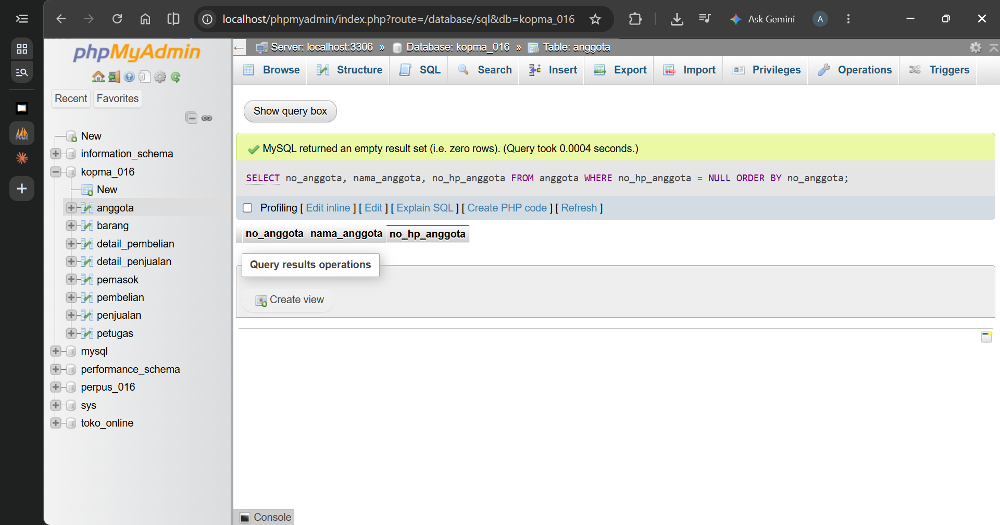

*Gambar 13. Q08a: `= NULL` mengembalikan 0 baris tanpa galat.*

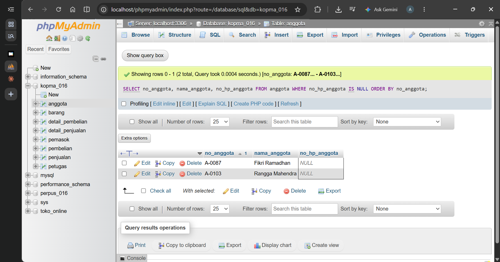

*Gambar 14. Q08b: `IS NULL` mengembalikan 2 baris.*

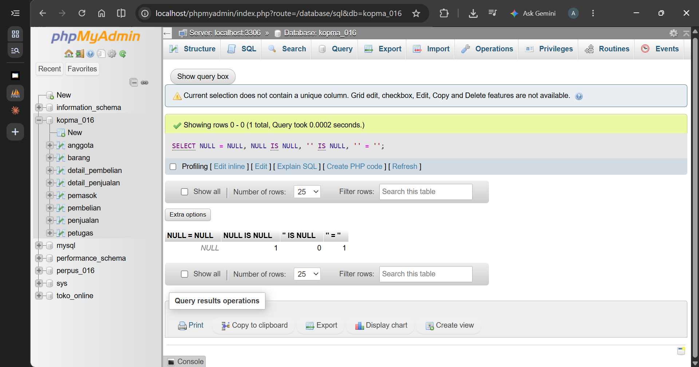

*Gambar 15. Q08c: perilaku `NULL` dan string kosong pada perbandingan.*

**Titik Analisis 3: subtotal bisa dihitung, total nota belum**

Subtotal dihitung **per baris**: setiap baris keluaran hanya memakai nilai dari barisnya sendiri (`qty * harga`), sehingga fungsi skalar cukup. Total nota adalah **satu nilai yang berasal dari banyak baris** (tiga baris detail dijumlahkan menjadi satu angka). Itu butuh fungsi agregat seperti `SUM` (juga `COUNT`, `AVG`) yang biasanya dipasangkan dengan `GROUP BY`. Fitur ini baru dipelajari pada Pertemuan 9, sehingga di modul ini total nota hanya dapat dijumlahkan manual (29.000).

### Analisis wajib (Kopma)

**Pemetaan kueri ke KI.**

| Kueri | KI / tujuan | Status |
|---|---|---|
| Q01, Q05b | KI-03: barang di bawah stok minimum | **Terjawab** |
| Q02, Q03, Q04, Q06 sampai Q14b | Latihan teknik (penyaringan, teks, NULL, tanggal, kesalahan semantik) | Pendukung |
| KI-01 | Omzet dan jumlah nota per hari/bulan: butuh `SUM`/`COUNT` + `GROUP BY` | **Belum** satu tabel, Pertemuan 9 |
| KI-02 | Lima barang terlaris per bulan: butuh `SUM` + `GROUP BY` + `JOIN` ke `barang` | **Belum** satu tabel, Pertemuan 9 sampai 10 |
| KI-04 | Sepuluh anggota belanja terbesar: butuh `JOIN` + `SUM` + `GROUP BY` | **Belum** satu tabel, Pertemuan 9 sampai 10 |

**Alasan pemilihan fungsi skalar.**

| Fungsi | Dipakai di | Alasan |
|---|---|---|
| `CONCAT` | Q06, Q07, Q12 | Menyusun satu label dari beberapa kolom (misalnya nama dan nomor anggota) |
| `DATE_FORMAT` | Q06, Q07 | Menampilkan tanggal dalam format Indonesia `dd-mm-yyyy` |
| `IFNULL` | Q06, Q07 | Mengganti `NULL` pada nomor HP dengan `-` agar mudah dibaca |
| `CASE` | Q06, Q07, Q09 | Memberi keterangan (diskon, kategori baru/lama) menurut kondisi |
| `DATEDIFF`, `CURDATE` | Q09 | Menghitung selisih hari antara hari ini dan tanggal daftar |
| `UPPER`, `FORMAT` | Q12 | Mengubah huruf menjadi kapital dan memformat angka menjadi rupiah |

## 5. Hasil Latihan dan Modifikasi

### E.1 Nama huruf kapital dan harga berformat "Rp4.000" (Q12)

```sql
SELECT kode_barang,
       UPPER(nama_barang) AS nama_barang,
       CONCAT('Rp', FORMAT(harga_jual_barang, 0, 'id_ID')) AS harga
FROM barang
ORDER BY kode_barang;
```

`UPPER` mengubah nama menjadi huruf kapital. `FORMAT(harga, 0, 'id_ID')` membuang desimal dan memakai titik sebagai pemisah ribuan, lalu `CONCAT` menambahkan awalan `Rp`. Hasil nyata: 8 baris urut `kode_barang`, misalnya `PULPEN GEL 0.5` dengan `Rp4.000` dan `TEH KOTAK 350` dengan `Rp5.500`. Server mengenali locale `id_ID`, sehingga kueri cadangan dengan `REPLACE` tidak diperlukan.

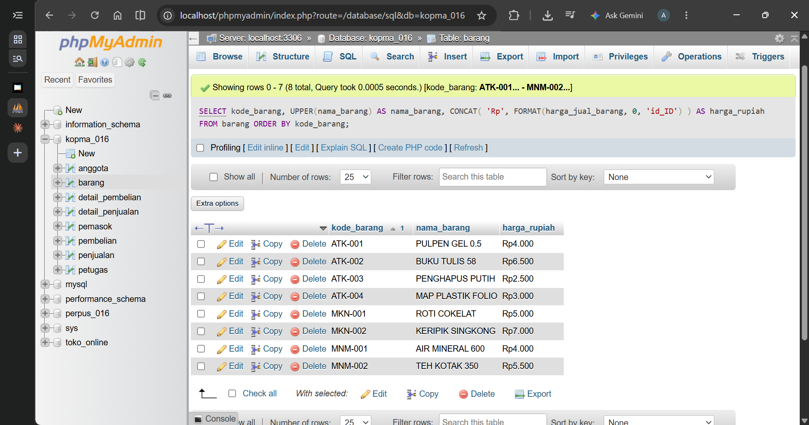

*Gambar 16. Q12: nama kapital dan harga berformat rupiah.*

### E.2 Kesalahan semantik yang tetap berjalan

**Pasangan 1: `OR` tanpa tanda kurung (Q13a dan Q13b).** Pertanyaan: barang ATK atau minuman yang stoknya di atas 40.

```sql
-- Q13a (salah, tetapi berjalan tanpa galat)
SELECT kode_barang, nama_barang, kategori_barang, stok_barang
FROM barang
WHERE kategori_barang = 'ATK' OR kategori_barang = 'minuman' AND stok_barang > 40
ORDER BY kode_barang;

-- Q13b (benar)
SELECT kode_barang, nama_barang, kategori_barang, stok_barang
FROM barang
WHERE (kategori_barang = 'ATK' OR kategori_barang = 'minuman') AND stok_barang > 40
ORDER BY kode_barang;
```

| | Hasil | Keterangan |
|---|---|---|
| Q13a (salah) | 5 baris: ATK-001 (114), ATK-002 (77), ATK-003 (57), **ATK-004 (37)**, MNM-001 (42) | ATK-004 stok 37 ikut tampil padahal tidak di atas 40 |
| Q13b (benar) | 4 baris: ATK-001, ATK-002, ATK-003, MNM-001 | Semua stok di atas 40 |

`AND` memiliki prioritas lebih tinggi daripada `OR`, sehingga Q13a dibaca sebagai "ATK (berapa pun stoknya) **atau** (minuman **dan** stok > 40)". Filter stok hanya berlaku untuk minuman. Server tidak menolaknya karena secara sintaks kueri itu sah.

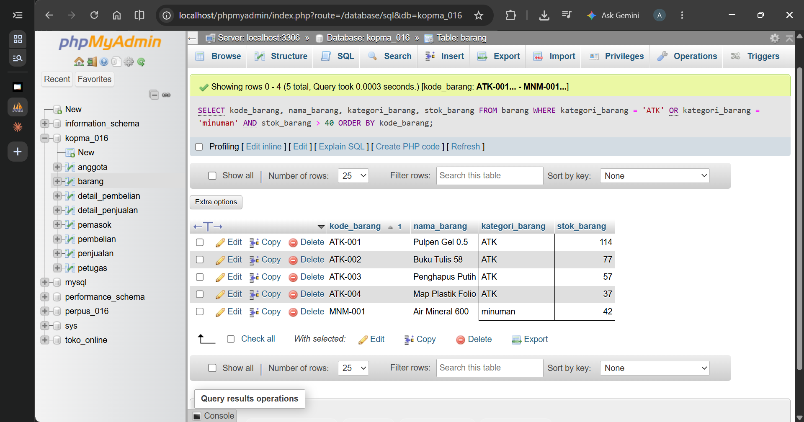

*Gambar 17. Q13a: hasil salah, Map Plastik Folio (stok 37) ikut tampil.*

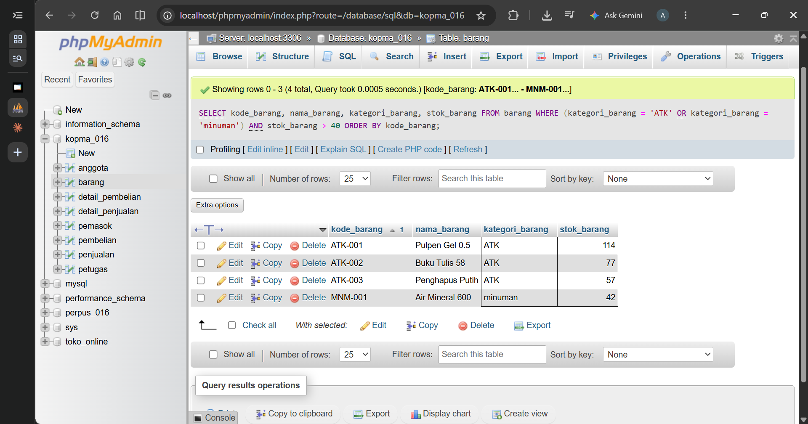

*Gambar 18. Q13b: hasil benar setelah diberi tanda kurung.*

**Pasangan 2: `BETWEEN` pada kolom `DATETIME` (Q14a dan Q14b).**

```sql
-- Q14a (salah)
SELECT no_nota_penjualan, tgl_penjualan FROM penjualan
WHERE tgl_penjualan BETWEEN '2026-09-23' AND '2026-09-24'
ORDER BY tgl_penjualan;

-- Q14b (benar: rentang setengah terbuka)
SELECT no_nota_penjualan, tgl_penjualan FROM penjualan
WHERE tgl_penjualan >= '2026-09-23' AND tgl_penjualan < '2026-09-25'
ORDER BY tgl_penjualan;
```

Q14a hanya mengembalikan 2 nota (`PJ-2609-0140` dan `PJ-2609-0141`), padahal ada 4 nota pada 23 sampai 24 September. Nilai `'2026-09-24'` dibaca sebagai pukul 00:00:00, sehingga nota pukul 10:15 dan 15:30 pada 24 September tertinggal. Q14b memperbaikinya dengan batas atas "kurang dari 25 September" dan menghasilkan 4 nota.

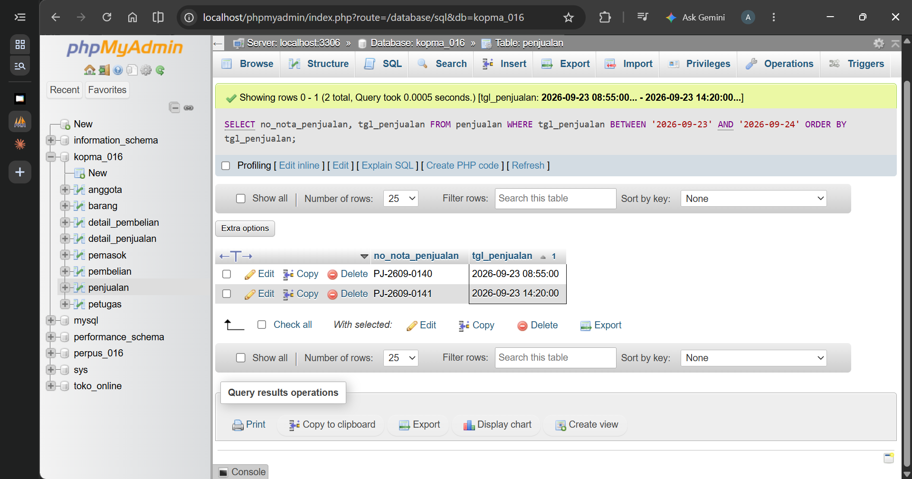

*Gambar 19. Q14a: hanya 2 nota, nota 24 September hilang.*

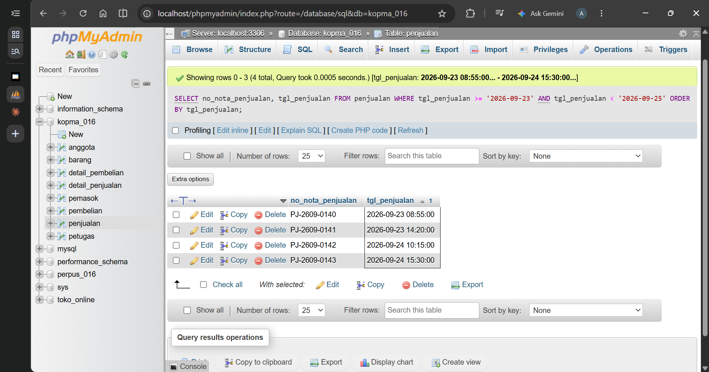

*Gambar 20. Q14b: 4 nota setelah memakai rentang setengah terbuka.*

## 6. Tugas Mandiri: Milestone Proyek 7

Proyek: **Perpustakaan Lentera AYP** (`perpus_016`), berkas `p07_kueri_25430016.sql`. Basis data dibangun dari kosong dengan urutan `p05_ddl_25430016.sql`, `p06_data_25430016.sql`, lalu kueri milestone ini.

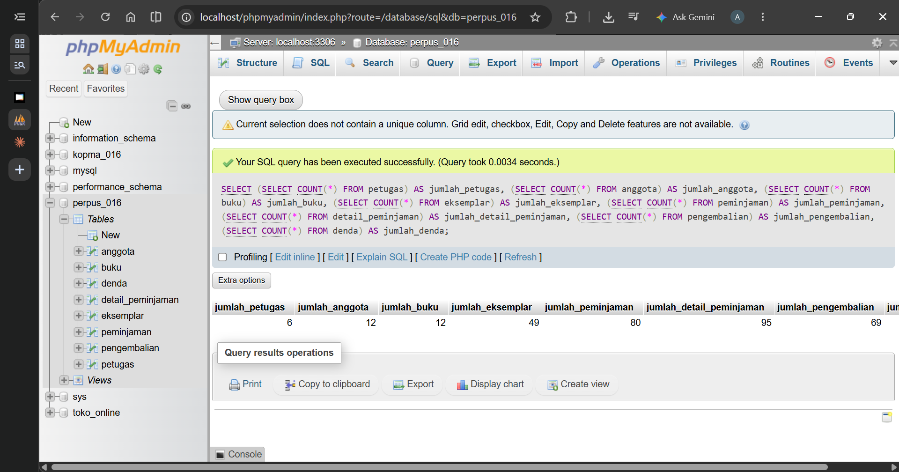

*Gambar 21. Pemeriksaan data awal `perpus_016` sebelum kueri dijalankan.*

### 6.1 Ringkasan berkas

Berkas memuat **13 kueri**, seluruhnya **satu tabel** (tanpa `JOIN` dan tanpa agregasi). Tiap kueri diberi komentar kode KI, pertanyaan dalam bahasa sehari-hari, dan hasil yang diharapkan.

| Operator / fungsi wajib | Dipakai pada |
|---|---|
| `LIKE` | Q02, Q05, Q07 |
| `BETWEEN` | Q11, Q12 |
| `IN` | Q04, Q12 |
| `IS NULL` | Q06 |
| `CASE` | Q03, Q09 |
| Fungsi tanggal | `DATEDIFF` (Q09), `DATE_FORMAT` (Q11) |
| Fungsi string | `CONCAT`, `LEFT`, `RIGHT` (Q02), `UPPER` (Q05) |

### 6.2 Pemetaan kueri ke KI

| KI | Kebutuhan informasi | Satu tabel? | Kueri |
|---|---|---|---|
| KI-01 | Daftar anggota aktif | **Bisa** (`anggota`) | Q01, Q02, Q03 |
| KI-02 | Katalog dan ketersediaan buku | **Belum**: `judul_buku` di `buku`, `status_eksemplar` di `eksemplar` | Q04 sampai Q07 (sebagian) |
| KI-03 | Riwayat peminjaman anggota | **Belum**: `nama_anggota` di `anggota`, `id_eksemplar` di `detail_peminjaman` | Q10 (sebagian) |
| KI-04 | Peminjaman yang masih berlangsung | **Belum**: butuh `anggota` dan `detail_peminjaman` | Q08 (sebagian) |
| KI-05 | Pengembalian dalam periode tertentu | **Bisa** (`pengembalian`) | Q11, Q12 |
| KI-06 | Peminjaman terlambat | **Belum**: butuh `peminjaman` + `pengembalian` + `anggota`, yang belum kembali butuh `LEFT JOIN` | Q09 (sebagian) |
| KI-07 | Rekapitulasi denda | **Bisa** untuk baris dendanya (`denda`); jumlah dan total per status butuh agregasi | Q13 |
| KI-08 | Buku paling banyak dipinjam | **Belum**: butuh `JOIN` tiga tabel + agregasi | Tidak ada kueri |

KI-02, KI-03, KI-04, KI-06, dan KI-08 ditandai **belum dapat dijawab dengan satu tabel** dan akan dijawab penuh pada Pertemuan 9 sampai 12 memakai `JOIN`. Kueri "sebagian" hanya mengambil porsi yang masih berada dalam satu tabel, dan batasannya dijelaskan di komentar kueri.

### 6.3 Hasil harapan dan hasil nyata

Ketiga belas kueri dijalankan satu per satu pada `perpus_016` dengan data hasil `p06_data_25430016.sql`.

| Kueri | KI | Operator / fungsi | Harapan | Hasil nyata | Status |
|---|---|---|---|---|---|
| Q01 | KI-01 | `WHERE`, `ORDER BY` | 10 baris (A001 sampai A010), semua Aktif | 10 baris | Sesuai |
| Q02 | KI-01 | `LIKE`, `CONCAT`, `LEFT`, `RIGHT` | 2 baris: A004 `0821****012`, A008 `0823****265` | 2 baris | Sesuai |
| Q03 | KI-01 | `CASE` | 12 baris: A001 sampai A010 "Boleh meminjam", A011 dan A012 "Tidak boleh meminjam" | 12 baris | Sesuai |
| Q04 | KI-02 | `IN` | 4 baris (B002, B001, B004, B003) urut judul | 4 baris | Sesuai |
| Q05 | KI-02 | `LIKE`, `UPPER` | 2 baris: B002 dan B003 | 2 baris | Sesuai |
| Q06 | KI-02 | `IS NULL` | 0 baris (semua buku sudah punya ISBN) | 0 baris | Sesuai |
| Q07 | KI-02 | `LIKE` | 4 baris: E006, E018, E042, E048 | 4 baris | Sesuai |
| Q08 | KI-04 | `WHERE`, `ORDER BY` | 41 baris Berlangsung (80 = 41 Berlangsung + 39 Selesai) | 41 baris | Sesuai |
| Q09 | KI-06 | `DATEDIFF`, `CASE` | 41 baris: 32 Terlambat, 9 Masih dalam masa pinjam; terbesar 20 hari | 41 baris; 32 dan 9 | Sesuai |
| Q10 | KI-03 | `WHERE`, `ORDER BY` | 13 baris untuk A007 (7 Berlangsung, 6 Selesai) | 13 baris | Sesuai |
| Q11 | KI-05 | `BETWEEN`, `DATE_FORMAT` | 24 baris (14 sampai 20 Oktober) | 24 baris | Sesuai |
| Q12 | KI-05 | `IN`, `BETWEEN` | 10 baris (petugas PT003 atau PT006, 12 sampai 18 Oktober) | 10 baris | Sesuai |
| Q13 | KI-07 | `WHERE` | 10 baris denda Belum Dibayar | 10 baris | Sesuai |

Tangkapan layar tiap kueri:

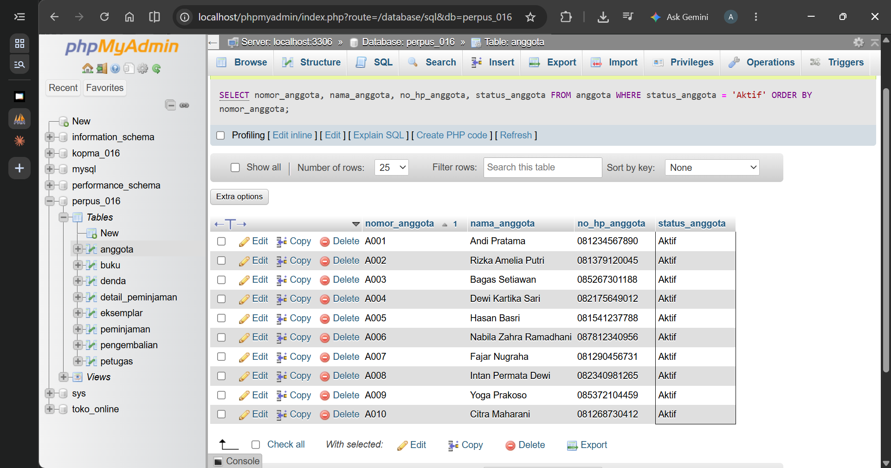

*Gambar 22. Q01 (KI-01): 10 anggota berstatus Aktif.*

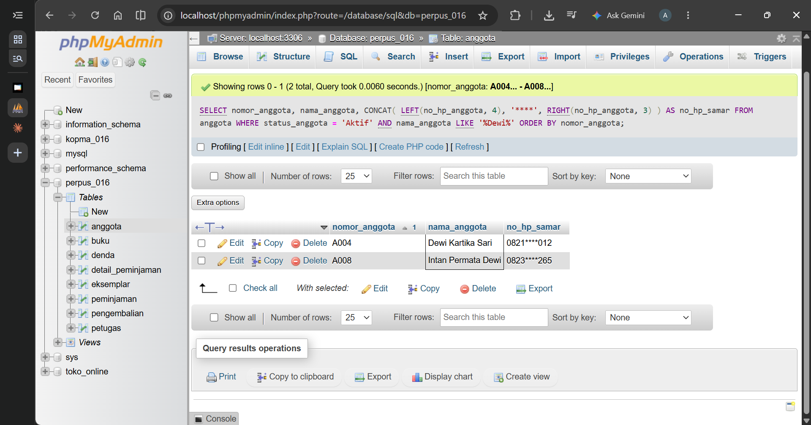

*Gambar 23. Q02 (KI-01): anggota aktif bernama "Dewi" dengan nomor HP disamarkan.*

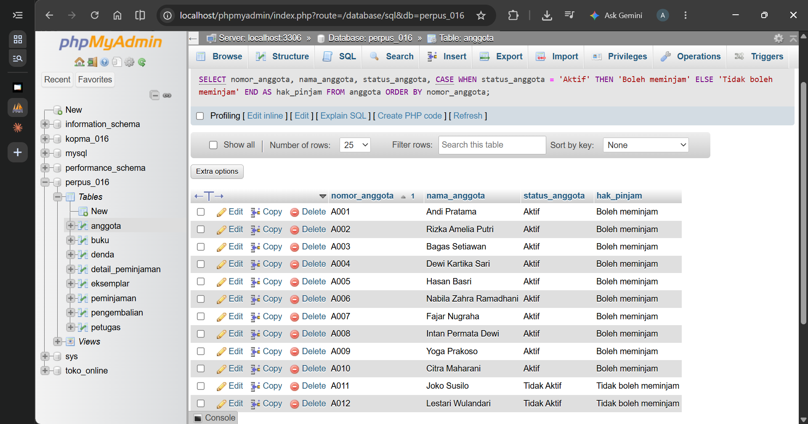

*Gambar 24. Q03 (KI-01): hak pinjam tiap anggota menurut aturan AB-02.*

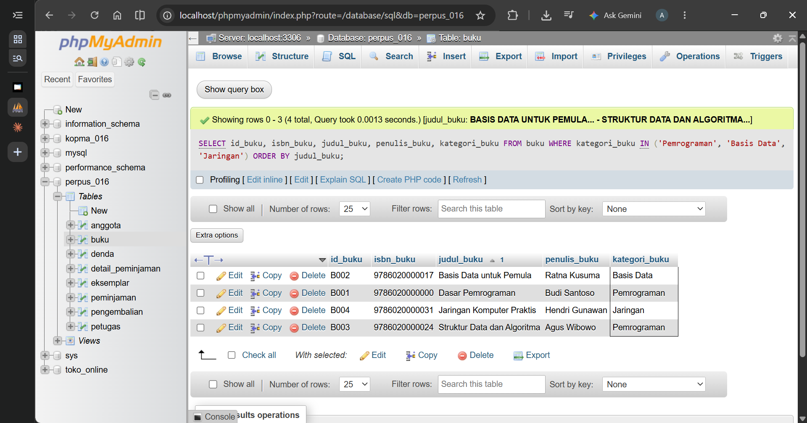

*Gambar 25. Q04 (KI-02, sisi katalog): buku kategori Pemrograman, Basis Data, atau Jaringan.*

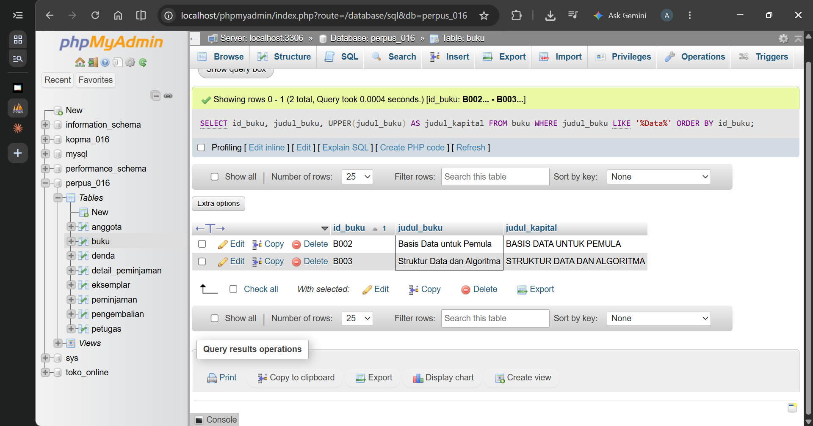

*Gambar 26. Q05 (KI-02, sisi katalog): judul mengandung kata "Data" beserta versi kapital.*

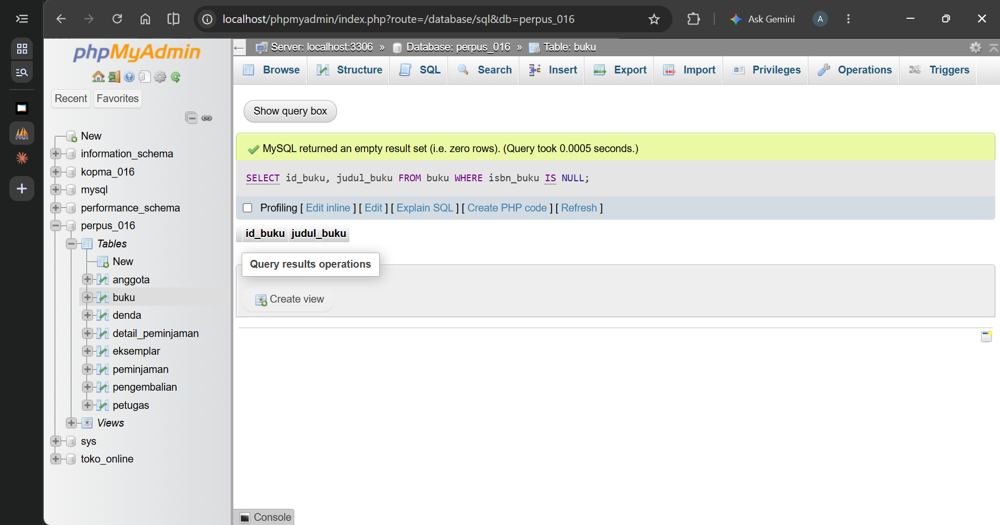

*Gambar 27. Q06 (KI-02, pemeriksaan kualitas data): 0 baris, semua buku sudah memiliki ISBN.*

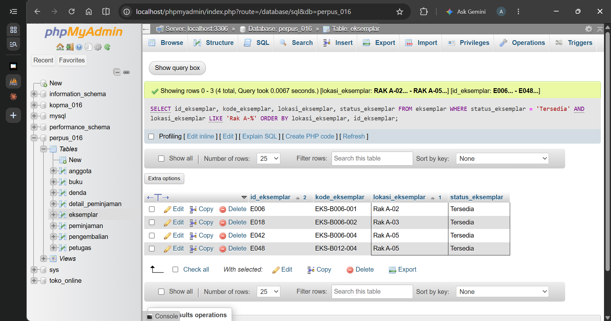

*Gambar 28. Q07 (KI-02, sisi ketersediaan): eksemplar Tersedia di deretan Rak A.*

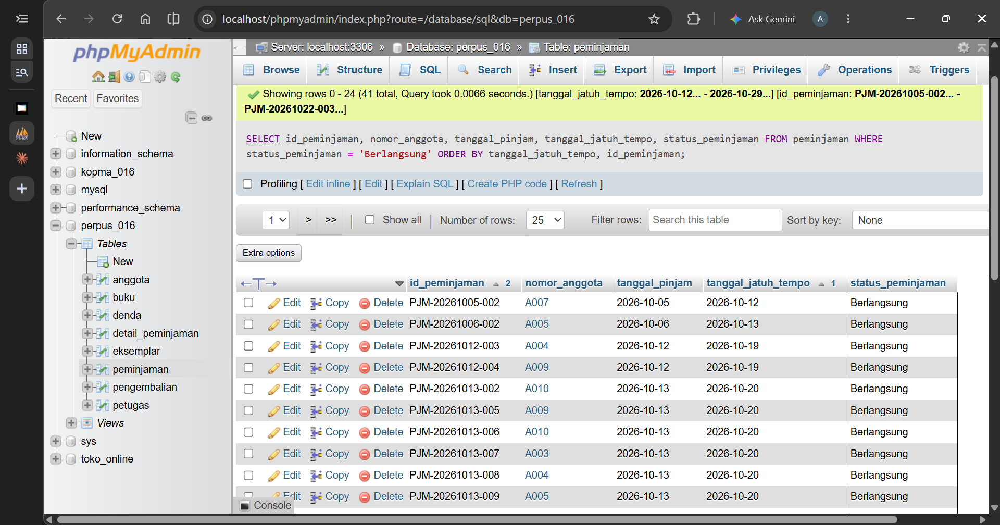

*Gambar 29. Q08 (KI-04, sebagian): 41 transaksi berstatus Berlangsung.*

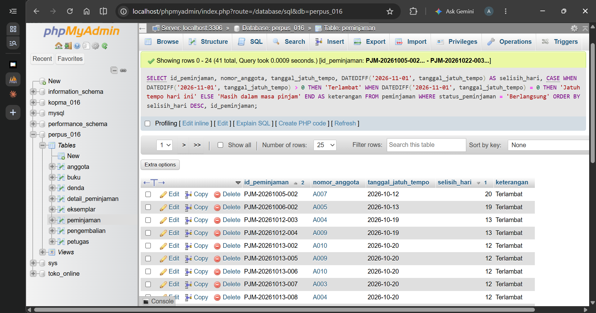

*Gambar 30. Q09 (KI-06, sebagian): selisih hari terhadap 2026-11-01 dan keterangan keterlambatan.*

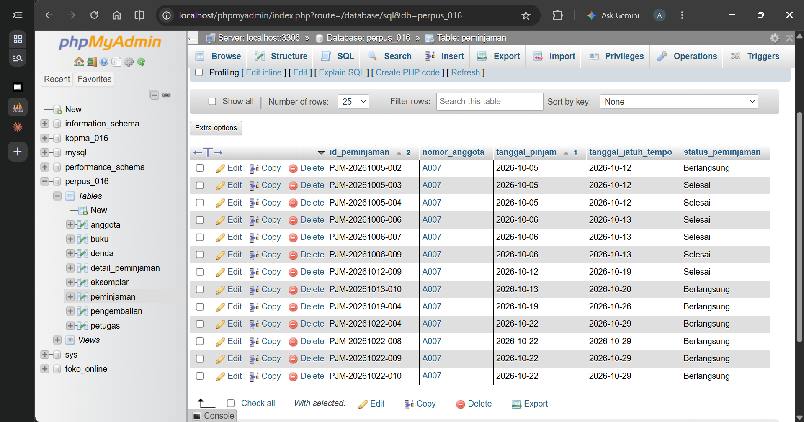

*Gambar 31. Q10 (KI-03, sebagian): riwayat transaksi peminjaman anggota A007.*

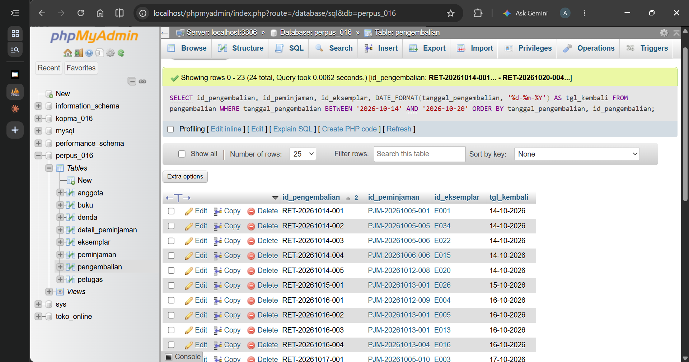

*Gambar 32. Q11 (KI-05): pengembalian 14 sampai 20 Oktober 2026 dengan tanggal berformat hari-bulan-tahun.*

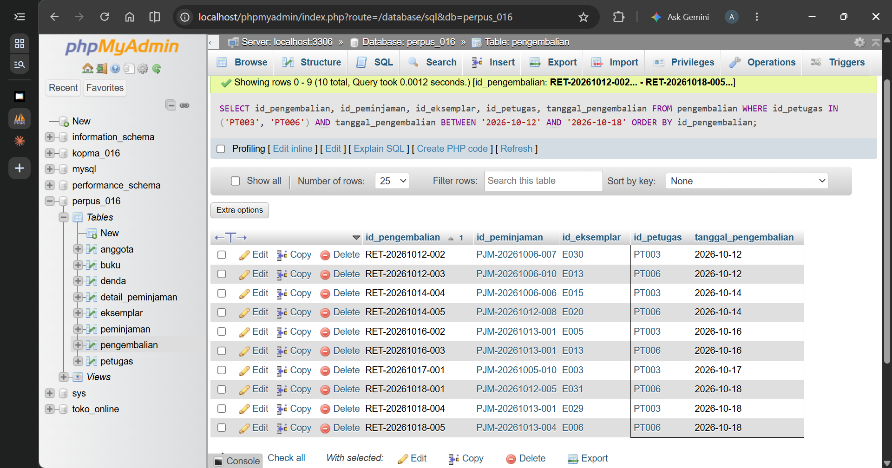

*Gambar 33. Q12 (KI-05): pengembalian oleh PT003 atau PT006 pada 12 sampai 18 Oktober 2026.*

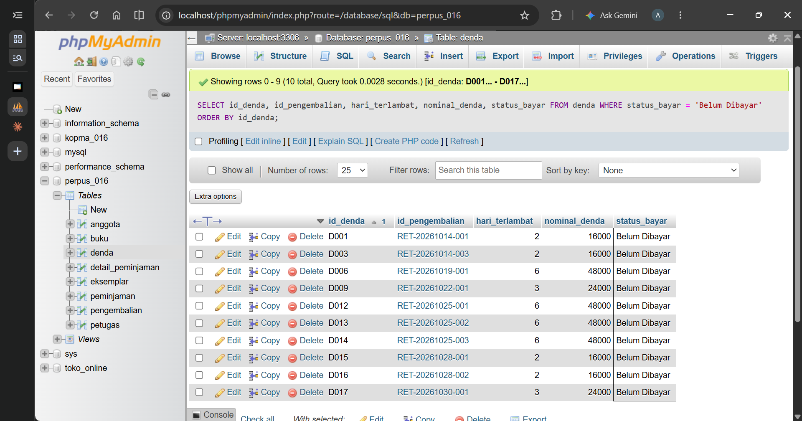

*Gambar 34. Q13 (KI-07): denda berstatus Belum Dibayar.*

### 6.4 Alasan pemilihan fungsi skalar dan keputusan desain

| Fungsi | Dipakai di | Alasan |
|---|---|---|
| `CONCAT`, `LEFT`, `RIGHT` | Q02 | Menyamarkan nomor HP (4 digit awal, `****`, 3 digit akhir) karena data pribadi dibatasi pada dokumen kebutuhan data (p02 bagian 9.4) |
| `UPPER` | Q05 | Menampilkan judul dalam huruf kapital bersama judul asli |
| `CASE` | Q03, Q09 | Mengubah status menjadi keterangan yang bermakna (hak pinjam menurut AB-02, status keterlambatan) |
| `DATEDIFF` | Q09 | Menghitung berapa hari transaksi sudah melewati tanggal jatuh tempo |
| `DATE_FORMAT` | Q11 | Menampilkan tanggal pengembalian dalam format `dd-mm-yyyy` |

Keputusan desain yang saya ambil:

- **Tanggal acuan berupa literal `'2026-11-01'` pada Q09**, bukan `CURDATE()`. Dengan begitu hasil kueri tetap sama bila dijalankan pada hari lain, sehingga selaras dengan syarat bahwa skrip dapat dijalankan ulang dengan hasil yang sama. Untuk laporan "hari ini", literal itu cukup diganti dengan `CURDATE()`.
- **Nomor HP disamarkan di Q02, tetapi tampil penuh di Q01.** KI-01 memang membutuhkan nomor HP agar petugas dapat menghubungi anggota. `alamat_anggota` sengaja tidak ditampilkan pada kueri laporan.
- **KI yang belum satu tabel tetap diberi kueri "sebagian" (Q04 sampai Q10)** agar jelas bagian mana yang sudah dapat dijawab dan bagian mana yang menunggu `JOIN`. KI-08 tidak diberi kueri sebagian karena seluruh jawabannya membutuhkan `JOIN` dan agregasi.
- **Tidak memakai agregasi** (`GROUP BY`, `COUNT`, `SUM`). Karena itu Q13 menampilkan baris dendanya, bukan total per status; rekap total dijawab setelah materi agregasi.

## 7. Pembahasan dan Kendala

Berdasarkan praktik yang telah dilakukan, kueri Perpustakaan dijalankan menggunakan database `perpus_016` melalui phpMyAdmin. Hasil pengujian pada kueri yang telah dikerjakan menunjukkan bahwa data yang ditampilkan sesuai dengan kondisi data pada database. Setiap kueri digunakan untuk mengambil informasi tertentu dengan memanfaatkan perintah SQL seperti `WHERE`, `ORDER BY`, `LIKE`, `IN`, `IS NULL`, `CONCAT`, `UPPER`, dan `CASE`.

**Hasil kosong yang benar pada Q06.** Pada Q06, kueri untuk mencari buku yang tidak memiliki ISBN menghasilkan 0 baris. Hasil tersebut bukan merupakan kesalahan karena seluruh 12 data buku yang tersedia sudah memiliki ISBN. Kueri ini dapat digunakan untuk memeriksa kelengkapan data. Dari praktik ini, saya memahami bahwa hasil kosong tidak selalu menunjukkan adanya kesalahan pada kueri. Hasil tersebut perlu dibandingkan dengan kondisi data dan tujuan pencarian yang telah ditentukan. Selain itu, pemeriksaan nilai kosong harus menggunakan `IS NULL`, bukan `= NULL`.

**Analisis peminjaman yang masih berlangsung pada Q08 dan Q09.** Pada Q08, kueri menghasilkan 41 transaksi dengan status *Berlangsung*. Selanjutnya, Q09 digunakan untuk menghitung selisih hari antara tanggal jatuh tempo dan tanggal acuan 1 November 2026. Hasilnya menunjukkan transaksi yang sudah melewati tanggal jatuh tempo maupun transaksi yang masih berada dalam masa pinjam. Kueri tersebut membantu mengidentifikasi keterlambatan berdasarkan transaksi peminjaman. Namun, hasilnya belum menunjukkan secara terperinci keterlambatan setiap eksemplar buku, termasuk buku yang sudah dikembalikan terlambat. Informasi tersebut memerlukan penggabungan beberapa tabel, seperti `peminjaman`, `detail_peminjaman`, dan `pengembalian`, sesuai kebutuhan analisis.

**Penggunaan fungsi dan kondisi pada kueri.** Pada Q02, fungsi `CONCAT()`, `LEFT()`, dan `RIGHT()` digunakan untuk menyamarkan sebagian nomor telepon anggota yang namanya mengandung kata Dewi dan berstatus aktif. Sementara itu, Q03 menggunakan `CASE` untuk menentukan keterangan hak peminjaman berdasarkan status anggota. Pada Q04, operator `IN` digunakan untuk menampilkan buku dari kategori tertentu, sedangkan Q05 menggunakan `LIKE` dan `UPPER()` untuk mencari judul yang mengandung kata Data sekaligus menampilkan judul dalam huruf kapital. Hasil praktik menunjukkan bahwa fungsi dan kondisi SQL dapat membantu menyaring serta menyajikan data sesuai kebutuhan informasi.

**Penggunaan `LIKE` dan pengaruh indeks.** Pada Q05, pola pencarian `LIKE '%Data%'` menggunakan karakter wildcard di awal kata pencarian. Pola tersebut umumnya tidak dapat memanfaatkan indeks B-tree biasa pada kolom judul untuk pencarian langsung, sehingga dapat memerlukan pemeriksaan banyak baris. Sebaliknya, Q07 menggunakan pola `LIKE 'Rak A-%'`, yang memiliki awalan tetap dan berpotensi memanfaatkan indeks yang sesuai. Meskipun perbedaan kinerja belum terasa pada jumlah data praktik, pemilihan pola pencarian tetap perlu diperhatikan apabila jumlah data bertambah.

**Kendala dan cara mengatasinya.** Berdasarkan bukti pengerjaan yang tersedia, kueri Q01 sampai Q10 berhasil dijalankan dan tidak terlihat adanya pesan galat SQL. Kendala berupa `ERROR 1054 Unknown column` tidak tercatat pada screenshot yang diberikan, sehingga tidak dicantumkan sebagai galat yang benar-benar dialami. Jika galat tersebut muncul saat praktik berikutnya, langkah pemeriksaannya adalah memastikan nama tabel dan kolom sesuai dengan struktur database serta memeriksa kemungkinan kesalahan penulisan nama kolom. Apabila kueri menghasilkan 0 baris, kondisi `WHERE`, penggunaan `IS NULL`, nilai yang dicari, dan rentang tanggal perlu diperiksa kembali sebelum menyimpulkan bahwa data tidak tersedia.

## 8. Kesimpulan

Pada pertemuan ini saya menulis 13 kueri satu tabel untuk proyek Perpustakaan yang masing-masing memuat komentar KI, pertanyaan, dan hasil yang diharapkan, serta mencakup `LIKE`, `BETWEEN`, `IN`, `IS NULL`, `CASE`, fungsi tanggal, dan fungsi string. Tiga KI (KI-01, KI-05, KI-07) dapat dijawab dari satu tabel, sedangkan lima KI lainnya (KI-02, 03, 04, 06, 08) ditandai menunggu `JOIN` dan agregasi pada Pertemuan 9 sampai 12. Dari studi kasus Kopma saya memahami bahwa urutan evaluasi `SELECT` dan perilaku `NULL` menjelaskan banyak galat, dan bahwa kesalahan semantik hanya dapat ditemukan dengan membandingkan hasil nyata dengan harapan.

## 9. Pernyataan Penggunaan AI

Saya menggunakan asisten AI (Claude) untuk: (1) membantu memahami konsep urutan evaluasi `SELECT`, perilaku `NULL`, dan kesalahan semantik, dan (2) membantu menyusun kerangka draf laporan ini dari hasil praktik saya. Seluruh kueri dijalankan sendiri pada phpMyAdmin dan hasil nyata serta tangkapan layar berasal dari laptop saya, dan (3) membantu untuk menulis `p07_kueri_kopma_25430016.sql` dan `p07_kueri_25430016.sql`, termasuk komentar hasil yang diharapkan. Selain itu saya juga menggunakan Chat GPT dalam pengerjakan praktikum ini yang di guanakan untuk : Mengarahkan saya dalam mengerjakan praktikum supaya pengerjaan praktikum bisa di lakukan secara urut dan tepat.

## 10. Bukti Git

- Repositori: https://github.com/arya-yoga-pratama/basisdata-25430016.git
- Pesan commit: Mileston: Pertemuan 7 - Basis Data
- Hash commit: 75c7b22 (HEAD -> master, origin/master) Mileston: Pertemuan 7 - Basis Data

Berkas yang di-commit: `p07_kueri_kopma_25430016.sql`, `p07_kueri_25430016.sql`, `laporan/p07_laporan_25430016.md`, dan folder `laporan/img/`.

## Checklist

**Checklist khusus Pertemuan 7 (Tabel 7.2)**

- [x] **Berkas wajib:** `p07_kueri_<NIM>.sql` berisi minimal 10 kueri satu tabel (13 kueri), masing-masing diberi komentar KI dan hasil yang diharapkan
- [x] **Bukti tangkapan layar:** hasil setiap kueri (Kopma Q01 sampai Q14b dan Perpustakaan Q01 sampai Q13)
- [x] **Analisis wajib:** pemetaan kueri ke KI; alasan pemilihan fungsi skalar yang dipakai

**Checklist umum (Tabel P.13)**

- [x] **Identitas:** nama, NIM, kelas, pertemuan, tanggal, nama dosen
- [x] **Tujuan:** ditulis dengan bahasa sendiri, maksimal 5 baris
- [x] **Ringkasan teori:** pemahaman sendiri, maksimal setengah halaman
- [x] **Langkah percobaan (D):** tangkapan layar hasil langkah kunci beserta keterangan
- [x] **Titik Analisis:** ketiganya dijawab lengkap dengan alasan
- [x] **Latihan (E):** skrip dan bukti berjalan E.1 dan E.2
- [x] **Tugas Mandiri (F):** berkas, bukti, dan penjelasan keputusan desain
- [x] **Pembahasan dan kendala:** bagian kendala nyata masih perlu diisi
- [x] **Kesimpulan:** dua sampai empat kalimat
- [x] **Pernyataan Penggunaan AI:** perlu dikonfirmasi sebelum dikumpulkan
- [ ] **Bukti Git:** hash commit belum diisi
- [x] **Keaslian:** pastikan setiap tangkapan layar memperlihatkan akun ber-NIM dan jam sistem
